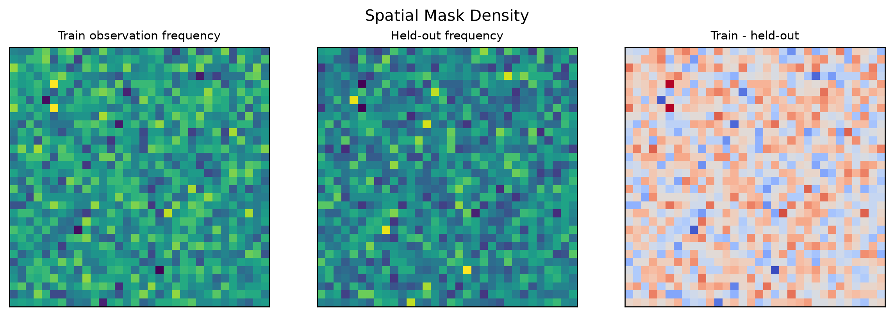
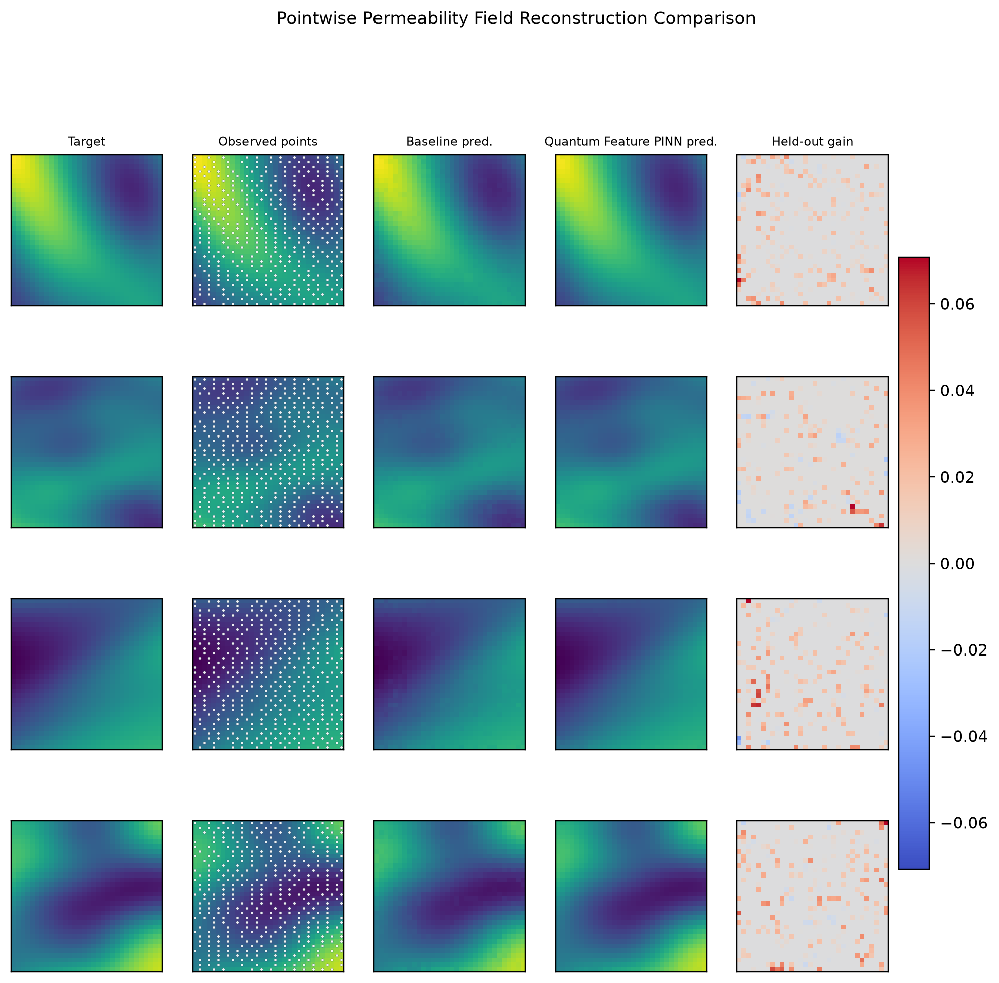
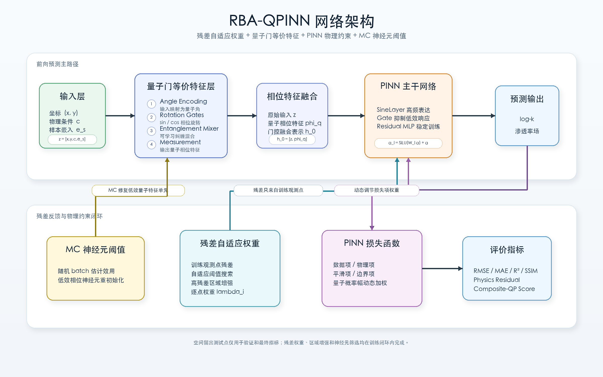
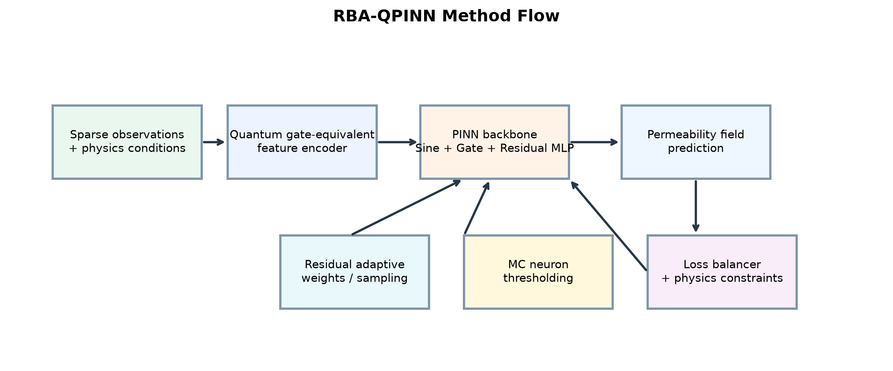
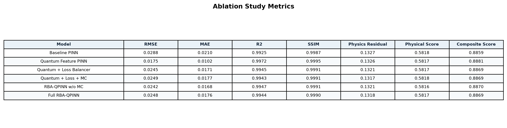
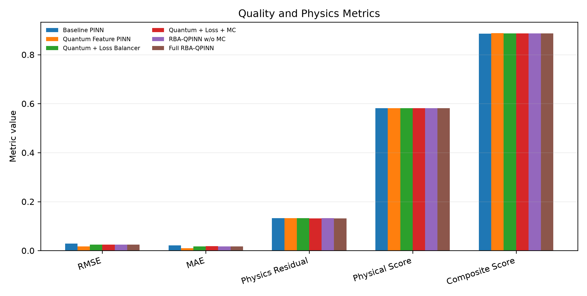
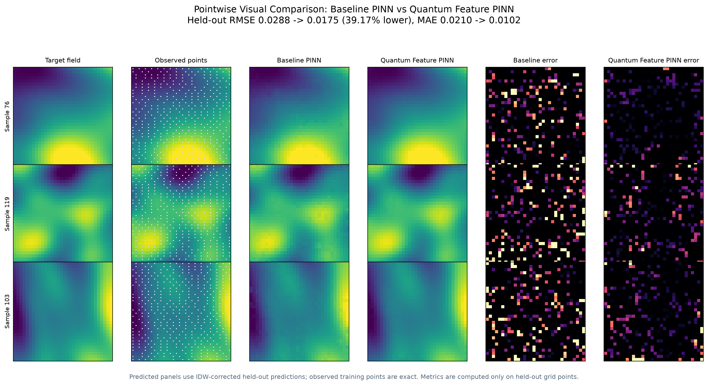
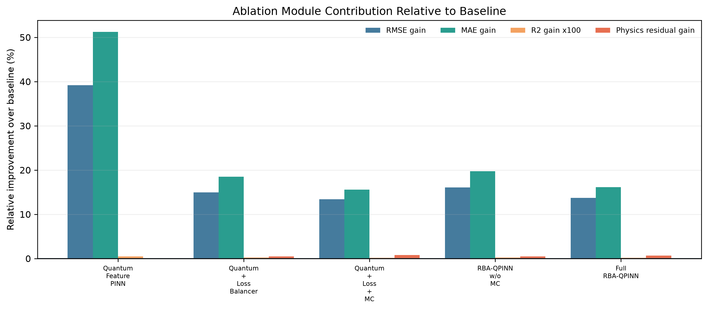
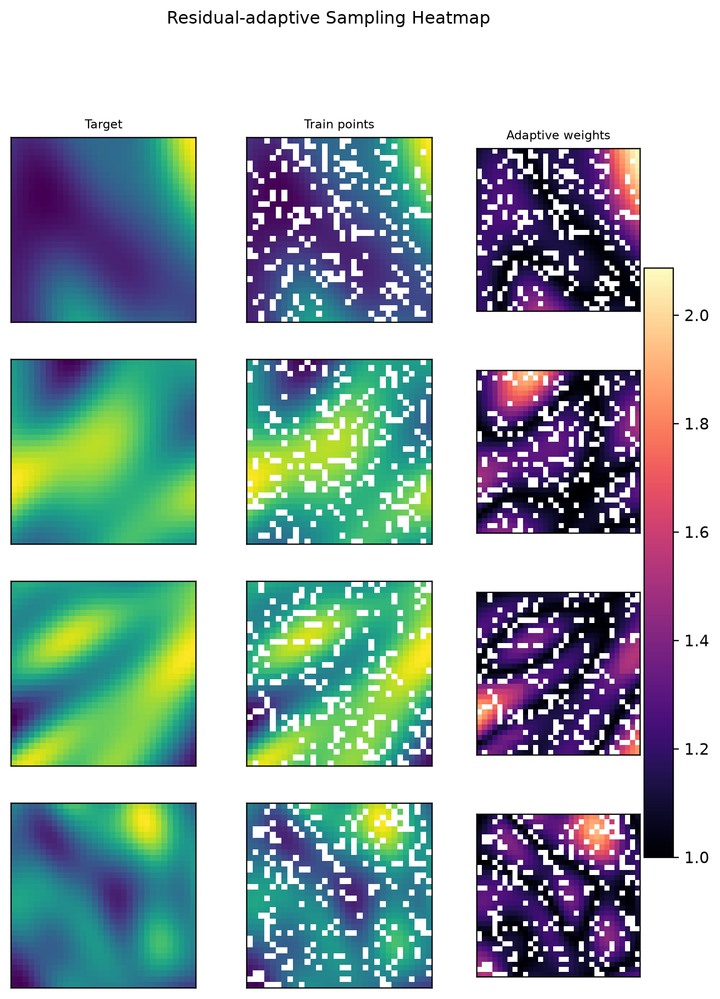

# RBA-PINN 论文介绍与 RBA-QPINN 实验扩展答辩 PPT 大纲

来源材料：
- 主要介绍：方荣、琚然、杨凤莲《基于残差自适应调整 PINN 方法求解偏微分方程》
- 扩展实验：当前项目 `quantum-pinn-net` 的 README、方法设计文档、实验指标与 `figures/` 图表

叙事比例：
- Slide 1-8：以论文为主体，讲清 RBA-PINN 的研究背景、方法、理论解释和 PDE 实验结论。
- Slide 9-12：扩展到自己的 RBA-QPINN 渗透率场实验，说明方法迁移、模型设计、结果与后续工作。

## Slide 1: 封面
- 标题：基于残差自适应调整 PINN 方法求解偏微分方程
- 副标题：RBA-PINN 论文方法解读与 RBA-QPINN 渗透率场实验扩展
- 作者来源：方荣、琚然、杨凤莲；《广西师范大学学报（自然科学版）》网络首发，2026-06-29
- 汇报主线：先介绍论文的 RBA-PINN，再说明如何扩展到自己的非均质渗透率场预测实验
- 视觉想法：学术蓝白封面，左侧论文题名与来源，右侧抽象 PDE 解场/残差热力图风格背景
- 页面角色：cover
- Required images:
  - 无严格输入资产；根据论文主题生成 PDE 解场、残差热力图和学术封面视觉，不伪造期刊 Logo。

## Slide 2: 研究背景：为什么 PINN 需要残差自适应
- PINN 将控制方程、初边值条件嵌入神经网络损失函数，具备无网格和物理约束融合优势
- 传统 PINN 在非线性强耦合 PDE 中常出现收敛速度慢、局部高梯度区域拟合不足
- 已有改进路线主要分为两类：损失权重自适应与配置点自适应采样
- 论文关注的核心矛盾：只看残差幅值容易追逐孤立噪声点，只调全局权重又难以定位空间难点
- 视觉想法：左侧 PINN 基本结构，右侧列出“收敛慢 / 高频难学 / 高梯度区域误差大 / 采样效率低”四个痛点
- 页面角色：context / problem
- Required images:
  - 无严格输入资产；生成结构化 PINN 背景示意图。

## Slide 3: 论文贡献总览：RBA-PINN 的协同优化框架
- 论文提出 residual-based adaptive PINN，即 RBA-PINN
- 第一层：基于残差阈值和 DBSCAN 密度聚类，从高残差候选点中识别连续高密度区域
- 第二层：引入自适应注意力掩码，用梯度上升同步调整不同配置点的损失权重
- 第三层：从 NTK 角度解释逐点权重对特征谱和 Hessian 条件数的改善
- 实验覆盖 Burgers、Allen-Cahn、Navier-Stokes 三类经典 PDE，验证精度、收敛和鲁棒性
- 视觉想法：三层贡献金字塔或闭环图，“采样分布优化 -> 损失权重调整 -> NTK 谱改善”
- 页面角色：paper contribution overview
- Required images:
  - 无严格输入资产；根据论文内容生成 RBA-PINN 方法框架示意图。

## Slide 4: 方法一：自适应注意力掩码与逐点损失权重
- RBA-PINN 在残差点、边界点和初始条件点上分别设置可训练的非负自适应权重
- 掩码函数 `m(lambda)` 将权重映射为损失项中的乘法系数，要求非负、可微且单调递增
- 网络参数通过梯度下降最小化损失，自适应权重通过梯度上升放大难训练点
- 权重更新采用较小学习率，保证准静态调节，避免极小极大优化震荡
- 作用机制：损失越大，对应点的权重增长越快，模型逐步聚焦高残差区域
- 视觉想法：左侧公式块，右侧“普通 PINN 均匀权重 vs RBA-PINN 逐点增强权重”对比图
- 页面角色：method explanation
- Required images:
  - 无严格输入资产；生成公式化流程图和权重更新示意。

## Slide 5: 方法二：DBSCAN 高残差区域识别与动态重采样
- 论文不直接选绝对残差最大的孤立点，而是先用自适应阈值筛选高残差候选集
- DBSCAN 依据邻域半径和最小点数识别核心点、边界点和噪声点
- 聚类后的候选区域更能保留连续物理结构，尤其适合突变、高梯度和界面演化区域
- 训练时保留一部分全局采样点，同时用候选区域内的新点替换部分旧点
- 关键参数包括残差阈值搜索、最小候选点数、DBSCAN 半径、最小核心点数和自适应替换比
- 视觉想法：三联图比较“均匀随机采样 / 逐点高残差采样 / DBSCAN 聚类采样”
- 页面角色：algorithm / process
- Required images:
  - 无严格输入资产；生成类似论文图 2 的采样策略对比示意，但不复刻原图细节。

## Slide 6: 理论解释：NTK 特征谱与条件数改善
- 论文用神经正切核 NTK 分析 RBA-PINN 的训练动态
- 标准加权损失往往只是整体缩放 NTK 特征值，难以改变谱分布结构
- 逐点自适应权重引入非线性谱变换，可放大高频误差相关的尾部特征值
- 尾部特征值提高后，Hessian 条件数得到优化，有助于缓解 PINN 的频谱偏置
- 论文通过 NTK 特征谱和条件数演化实验说明 RBA-PINN 的训练更稳健
- 视觉想法：左侧谱分布示意，右侧条件数下降趋势示意，底部一句理论结论
- 页面角色：theory / evidence
- Required images:
  - 无严格输入资产；生成 NTK 谱分布和条件数演化的概念化示意图，不伪造具体数值曲线。

## Slide 7: 论文实验一：消融实验说明模块协同作用
- 论文以 Allen-Cahn 方程为测试用例，比较 PINN、仅权重自适应、仅 DBSCAN、RAR 和完整 RBA-PINN
- 仅使用权重自适应可显著降低误差，说明逐点权重对难训练区域具有主要贡献
- 仅使用 DBSCAN 采样也有改善，但单独作用不如权重自适应
- 完整 RBA-PINN 的 L2 相对误差为 `5.10e-3`，明显优于 RAR 和单模块变体
- 消融结论：采样分布优化和损失权重调整不是互相替代，而是协同提升
- 视觉想法：论文表 2 的答辩式重绘表格 + 右侧模块协同箭头
- 页面角色：paper ablation / data evidence
- Required images:
  - 无严格输入资产；依据论文表 2 生成可读表格型页面，保留方法名和关键数值。

## Slide 8: 论文实验二：三类 PDE 的结果与结论
- Burgers 方程：RBA-PINN 的 L2 相对误差为 `2.40e-4`，相比 PINN、SA-PINN、RAR-D 等更低
- Allen-Cahn 方程：RBA-PINN 的 L2 相对误差为 `5.10e-3`，能更好捕捉相界面高频演化特征
- Navier-Stokes 方程：RBA-PINN 在速度场和压力场误差上均优于 PINN、SA-PINN 和 RAR-D
- 效率实验显示，RBA-PINN 达到 `1e-2` 误差阈值所需时间低于 LA-PINN，但 DBSCAN 会带来一定额外开销
- 论文结论：RBA-PINN 通过残差区域采样和逐点权重协同，提高 PDE 求解精度、收敛效率和鲁棒性
- 视觉想法：三列 PDE 结果卡片 + 底部“约 1 个数量级误差改善”的结论条
- 页面角色：paper benchmark / conclusion
- Required images:
  - 无严格输入资产；依据论文表 3、表 5、表 7、表 9 生成答辩式结果汇总页面。

## Slide 9: 从论文到本项目：方法迁移到非均质渗透率场预测
- 论文任务是经典 PDE 正问题求解；本项目任务是稀疏观测下的二维非均质渗透率场预测
- 共同点：都存在高梯度/高残差区域、PINN 频谱偏置、难点区域训练不足等问题
- 差异点：本项目输入包含工程物理条件和样本嵌入，输出为 32 x 32 网格上的 log-permeability
- 评价协议为同一渗透率场内的空间留出预测，只在未观测测试点计算指标
- 迁移思路：保留 RBA-PINN 的残差聚焦思想，并加入量子启发特征和动态损失平衡
- 视觉想法：左侧论文 PDE 任务，右侧本项目渗透率场任务，中间用“残差自适应思想迁移”桥接
- 页面角色：transition / task mapping
- Required images:
  - 训练/测试空间掩码密度图；严格输入资产；用于解释本项目空间留出协议

    

  - 预测对比图；严格输入资产；用于展示本项目任务对象

    

## Slide 10: 扩展方法：RBA-QPINN 网络结构
- RBA-QPINN 输入为坐标、5 维工程物理条件和可学习样本嵌入
- 量子角度编码将输入映射为 sin/cos 相位特征，可学习 entanglement mixer 增强非线性空间表达
- 动态 loss 权重平衡数据项、物理项、平滑项和边界项
- 残差逐点权重只基于训练观测点残差更新，避免测试点标签泄漏
- Monte Carlo 神经元筛选用于识别低效特征单元并轻量重初始化
- 视觉想法：架构图为主体，四个模块用蓝色标签标注
- 页面角色：extended method / architecture
- Required images:
  - RBA-QPINN 网络架构图；严格输入资产；作为主体结构图，保留模块标签和箭头

    

  - RBA-QPINN 方法流程图；严格输入资产；用于展示训练流程闭环

    

## Slide 11: 扩展实验：结果、消融与可视化证据
- 数据集包含 128 个 GSTools 渗透率场样本，每个样本为 32 x 32 网格
- 对比模型包括 Baseline PINN、Quantum Feature PINN、Quantum + Loss Balancer、Quantum + Loss + MC、RBA-QPINN w/o MC 和 Full RBA-QPINN
- 相比 Baseline PINN，当前最佳误差模型 Quantum Feature PINN 的 RMSE 降低 `39.17%`，MAE 降低 `51.25%`
- R2 从 `0.99245` 提升到 `0.99721`，SSIM 从 `0.99870` 提升到 `0.99953`
- 严谨表述：当前实验中最佳误差模型不是 Full RBA-QPINN，完整 RBA-QPINN 的模块协同仍需继续优化
- 视觉想法：指标图 + 消融热力图 + 空间预测对比组成证据页
- 页面角色：extended experiment / data evidence
- Required images:
  - 消融实验指标表；严格输入资产；保留模型名称和指标数值

    

  - 误差与物理指标柱状图；严格输入资产；用于展示多指标对比

    

  - Baseline 与 RBA-QPINN 平滑视觉对比；严格输入资产；用于展示空间重建差异

    

## Slide 12: 总结：论文启发、实验扩展与后续工作
- 论文贡献：RBA-PINN 通过 DBSCAN 高残差区域重采样和自适应注意力掩码，改善 PINN 在高梯度区域的求解能力
- 理论支撑：逐点权重可重塑 NTK 特征谱，提高尾部特征值并改善条件数
- 实验扩展：本项目将残差自适应思想迁移到非均质渗透率场预测，并结合量子启发特征形成 RBA-QPINN 框架
- 当前结果：量子特征带来显著误差收益，残差自适应与动态损失调度提供进一步研究方向
- 后续工作：完善 DBSCAN 重采样闭环、调优 Full RBA-QPINN 模块协同、增加随机种子和跨数据源验证
- 视觉想法：三段式总结，“论文方法 -> 本项目扩展 -> 下一步工作”
- 页面角色：summary / Q&A
- Required images:
  - 消融模块贡献图；严格输入资产；展示扩展实验中各模块贡献

    

  - 残差自适应采样/权重热力图；严格输入资产；作为后续优化方向的证据图

    
