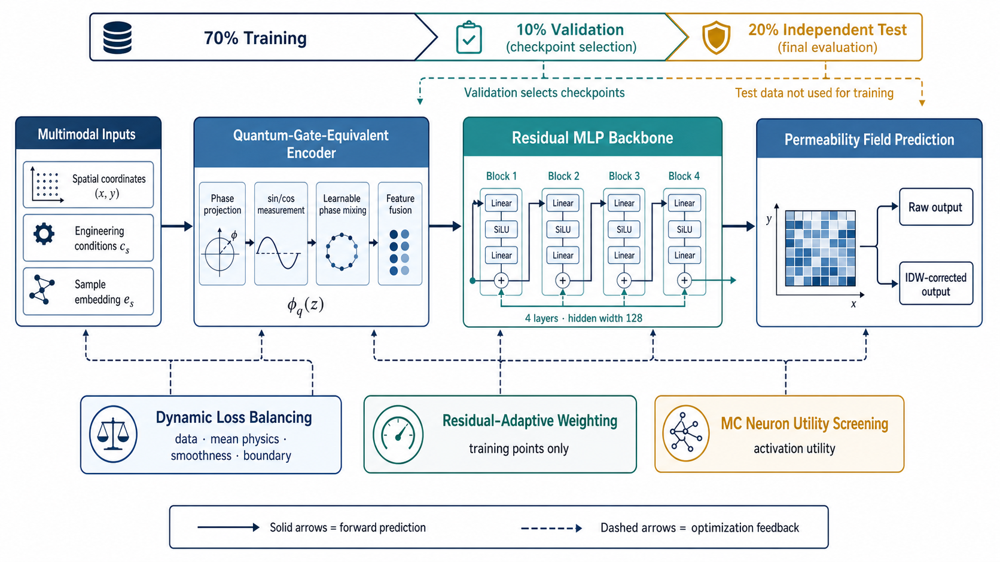
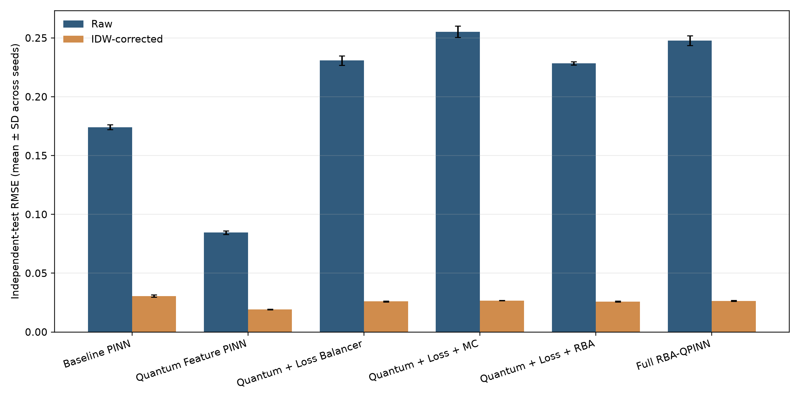
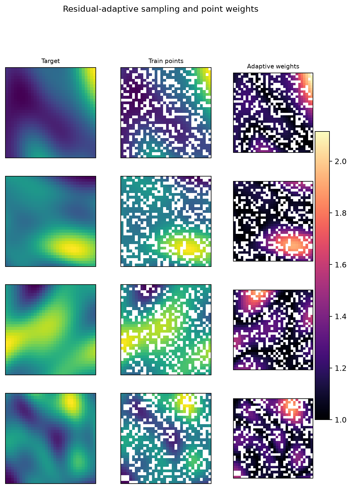
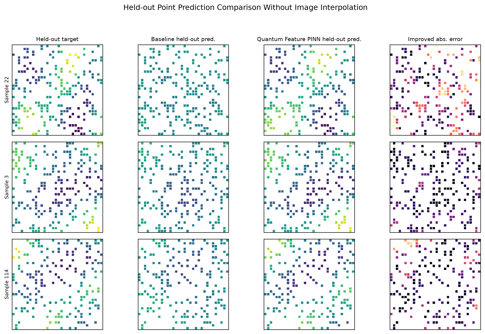

# 量子门等价特征增强物理引导神经网络的非均质渗透率场空间补全

作者姓名1，作者姓名2*

（作者单位，城市 邮编）

## 摘要

非均质渗透率场的快速重建是地下流体模拟与储层表征中的基础问题。针对坐标神经网络易平滑局部高梯度结构、复合物理约束优化易失衡的问题，提出一种量子门等价特征增强的物理引导神经网络，并在统一框架下考察动态损失平衡、残差自适应加权与 Monte Carlo 神经元效用筛选的作用。该方法将空间坐标、工程条件和样本嵌入映射为可学习相位，通过正弦—余弦测量响应及相位混合构造经典可微的量子启发特征。实验采用 128 个二维非均质渗透率场，每个场含 32×32 个网格点；对每个随机种子生成互斥的训练集、验证集和独立测试集，比例分别为 70%、10% 和 20%，并以 5 个随机种子重复 6 组消融实验。独立测试结果表明，单独加入量子门等价特征的模型取得最优网络原始输出精度，其均方根误差为 0.0845±0.0014，较基线的 0.1741±0.0021 下降 51.47%；平均绝对误差下降 55.12%，决定系数由 0.7237±0.0058 提升至 0.9349±0.0025。种子级单侧 Wilcoxon 检验的 p=0.03125，平均均方根误差改善的 bootstrap 95% 置信区间为 [0.0870, 0.0918]。经逆距离加权残差校正后，最佳模型的均方根误差为 0.01915±0.00018，较校正基线下降 37.37%。动态损失、残差自适应和神经元筛选能够降低弱物理均值残差，但显著牺牲原始预测精度。结果表明，相位型周期特征是当前任务性能提升的主要来源，完整模块堆叠并非最优。

**关键词：** 渗透率场；空间补全；物理引导神经网络；量子启发特征；残差自适应；消融实验

**中图分类号：** TP183；O241.82　　**文献标志码：** A

渗透率控制多孔介质中的流体运移，是地下水预测、油气藏模拟和二氧化碳地质封存等任务中的关键参数。实际地层通常具有显著空间非均质性，局部高、低渗区域及其连通结构会直接影响优势流动通道。传统数值方法依赖明确的控制方程、边界条件与网格离散；当需要对大量候选场或工况反复求解时，计算成本较高。数据驱动模型能够从已有样本中学习空间映射，但若训练目标只包含点值误差，未观测区域容易出现过度平滑或偏离工程统计关系的预测。

物理信息神经网络（physics-informed neural network，PINN）通过在目标函数中加入控制方程、边界条件或其他物理先验，为数据与机理的联合建模提供了统一形式[1]。然而，多尺度解、尖锐过渡及复合损失梯度失衡会使 PINN 难以训练[2]。已有研究分别从逐点自适应权重[3]、残差驱动采样[4]和动态损失平衡[2]等方面缓解上述问题。另一方面，坐标多层感知机对高频分量的学习速度较慢，周期特征映射能够改变其有效核的频率分布，从而增强低维空间信号的表达能力[5]。量子机器学习中的角度编码也可解释为由数据编码门决定频率谱的函数族[6]，为构造经典可微的相位特征提供了启发。

方荣等[7]将自适应阈值、密度聚类和注意力掩码结合，使训练过程聚焦于连续高残差区域。与连续域偏微分方程配置点重采样不同，本文研究固定网格上的空间留出补全：给定稀疏空间观测、样本级工程条件和样本标识，预测未观测网格上的归一化对数渗透率。由于现有数据缺少逐点压力、井源项、真实尺度和绝对渗透率单位，本文仅将工程条件与场均值的统计关系作为弱物理先验，不将其表述为严格 Darcy 方程残差。

本文主要工作如下：1）构建经典硬件可执行的量子门等价特征层，以角度编码、周期测量响应和可学习相位混合增强二维非均质场的坐标表达；2）在统一框架下组合动态损失平衡、训练点残差自适应权重和 Monte Carlo 神经元效用筛选，通过 6 组消融实验辨析各模块作用；3）建立训练—验证—独立测试三分协议，在 5 个随机种子上分别报告网络原始输出和逆距离加权校正结果，并开展种子级配对检验和 bootstrap 区间估计；4）揭示量子门等价特征与其他自适应模块在预测精度和弱物理一致性上的非加性作用。

## 1 模型与方法

### 1.1 问题描述与总体框架

设第 s 个样本的归一化对数渗透率场为

$$
u_s:\Omega\rightarrow\mathbb{R},\qquad \Omega=[-1,1]\times[-1,1].
$$

每个样本对应工程条件 c_s=[P_s,∇P_s,μ_s,φ_s,Q_s]，分别表示压力、压力梯度、黏度、孔隙度和流量。对每个场生成两两互斥且覆盖完整网格的训练、验证和测试掩码 M_s^tr、M_s^val 与 M_s^te。模型只在训练掩码上计算梯度；验证掩码仅用于选择最低验证损失 checkpoint；全部训练结束后，测试掩码仅用于一次最终评价。

网络输入为

$$
z_{s,i}=[x_i,y_i,\widetilde c_s,e_s],
$$

式中：\widetilde c_s 为标准化工程条件；e_s∈R^24 为可学习样本嵌入。样本嵌入使模型能够区分同一数据集中的不同随机场，因此当前协议评价的是已知样本内部的空间补全能力，而非对全新样本的外推能力。总体流程见图1。

**图1　量子门等价特征增强物理引导神经网络总体流程**

**Fig. 1　Overall framework of the physics-guided neural network enhanced by quantum-gate-equivalent features**

基线模型采用坐标 Fourier 特征、4 层残差多层感知机、SiLU 激活和 LayerNorm，隐藏维度为 128。该设置用于避免将普通周期坐标编码的收益误归因于量子启发模块。基线不使用可学习相位混合、动态损失、残差自适应或神经元筛选。

### 1.2 量子门等价特征

首先将输入投影为 q 个相位角：

$$
\theta=W_ez+b_e. \tag{1}
$$

单量子比特旋转后的测量响应可由周期函数等价表示：

$$
\phi_1=\sin(\theta),\qquad \phi_2=\cos(\theta). \tag{2}
$$

为描述不同相位通道之间的耦合，引入可学习矩阵 M_q：

$$
\eta=\sin(\theta M_q). \tag{3}
$$

最终量子门等价特征写为

$$
\phi_q(z)=[\sin(\theta),\cos(\theta),\sin(\theta+\eta),\cos(\theta-\eta)]. \tag{4}
$$

将 φ_q(z) 与原始输入拼接后送入残差主干网络。上述运算全部由经典自动微分框架实现，不调用量子处理器，也不代表量子计算加速。“量子门等价”仅说明特征形式来源于角度编码、相位混合与测量响应的经典等价表达。

### 1.3 物理引导复合损失

总损失为

$$
L=w_dL_{\mathrm{data}}+w_pL_{\mathrm{mean}}+w_sL_{\mathrm{smooth}}+w_bL_{\mathrm{boundary}}. \tag{5}
$$

训练数据项为训练掩码内的加权均方误差：

$$
L_{\mathrm{data}}=\frac{\sum_{s,i\in M_s^{\mathrm{tr}}}\lambda_{s,i}(\hat u_{s,i}-u_{s,i})^2}{\sum_{s,i\in M_s^{\mathrm{tr}}}\lambda_{s,i}+\varepsilon}. \tag{6}
$$

工程条件经数据内线性标定得到期望场均值 m_s^phy，弱物理均值项为

$$
L_{\mathrm{mean}}=\frac{1}{S}\sum_s\left(\frac{1}{|\Omega|}\sum_i\hat u_{s,i}-m_s^{\mathrm{phy}}\right)^2. \tag{7}
$$

平滑项惩罚相邻网格预测差分，边界项约束左右边界均值及上下边界均值的一致性。固定权重版本取 w_d=1.0、w_p=0.1、w_s=0.002、w_b=0.001。需要指出，L_mean 是由样本级条件构造的统计约束，并非局部 Darcy 守恒残差。

### 1.4 自适应优化机制

对数据、均值物理、平滑和边界 4 个损失项维护概率幅 a_k，并按当前损失尺度和相对改善率 g_k 更新：

$$
a_k\leftarrow\sqrt{\beta a_k^2+(1-\beta)\operatorname{softmax}(g_k)},\qquad w_k=4a_k^2. \tag{8}
$$

训练掩码内的逐点残差为 r_{s,i}=|\hat u_{s,i}-u_{s,i}|。根据归一化残差以指数滑动方式更新 λ_{s,i}，并将其限制在 [1,4]。每隔 5 个 epoch，从超过自适应阈值的训练点中识别高残差候选区域，并在满足密度条件的局部邻域扩散权重，以减弱孤立异常点的影响。该过程不访问验证或测试点标签。

对相位特征层第 j 个神经元定义 Monte Carlo 效用

$$
U_j=\mathbb{E}_{\mathrm{MC}}[|a_j(z)|]\sqrt{\operatorname{Var}_{\mathrm{MC}}[a_j(z)]+\varepsilon}. \tag{9}
$$

训练前半程使用 4 次随机批采样估计 U_j，并对低于分位阈值的神经元进行轻量重初始化。该步骤不改变网络宽度。

### 1.5 训练观测残差校正

为评价统一后处理下的工程系统性能，对所有模型应用逆距离加权（inverse distance weighting，IDW）残差校正。对测试位置 x，利用同一场内 K=8 个最近训练观测点的残差估计

$$
\Delta(x)=\frac{\sum_{j\in \mathcal{N}_K(x)}d(x,x_j)^{-p}[u(x_j)-\hat u(x_j)]}{\sum_{j\in \mathcal{N}_K(x)}d(x,x_j)^{-p}+\varepsilon},\qquad \hat u^{\,c}(x)=\hat u(x)+0.95\Delta(x). \tag{10}
$$

式中 p=2。该校正只使用训练观测点。本文以网络原始输出（Raw）作为模型本体的主结果，将 IDW 校正输出（Corrected）作为次结果。

## 2 数值实验

### 2.1 数据与评价协议

实验数据由 GSTools 地质统计流程生成[8]，包含 128 个 32×32 二维归一化对数渗透率场，共 131072 个网格点。采用随机种子 42—46 重复实验。以 seed 42 为例，训练、验证和独立测试掩码分别包含 91928、13070 和 26074 个点，占 70.14%、9.97% 和 19.89%。不同种子重新生成掩码，但保持相同划分概率与模型配置。工程条件的统计范围见表1。

**表1　工程条件统计**

**Tab. 1　Statistics of engineering conditions**

| 条件 | 均值 | 标准差 | 最小值 | 最大值 |
|---|---:|---:|---:|---:|
| 压力/MPa | 30.1751 | 4.9193 | 19.7594 | 41.8335 |
| 压力梯度/(MPa·m⁻¹) | 0.0120 | 0.0017 | 0.0065 | 0.0166 |
| 黏度/cP | 1.0130 | 0.1450 | 0.6792 | 1.3856 |
| 孔隙度 | 0.2210 | 0.0178 | 0.1727 | 0.2689 |
| 流量/(m³·d⁻¹) | 119.1079 | 18.5368 | 69.0806 | 167.9973 |

所有模型采用 AdamW 优化器，初始学习率为 10^-3，权重衰减为 10^-5，并使用余弦退火学习率；批大小为 8，训练 40 个 epoch，梯度范数裁剪阈值为 1.0。量子启发模型与基线均采用 4 层、隐藏维度 128 的主干网络。每个种子的运行目录均禁止覆盖，并保存配置 manifest、三类掩码、模型权重、Raw/Corrected 预测和逐样本误差。

### 2.2 对比模型与评价指标

消融实验包含 6 种设置：Baseline PINN；Quantum Feature PINN；Quantum + Loss Balancer；Quantum + Loss + MC；Quantum + Loss + RBA（不含 MC）；Full RBA-QPINN。主要指标为独立测试点上的均方根误差（RMSE）、平均绝对误差（MAE）和决定系数 R^2；结构相似性（SSIM）在完整重建场上计算。Physics Residual 定义为预测场均值与工程条件期望均值之差的平均绝对值，仅表示弱物理统计一致性。

各指标报告 5 个随机种子的均值±样本标准差。最佳非基线模型与基线的 RMSE 采用种子级配对 t 检验、单侧 Wilcoxon 符号秩检验和以种子为重采样单位的 bootstrap 95% 置信区间分析。逐样本检验仅作辅助分析，不将同一种子内样本视为主要独立重复。

## 3 结果与分析

### 3.1 网络原始输出性能

6 组模型的独立测试 Raw 结果见表2。Quantum Feature PINN 在 RMSE、MAE、R^2 和 SSIM 上均取得最优值。其 RMSE 为 0.0845±0.0014，较 Baseline PINN 的 0.1741±0.0021 平均下降 51.47%；MAE 下降 55.12%，R^2 提升 0.2112。5 个种子的 RMSE 改善均为正，种子级配对 t 检验的单侧 p=1.59×10^-7，单侧 Wilcoxon 检验的 p=0.03125；平均 RMSE 改善为 0.0896，bootstrap 95% 置信区间为 [0.0870,0.0918]。上述结果支持“可学习相位与周期响应增强非均质空间表达”的判断，但不支持量子计算加速或完整 RBA-QPINN 全面优越的结论。

**表2　6组模型的独立测试 Raw 结果（均值±标准差，n=5）**

**Tab. 2　Raw results on independent test masks for six models (mean±standard deviation, n=5)**

| 方法 | RMSE↓ | MAE↓ | R^2↑ | SSIM↑ | Physics Residual↓ |
|---|---:|---:|---:|---:|---:|
| Baseline PINN | 0.1741±0.0021 | 0.1317±0.0014 | 0.7237±0.0058 | 0.6866±0.0122 | 0.1228±0.0003 |
| Quantum Feature PINN | **0.0845±0.0014** | **0.0591±0.0009** | **0.9349±0.0025** | **0.9384±0.0028** | 0.1209±0.0001 |
| Quantum + Loss | 0.2309±0.0040 | 0.1809±0.0034 | 0.5141±0.0168 | 0.3296±0.0109 | 0.0600±0.0016 |
| Quantum + Loss + MC | 0.2553±0.0048 | 0.2020±0.0035 | 0.4055±0.0253 | 0.1546±0.0133 | **0.0339±0.0030** |
| Quantum + Loss + RBA | 0.2284±0.0015 | 0.1794±0.0010 | 0.5245±0.0033 | 0.3483±0.0217 | 0.0627±0.0036 |
| Full RBA-QPINN | 0.2477±0.0041 | 0.1966±0.0034 | 0.4406±0.0212 | 0.1852±0.0291 | 0.0395±0.0035 |

**图2　6组模型在 Raw 与 IDW-Corrected 设置下的 RMSE（5个随机种子的均值±标准差）**

**Fig. 2　RMSE of six models under Raw and IDW-Corrected settings (mean±standard deviation over five seeds)**

### 3.2 精度与弱物理一致性的权衡

加入动态损失平衡后，Raw RMSE 从 Quantum Feature PINN 的 0.0845 上升至 0.2309；继续加入 MC 或 RBA 后，RMSE 为 0.2284～0.2553。Full RBA-QPINN 的 RMSE 为 0.2477，高于基线的 0.1741，说明当前数据规模和训练预算下，多模块联合优化存在明显负交互。

Physics Residual 的变化方向与预测误差不同。Quantum + Loss + MC 得到最低值 0.0339±0.0030，较基线下降约 72.43%；Full RBA-QPINN 为 0.0395±0.0035。与此同时，两者的 RMSE 明显恶化，说明动态损失和神经元筛选将优化重点转向了场均值约束，形成预测精度与弱物理一致性的权衡，而不是同时改善两个目标。

残差权重的空间分布见图3。密度扩散使连续高残差区域获得较高权重，避免只追逐单个异常点；但 5 个随机种子的结果均未证明这种关注变化可以转化为更低的测试 RMSE。因此，该图仅用于解释训练机制，不作为性能提升的独立证据。

**图3　seed 42下训练点残差自适应权重的空间分布**

**Fig. 3　Spatial distribution of residual-adaptive weights on training points for seed 42**

### 3.3 逆距离加权校正结果

IDW 校正结果见表3。校正显著降低了所有模型的测试误差，但未改变最佳模型排序。Quantum Feature PINN 的 RMSE 为 0.01915±0.00018，较校正基线下降 37.37%，种子级单侧 Wilcoxon 检验的 p=0.03125。Raw 与 Corrected 的改善幅度分别为 51.47% 和 37.37%，说明最终系统性能同时来自神经表示与空间残差校正，因此 Raw 结果更适合评价模型本体。

**表3　6组模型的 IDW-Corrected 独立测试结果（均值±标准差，n=5）**

**Tab. 3　IDW-Corrected results on independent test masks for six models (mean±standard deviation, n=5)**

| 方法 | RMSE↓ | MAE↓ | R^2↑ | SSIM↑ | Physics Residual↓ |
|---|---:|---:|---:|---:|---:|
| Baseline PINN | 0.03057±0.00091 | 0.02221±0.00066 | 0.99148±0.00048 | 0.99766±0.00018 | 0.13266±0.00008 |
| Quantum Feature PINN | **0.01915±0.00018** | **0.01131±0.00011** | **0.99666±0.00007** | **0.99906±0.00007** | 0.13259±0.00004 |
| Quantum + Loss | 0.02603±0.00047 | 0.01800±0.00033 | 0.99382±0.00021 | 0.99838±0.00009 | 0.13172±0.00003 |
| Quantum + Loss + MC | 0.02676±0.00021 | 0.01887±0.00017 | 0.99347±0.00011 | 0.99829±0.00005 | **0.13121±0.00006** |
| Quantum + Loss + RBA | 0.02590±0.00034 | 0.01792±0.00017 | 0.99389±0.00014 | 0.99846±0.00007 | 0.13174±0.00006 |
| Full RBA-QPINN | 0.02641±0.00039 | 0.01857±0.00025 | 0.99364±0.00019 | 0.99828±0.00012 | 0.13128±0.00007 |

### 3.4 空间结构与误差分布

独立测试点预测对比见图4。Quantum Feature PINN 的散点更集中于 y=x 附近，其绝对误差分布和累计分布的大误差比例也更低。重建场结果表明，基线能够恢复主要低频区域，但在局部变化较快的位置更易出现平滑偏差；相位型周期特征为坐标网络提供了更丰富的频率基，可能缩短高频结构的学习路径。这一解释与 Fourier 特征缓解坐标网络频谱偏置的结论一致[5]。

**图4　seed 42下6组模型在独立测试点上的预测结果**

**Fig. 4　Predictions of six models on independent test points for seed 42**

## 4 讨论

实验结果体现出 3 个值得关注的特征。第一，量子门等价特征在 5 个随机种子上稳定降低误差，说明收益主要来自相位型周期基对空间高频成分的表达，而非偶然划分。第二，动态损失、残差加权和神经元筛选并未产生简单叠加收益。均值物理项的下降伴随点值误差上升，提示当前损失尺度、40 个 epoch 的训练预算及场均值先验强度尚不匹配。第三，统一的 IDW 校正压缩了不同模型之间的差异，表明工程后处理可以显著提升最终重建质量，但不能代替对网络原始输出的公平评价。

本文存在两项主要限制。其一，训练、验证和测试点位于相同的 128 个随机场内，共享样本级嵌入和工程条件，因此当前结果不能推断模型对全新渗透率场的泛化能力。其二，物理项只约束场均值，缺少逐点压力、边界条件和真实尺度，不能等同于 Darcy 局部质量守恒。后续应增加按样本划分的外推实验，研究无需样本 ID 的观测编码器，并在获得压力场和边界条件后引入 ∇·[(k/μ)∇p]=0 的局部残差。

## 5 结束语

针对二维非均质渗透率场空间补全问题，本文构建了融合量子门等价周期特征、动态损失平衡、逐点残差权重和 Monte Carlo 神经元筛选的物理引导神经网络，并完成训练—验证—独立测试三分、5 个随机种子和 6 组消融实验。结果表明，量子门等价特征是预测性能提升的主要来源：相较强基线，最佳模型的独立测试 Raw RMSE 和 MAE 分别下降 51.47% 和 55.12%，且种子级配对检验支持该改善；IDW 校正后 RMSE 仍下降 37.37%。完整模块组合未获得最低预测误差，动态损失和 MC 筛选虽降低弱物理均值残差，却明显损害点值及结构精度，揭示出当前训练设置下预测精度与先验一致性之间的优化权衡。

上述结论适用于已知样本内部的空间补全。未来工作将重点开展未知场外推、严格 Darcy 守恒约束和更长训练预算下的超参数敏感性研究，以进一步验证模型的泛化能力和工程适用性。

**数据与代码可用性：** 实验代码、处理后数据、空间掩码、模型权重、逐样本结果和图表生成脚本保存在项目仓库中。正式投稿时将按期刊政策提供匿名仓库链接。

**利益冲突声明：** 作者声明不存在可能影响本文工作的已知利益冲突。

**作者贡献：** 待按 CRediT 规范补充。

## 参考文献

[1] Raissi M, Perdikaris P, Karniadakis G E. Physics-informed neural networks: A deep learning framework for solving forward and inverse problems involving nonlinear partial differential equations[J]. Journal of Computational Physics, 2019, 378: 686-707. DOI: 10.1016/j.jcp.2018.10.045.

[2] Wang S F, Teng Y J, Perdikaris P. Understanding and mitigating gradient flow pathologies in physics-informed neural networks[J]. SIAM Journal on Scientific Computing, 2021, 43(5): A3055-A3081. DOI: 10.1137/20M1318043.

[3] McClenny L D, Braga-Neto U M. Self-adaptive physics-informed neural networks[J]. Journal of Computational Physics, 2023, 474: 111722. DOI: 10.1016/j.jcp.2022.111722.

[4] Wu C X, Zhu M, Tan Q Y, et al. A comprehensive study of non-adaptive and residual-based adaptive sampling for physics-informed neural networks[J]. Computer Methods in Applied Mechanics and Engineering, 2023, 403: 115671. DOI: 10.1016/j.cma.2022.115671.

[5] Tancik M, Srinivasan P P, Mildenhall B, et al. Fourier features let networks learn high frequency functions in low dimensional domains[C]//Advances in Neural Information Processing Systems. 2020, 33: 7537-7547.

[6] Schuld M, Sweke R, Meyer J J. Effect of data encoding on the expressive power of variational quantum-machine-learning models[J]. Physical Review A, 2021, 103(3): 032430. DOI: 10.1103/PhysRevA.103.032430.

[7] 方荣, 鞠然, 杨凤莲. 基于残差自适应调整PINN方法求解偏微分方程[J/OL]. 广西师范大学学报(自然科学版). DOI: 10.16088/j.issn.1001-6600.2026040803.

[8] Müller S, Schüler L, Zech A, Heße F. GSTools v1.3: A toolbox for geostatistical modelling in Python[J]. Geoscientific Model Development, 2022, 15: 3161-3182. DOI: 10.5194/gmd-15-3161-2022.

[9] Lu L, Meng X H, Mao Z P, et al. DeepXDE: A deep learning library for solving differential equations[J]. SIAM Review, 2021, 63(1): 208-228. DOI: 10.1137/19M1274067.

[10] Nabian M A, Gladstone R J, Meidani H. Efficient training of physics-informed neural networks via importance sampling[J]. Computer-Aided Civil and Infrastructure Engineering, 2021, 36(8): 962-977. DOI: 10.1111/mice.12685.

## English title and abstract

### Quantum-Gate-Equivalent Feature Enhanced Physics-Guided Neural Network for Spatial Completion of Heterogeneous Permeability Fields

Author Name 1, Author Name 2*

(Affiliation, City Postal Code, China)

**Abstract:** Rapid reconstruction of heterogeneous permeability fields is fundamental to subsurface-flow simulation and reservoir characterization. To alleviate the oversmoothing of local high-gradient structures by coordinate neural networks and the optimization imbalance caused by compound physics-guided objectives, a physics-guided neural network enhanced by quantum-gate-equivalent features is proposed. Spatial coordinates, engineering conditions, and sample embeddings are projected into learnable phases, while sinusoidal measurement responses and trainable phase mixing form a fully differentiable, classically executable quantum-inspired representation. Dynamic loss balancing, residual-adaptive weighting, and Monte Carlo neuron-utility screening are examined within the same framework. Experiments use 128 two-dimensional heterogeneous permeability fields, each discretized on a 32×32 grid. For each of five random seeds, mutually exclusive training, validation, and independent-test masks are generated at ratios of 70%, 10%, and 20%, and six ablation variants are evaluated. On the independent test masks, the quantum-feature-only model achieves the best raw accuracy, with an RMSE of 0.0845±0.0014 versus 0.1741±0.0021 for the baseline, corresponding to a 51.47% reduction. Its MAE decreases by 55.12%, and R^2 increases from 0.7237±0.0058 to 0.9349±0.0025. A seed-level paired one-sided Wilcoxon test gives p=0.03125, and the bootstrap 95% confidence interval for the mean RMSE improvement is [0.0870, 0.0918]. After inverse-distance-weighted residual correction, the best RMSE is 0.01915±0.00018, 37.37% below the corrected baseline. Dynamic loss balancing, residual adaptation, and neuron screening reduce the weak mean-physics residual but substantially degrade raw predictive accuracy. These results identify phase-based periodic features as the main source of improvement and show that stacking all adaptive modules is not optimal under the present setting.

**Keywords:** permeability field; spatial completion; physics-guided neural network; quantum-inspired feature; residual adaptation; ablation study
