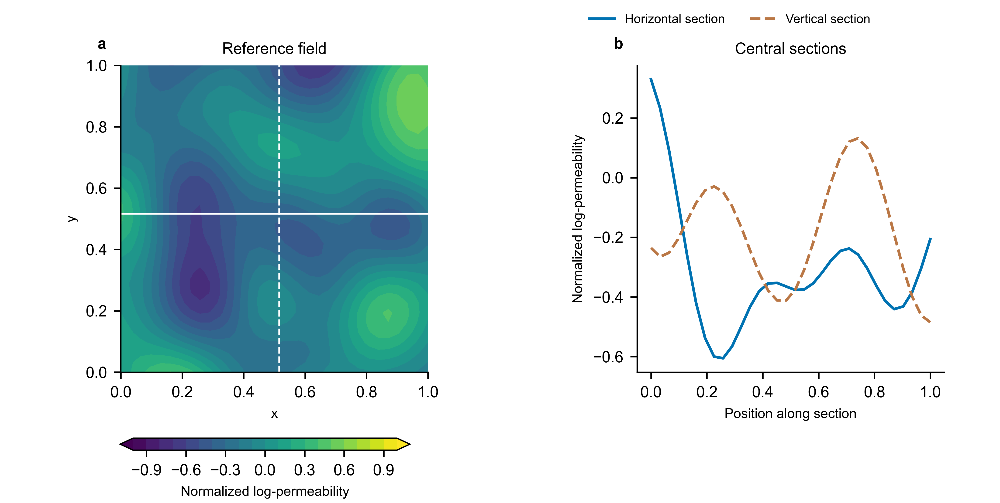
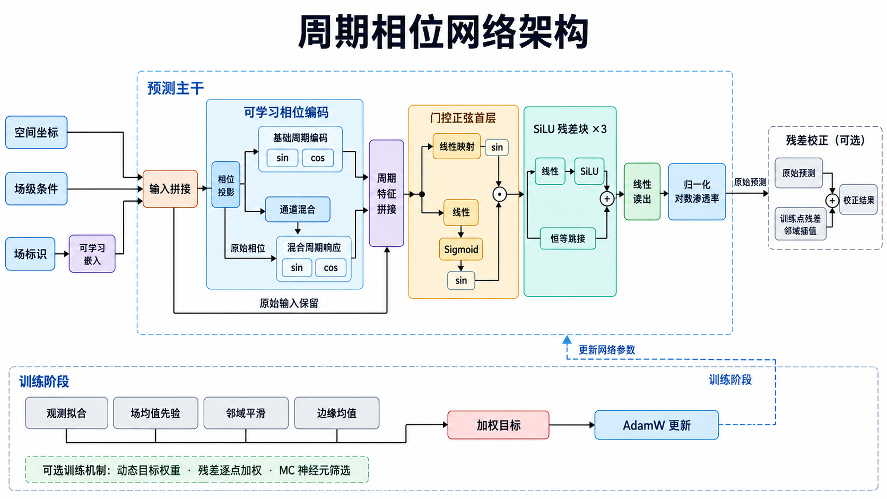
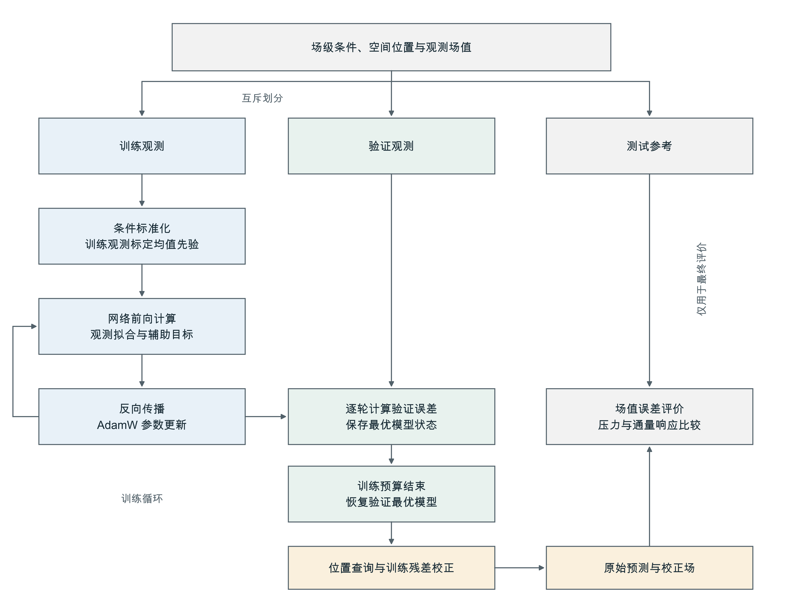
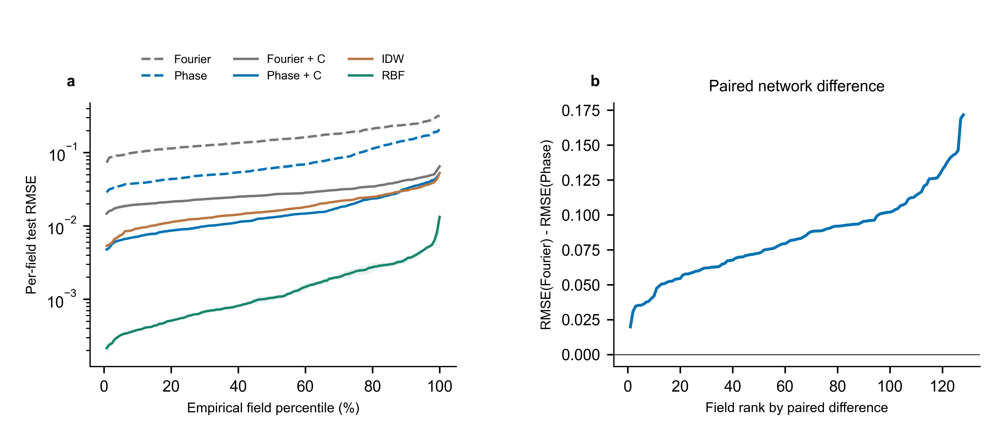
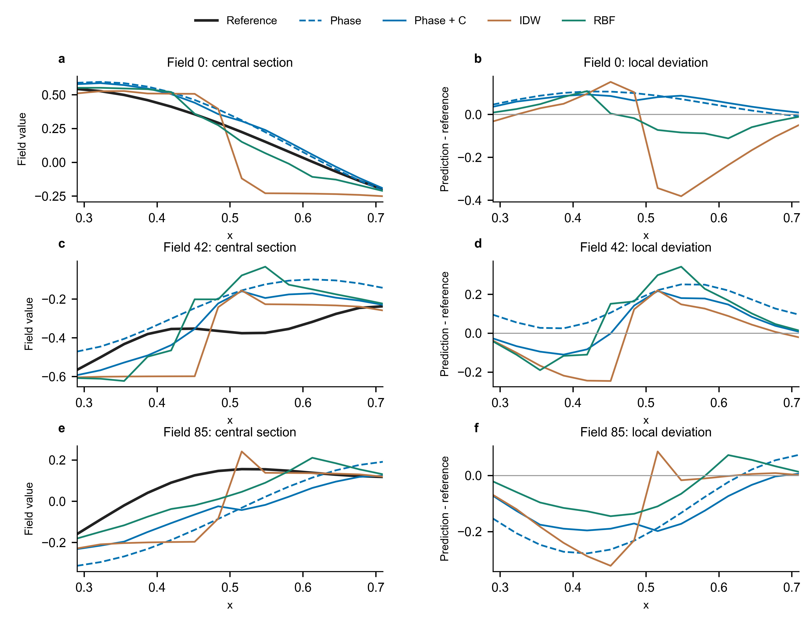
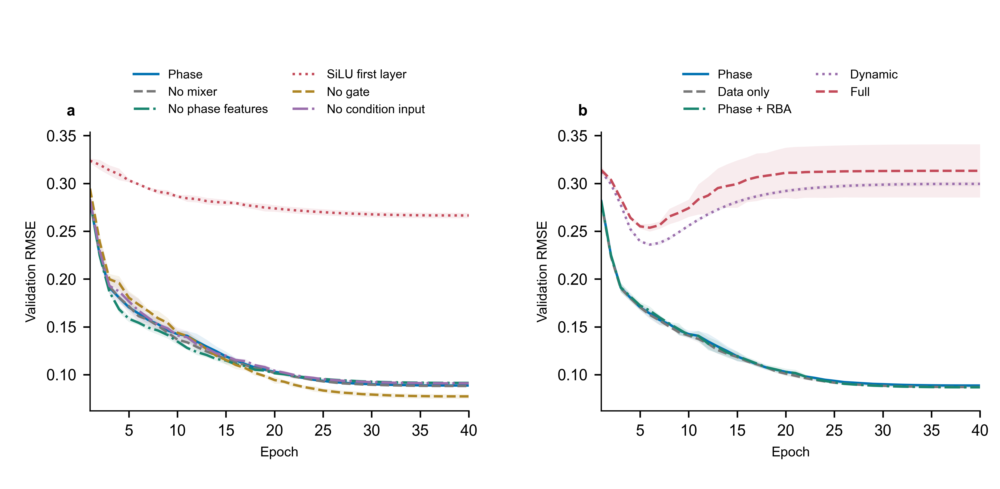
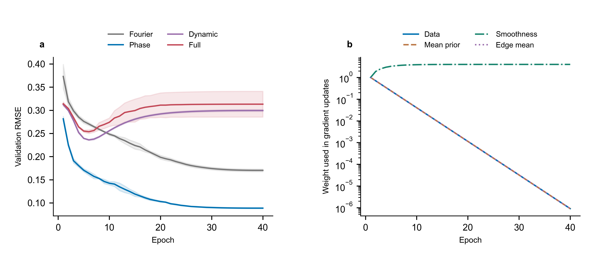
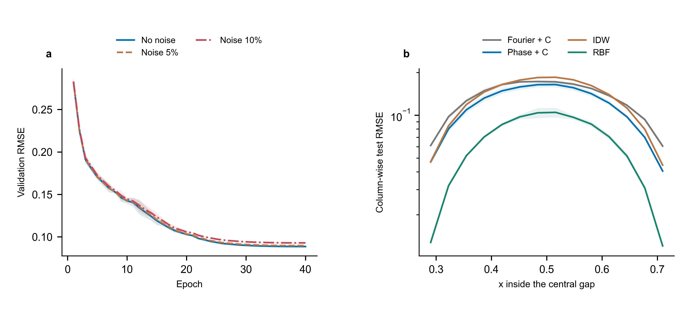
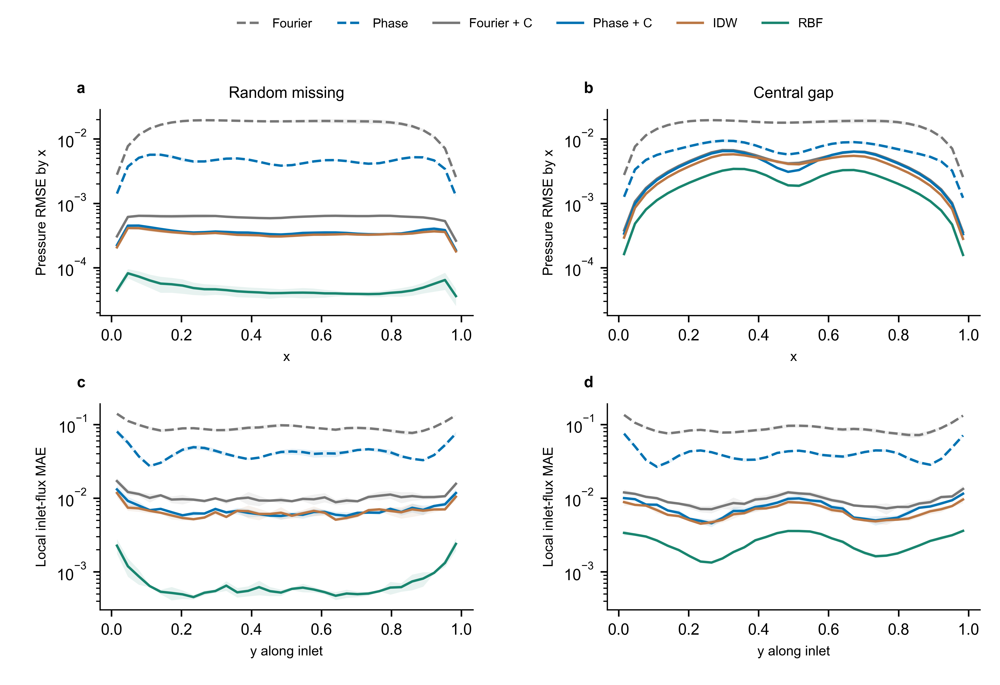
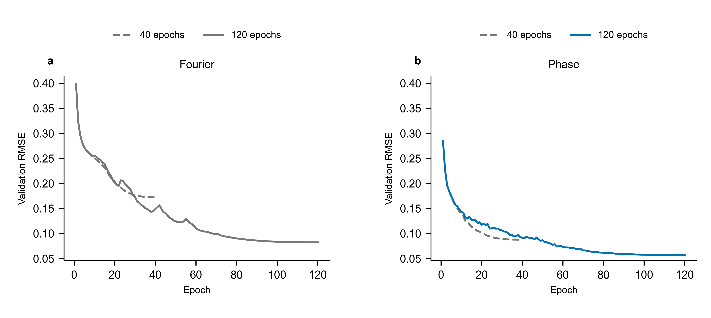

# 非均质渗透率场的周期相位补全及流动响应分析

**Phase-Periodic Completion of Heterogeneous Permeability Fields and Analysis of Flow Responses**

## 摘要

非均质渗透率场的缺测补全既需恢复局部空间变化，也需辨明重建误差对流动响应的影响。针对坐标网络表示改进与邻域校正贡献难以区分的问题，构建输入相关相位特征与正弦首层相结合的残差坐标网络，并用训练观测残差进行局部校正。通过分离原始预测与校正结果、设置同主干组件消融，将周期表示、训练权重与空间信息利用的作用分别检验。在128幅二维数值场上，以固定Fourier网络、逆距离加权和局部薄板样条为对照，开展随机缺测、测量噪声、中央区域缺测及稳态流动评价。结果表明：在相同训练轮数下，周期网络原始输出的均方根误差较Fourier对照降低48.15%；残差校正后误差降至0.01912，仍高于薄板样条的0.00247。正弦首层是当前结构中改善拟合的主要环节，相位混合未显示明确收益；倒数损失加权向平滑项集中，削弱了观测拟合。中央缺测时，校正周期网络误差增至0.12373，且场值精度与通量精度并非严格同序。上述结果明确了周期网络在有限预算下的拟合收益，同时揭示了邻域信息缺失和目标权重失衡对补全精度的制约。

**关键词**：渗透率场；空间补全；周期坐标网络；残差校正；自适应加权；流动响应

## Abstract

Completion of heterogeneous permeability fields requires recovery of local spatial variations and assessment of their effects on flow responses. To distinguish improvements in network representation from those due to neighborhood correction, a residual coordinate network combines input-dependent phase features with a sinusoidal first layer, followed by local correction using residuals at training observations. Raw and corrected predictions are evaluated separately, while component ablations with a shared backbone isolate the effects of periodic representation, loss weighting, and spatial information. Experiments on 128 two-dimensional numerical fields compare the network with a fixed Fourier network, inverse-distance weighting, and local thin-plate spline interpolation under random missingness, measurement noise, and a central missing region. Steady flow calculations further assess pressure and flux errors. At the same training-epoch budget, the periodic network reduces raw-output root mean square error by 48.15% relative to the Fourier baseline. Residual correction lowers its error to 0.01912, which remains above the thin-plate spline error of 0.00247. The sinusoidal first layer is the main contributor to improved fitting in the tested architecture, whereas phase mixing shows no clear benefit. Inverse-loss weighting concentrates on the smoothness objective and weakens data fitting. With a central missing region, the corrected periodic-network error increases to 0.12373, and field-value accuracy does not strictly predict flux accuracy. These results identify a limited-budget fitting benefit of periodic representation and show how missing neighborhood information and unbalanced objectives constrain completion accuracy.

**Keywords**: permeability field; spatial completion; periodic coordinate network; residual correction; adaptive weighting; flow response

## 0 引言

非均质渗透率场是地下流动计算的基础输入。有限位置上的参数观测通常不足以形成完整的空间描述，需要依据邻近关系和已有信息估计缺测位置。Siena和Riva对高非均质含水层的研究表明，不同地质统计重建方法得到的岩相连通性会影响水力参数标定和水头预测[1]。因此，补全评价除了比较场值偏差，还应考察高、低渗区域的空间组合及其对应的流动响应。

在规则网格内补全已登记场，与从动态响应反演未知地层具有不同的信息条件。前者已掌握同一场中的部分点值，空间邻近关系本身就是重要信息；后者需要借助观测响应和控制方程辨识参数。逆距离加权直接利用距离衰减关系，局部径向基函数通过核展开恢复空间变化，地质统计方法则借助协方差、变差函数和条件模拟表达空间相关结构[2]。这些途径与神经网络的计算方式不同，应在相同观测信息下共同检验。另一类连续表示将空间坐标与对象编码送入共享网络。DeepSDF在形状表示和补全中使用了这一思路，但新对象的补全仍需优化对应编码[3]；因而，可查询的连续表示与无需适配的新对象预测是两种不同能力。

坐标网络的拟合过程受表示形式影响。频谱分析发现，深层ReLU网络在所研究条件下倾向于较早拟合低频分量，且这种偏置与数据所在流形的几何性质有关[4]。Fourier特征通过输入频率映射改善细节拟合[5]，SIREN则用周期激活及相应初始化表达信号和导数[6]。NeRF的逐场景拟合展示了位置编码与连续函数表示的结合[7]；BACON进一步控制中间层的频带，以支持多尺度输出[8]。这些工作说明输入编码、激活函数与频率控制承担不同作用，不能将它们统称为同一种周期机制。多尺度Fourier网络的研究还表明，特征频率尺度需要与目标变化相适应，预设频率并非对所有问题同样有效[9]。因此，本文既比较整体架构，也在共同主干下分别检验相位混合、正弦首层和门控。

领域信息的引入需要对应明确的数学对象。PINN通过微分方程和初边值条件约束解空间[10]，DGM以随机时空点上的微分算子残差训练解函数[11]，Deep Ritz则将神经网络作为试探函数用于能量泛函最小化[12]。这些方法的共同前提是已知控制关系，而约束施加的形式并不相同[13]。宋家豪等将周期方向上的傅里叶变换用于控制方程，构造FD-PINN并降低算例中的求解成本[14]，其核心是方程转换，而非仅对坐标作周期编码。对于缺少局部压力观测和真实边界条件的渗透率补全，场均值先验不能替代局部质量守恒。本文据此将统计先验用于训练，将Darcy流动计算用于评价。

多个训练目标并存时，误差下降还取决于各项对参数更新的实际贡献。梯度流和神经正切核分析分别揭示了梯度失衡及损失分量收敛速率不一致的问题[15-16]；对流、反应和扩散算例中的失败也表明，增加软约束并不必然提高解的精度[17]。逐点可训练权重和残差驱动注意力通过不同更新规则提高困难位置的训练贡献[18-19]。徐宝昌等将自适应权重用于两相流环空压力预测，并对观测数据项保持不加权，以降低噪声重复拟合的风险[20]。与调整已有点的权重不同，残差自适应采样会改变方程配置点的分布[21-22]。这些区别决定了相应成果不能直接移用到固定观测点的场值补全，也不能把“动态”本身视为有效性的依据。

基于上述问题，本文构建输入相关周期相位表示与观测残差校正相结合的场内补全方法，并将表示收益、校正收益和流动响应分开检验。具体考察：周期结构在有限预算下能改善多少原始预测误差，主要作用来自哪个环节；引入残差校正后，相对于直接空间插值还保留多少增益；测量扰动和集中缺测如何改变局部恢复及下游响应。验证采用共同数据划分、独立选模和同主干消融，这也与现有PINN训练研究强调的组件对照和强基线评价原则一致[23]。本文的贡献定位于特定补全任务的表示构造与作用辨析，不将已有模块的组合视为新的物理方程求解理论。

## 1 渗透率补全任务与评价对象

### 1.1 已知信息与待求场

设第 \(s\) 个归一化对数渗透率场为 \(u_s(\mathbf x)\)，定义于 \(\Omega=[-1,1]^2\) 的 \(32\times32\) 网格。归一化值没有绝对渗透率单位。训练位置、验证位置和测试位置分别记为 \(\mathcal T_s\)、\(\mathcal V_s\) 和 \(\mathcal E_s\)，三者互不重叠。训练点值用于拟合模型，验证点值用于选择检查点或插值参数，测试点值仅在训练与选择结束后用于评价。

各场对应五维条件向量 \(\mathbf c_s=[P_s,G_s,\mu_s,\phi_s,Q_s]\)，依次表示压力、压力梯度、黏度、孔隙度和流量。对已登记场的条件作标准化，记为 \(\widetilde{\mathbf c}_s\)，并为每个场分配24维可学习嵌入 \(\mathbf e_s\)。网络输入与输出为

$$
\mathbf z_{s,i}=[x_i,y_i,\widetilde{\mathbf c}_s,\mathbf e_s]^\mathsf T
\in\mathbb R^{31},\qquad
\widehat u_{s,i}=f_\Theta(\mathbf z_{s,i}).
\tag{1}
$$

嵌入利用同一场的训练点更新，使共享网络能够表示多幅场而不退化为跨场平均。它同时限定了本研究的使用方式：模型面向已登记场的空间补全，新场需要重新拟合嵌入或训练模型。本文不把空间位置留出解释为未知场泛化。

图1给出一幅参考场及其两条相交剖面。横向剖面包含快速下降、局部回升和再次转折，纵向剖面的峰谷位置与之不同，说明二维非均质结构不能由单一方向的变化概括。场值补全除了降低平均偏差，还需恢复这些转折及其空间位置。下文同时采用全体场的误差分布和预先指定剖面的局部偏差评价恢复效果。

**图1 参考场及中心剖面。** a为第42号场，白色实线、虚线分别标出行索引16和列索引16；b为对应的横向、纵向剖面。坐标以0至1的相对位置表示。等值填色仅用于呈现原网格的空间结构，剖面曲线连接全部32个原始网格值，不作额外平滑；本图不承担性能比较。

### 1.2 场级先验与局部约束的区别

工程条件通过经验指标与场均值建立联系：

$$
I_s=\ln\frac{Q_s}{Q_0}+\ln\frac{\mu_s}{\mu_0}
-\ln\frac{G_s}{G_0}
+2.8\frac{\phi_s-\phi_0}{\phi_0}
-\kappa(P_s-P_0),\qquad m_s=aI_s+b.
\tag{2}
$$

参考量取 \(Q_0=120\ \mathrm{m^3/d}\)、\(\mu_0=1\ \mathrm{cP}\)、\(G_0=0.012\ \mathrm{MPa/m}\)、\(\phi_0=0.22\)、\(P_0=30\ \mathrm{MPa}\)，\(\kappa=0.015\ \mathrm{MPa^{-1}}\)。这些经验参数预先固定，不作物理常数解释。每次实验只用训练点均值 \(\bar u_{s,\mathcal T}\) 拟合标定系数：

$$
(a,b)=\arg\min_{\alpha,\beta}
\sum_s\left(\bar u_{s,\mathcal T}-\alpha I_s-\beta\right)^2.
\tag{3}
$$

式(2)提供全局统计约束，而不确定具体位置的场值。具有相同均值的场仍可呈现不同通道和阻隔结构，因此先验的价值必须由留出位置及下游响应检验。将拟合限制在训练观测内，也使该约束与实际补全的信息条件一致。噪声实验中的标定使用受扰训练观测，不另行调用无噪声完整均值。

### 1.3 下游流动诊断

为检验误差的工程后果，将完整预测场作为相对渗透率输入，求解单位正方形内的稳态单相流：

$$
k_s^*(\mathbf x)=\exp\left[u_s(\mathbf x)-\bar u_s\right],
\quad \nabla\cdot\left(k_s^*\nabla p_s^*\right)=0,
\quad \mathbf q_s^*=-k_s^*\nabla p_s^*.
\tag{4}
$$

左、右边界分别取 \(p^*=1\) 和 \(p^*=0\)，上、下边界为无流。参考场与各预测场分别中心化后转换为正渗透率，以比较空间非均质结构对响应的影响。该映射移除了整体均值差，不能用于评价绝对渗透率尺度或实际产量；原始场均值误差另行统计。

采用网格中心有限体积离散，内部面的传导率由相邻两单元渗透率的调和平均确定，入口和出口使用半网格边界距离，无流边界不增加通量连接。离散方程由 SciPy 稀疏直接求解器求解[24]，并检查线性系统残差和入口、出口通量平衡。对任意给定正渗透率场均可得到满足方程的压力解，因此“小守恒残差”首先说明数值求解充分，不能单独说明渗透率准确。本文比较的是预测场与参考场对应的压力、流量差异，而非把求解器残差当成重建精度。

## 2 周期相位表示与训练方法

图2概括网络结构。空间坐标、场级条件和可学习场嵌入共同构成输入；周期相位特征与原始输入拼接后，依次经过门控正弦首层、残差主干和线性读出。网络首先输出归一化对数渗透率，训练后的残差校正另行处理。相位映射、主干计算及校正运算由式(5)—式(15)定义。

**图2 周期相位网络架构。** 上部为查询位置的预测路径，保留原始输入旁路，门控分支与正弦响应逐元素相乘，残差主干包含三次线性变换、SiLU激活与恒等跳接。下部为训练目标及参数更新；动态权重、逐点残差加权和神经元筛选仅在对应对照组启用。右侧校正利用训练点残差，不属于可训练输出层。图为结构示意，不表示实验精度或物理场分布。

### 2.1 输入相关的周期特征

相位网络先将输入投影到六个相位通道，再构造非线性混合响应：

$$
\boldsymbol\theta=W_e\mathbf z+\mathbf b_e,\qquad
\boldsymbol\eta=\sin(M^\mathsf T\boldsymbol\theta),
\quad W_e\in\mathbb R^{6\times31},\ M\in\mathbb R^{6\times6}.
\tag{5}
$$

特征映射定义为

$$
\boldsymbol\psi(\mathbf z)=
\left[\sin\boldsymbol\theta,\cos\boldsymbol\theta,
\sin(\boldsymbol\theta+\boldsymbol\eta),
\cos(\boldsymbol\theta-\boldsymbol\eta)\right]^\mathsf T,
\qquad
\boldsymbol\xi=[\mathbf z,\boldsymbol\psi]^\mathsf T\in\mathbb R^{55}.
\tag{6}
$$

固定 Fourier 编码预设坐标频率，相位投影则允许坐标、工程条件和场嵌入共同改变周期响应。混合项进一步改变各相位通道的组合关系。保留原始输入可使后续网络直接访问非周期信息，不必将所有变化都压入三角函数。

周期特征并不要求渗透率场在物理边界上周期延拓，也不等同于对控制方程作傅里叶变换。模型采用经典张量运算，不涉及量子线路。本研究关注的是这一具体周期表示能否改善任务误差，其有效性由结构对照检验，而不由命名或类比预先确定。

### 2.2 门控正弦首层与残差主干

首层由正弦响应和幅值门控组成：

$$
\mathbf h_0=
\sin\left[\sigma(W_g\boldsymbol\xi+\mathbf b_g)\right]
\odot\sin\left[\omega(W_0\boldsymbol\xi+\mathbf b_0)\right],
\qquad \omega=18,
\tag{7}
$$

其中 \(\sigma\) 为 Sigmoid 函数，\(\odot\) 为逐元素乘积。门控分支的输出经正弦变换后位于0至 \(\sin1\) 之间，因而不仅引入输入相关调制，也改变首层有效幅值。这一幅值变化可能影响优化，不能直接解释为自动选择了有用特征。

三层隐藏残差变换及输出写为

$$
\mathbf h_\ell=\mathbf h_{\ell-1}
+\operatorname{SiLU}(W_\ell\mathbf h_{\ell-1}+\mathbf b_\ell),
\quad \ell=1,2,3;\qquad
\widehat u=\mathbf w_o^\mathsf T\mathbf h_3+b_o.
\tag{8}
$$

隐藏宽度为128。周期首层提供随输入变化的振荡响应，后续残差层调整幅值与组合。该设计与采用正弦激活表达连续信号的思路有关[6]，但首层初始化、门控和后续激活并不等同于完整 SIREN 配置，本文不将其作为 SIREN 的替代基准。

激活函数的输入尺度同样会改变训练过程。Jagtap等通过可训练激活尺度改善函数逼近和方程求解中的收敛[25]，随后又将尺度参数细化至层和神经元并加入斜率恢复项[26]。本文固定首层频率，未采用这些自适应激活方案；正弦与SiLU的比较仅用于判断当前首层构造的作用，不能据此推断所有激活配置的优劣。

为分离组件作用，设置五种同主干干预：令 \(\boldsymbol\eta=0\) 以去除相位混合；将24维周期特征槽位置零；把正弦首层替换为普通 SiLU 线性层；去除门控乘子；将五维条件输入置零。最后一种干预保留均值先验，因而只检验条件直接进入网络的作用。各干预保留隐藏层数、宽度、场嵌入及其余运算，关闭不再使用模块的梯度。特征置零仍会改变有效表达容量，因此这些对照用于定位当前结构中的作用，不声称实现了所有意义上的等容量比较。

### 2.3 多目标训练

训练点的加权数据误差为

$$
\mathcal L_d=
\frac{\sum_s\sum_{i\in\mathcal T_s}
\lambda_{s,i}(\widehat u_{s,i}-u_{s,i})^2}
{\sum_s\sum_{i\in\mathcal T_s}\lambda_{s,i}+\varepsilon}.
\tag{9}
$$

不采用残差加权时 \(\lambda_{s,i}=1\)。均值先验项、相邻差分平滑项和边缘均值项分别定义为

$$
\begin{aligned}
\mathcal L_m&=\frac1B\sum_s(\overline{\widehat u}_s-m_s)^2,\\
\mathcal L_s&=\langle(\Delta_x\widehat u)^2\rangle+
\langle(\Delta_y\widehat u)^2\rangle,\\
\mathcal L_b&=\frac1B\sum_s\left[
(\overline{\widehat u}_{s,L}-\overline{\widehat u}_{s,R})^2+
(\overline{\widehat u}_{s,T}-\overline{\widehat u}_{s,B})^2\right].
\end{aligned}
\tag{10}
$$

其中 \(B\) 为批次内场数，尖括号表示在批次和对应邻接位置上平均，\(L,R,T,B\) 指四条边缘。差分未除以物理网格间距，边缘项仅约束相对边缘平均值，不施加真实压力边界条件。总目标为

$$
\mathcal L=w_d\mathcal L_d+w_m\mathcal L_m+
w_s\mathcal L_s+w_b\mathcal L_b.
\tag{11}
$$

固定配置采用 \((1,0.1,0.002,0.001)\)，以观测拟合为主。另设仅数据项配置，检验整体正则化是否真正降低测试误差。平滑和均值约束在输入观测不足时可能提供帮助，但对已经较平滑且观测密集的场，也可能把输出推离观测支持的局部变化；先验是否有用不能由其自身损失下降判断。

### 2.4 全局动态权重与局部残差权重

为检验损失数值驱动的全局加权，设置如下倒数损失评分规则。设 \(L_{k,t}\) 为第 \(t\) 轮末批第 \(k\) 项损失，

$$
g_{k,t}=\frac1{L_{k,t}+\varepsilon}+
\operatorname{clip}\left(
\frac{L_{k,t-1}-L_{k,t}}{|L_{k,t-1}|+\varepsilon},
-0.5,0.5\right),\qquad
\pi_{k,t}=\operatorname{softmax}(\mathbf g_t)_k.
\tag{12}
$$

初轮只保留倒数项，权重按

$$
a_{k,t}^2=0.7a_{k,t-1}^2+0.3\pi_{k,t},\qquad
w_{k,t+1}=4a_{k,t}^2,\qquad a_{k,0}=1/2
\tag{13}
$$

更新。四项权重初始均为1，总和为4；该规则替代固定权重，不是对固定权重的小幅修正。其倒数评分偏向数值较小的损失，而“数值小”与“对补全重要”没有必然关系。与梯度范数平衡不同，式(12)不直接衡量各项对网络参数的梯度作用，故需要结合验证曲线及实际投入梯度更新的权重解释结果。

局部残差加权只改变数据项内部的位置贡献。对训练点残差 \(r_{s,i}=|\widehat u_{s,i}-u_{s,i}|\)，以该场训练残差均值 \(\bar r_s\) 归一化，按

$$
\lambda_{s,i}^{t+1}=
\operatorname{clip}_{[1,4]}\left[
0.7\lambda_{s,i}^{t}
+0.3\left(1+0.2\frac{r_{s,i}}{\bar r_s+\varepsilon}
+\delta_{s,i}\right)\right].
\tag{14}
$$

每5轮对高残差训练位置作局部密度分组，在其邻近区域增加 \(\delta_{s,i}\)。它没有引入新的观测位置，也没有读取未知点残差。全局权重决定数据项相对其他目标的重要程度，局部权重决定观测之间的分配；当全局数据权重趋近于零时，局部调整的作用也会被压缩。二者不能以“都是自适应”而视为同一种机制。

完整配置还在前20轮进行神经元效用筛选：由四个随机批次的首层激活绝对均值与标准差乘积估计通道效用，重置最低5%的首层通道。该操作改变训练轨迹且保留原优化器状态，本文将其作为既有组合方案的一部分进行比较，不单独据此推断神经元重要性的因果作用。区域参数及筛选实现细节列入补充材料，正文保留影响方法理解的运算关系。

### 2.5 观测残差校正与空间基线

坐标网络把观测压入共享参数及场嵌入，推理时不直接读取邻近点集合。若训练后残差仍具有空间相关性，可以用已知位置构造第二阶段校正。记训练残差为 \(e_{s,j}=u_{s,j}-\widehat u_{s,j}\)，对查询位置取八个最近训练点，

$$
\widehat u_{s,i}^{\,c}
=\widehat u_{s,i}
+0.95\,
\frac{\sum_{j\in\mathcal N_8(i)}
(d_{ij}^2+10^{-6})^{-1}e_{s,j}}
{\sum_{j\in\mathcal N_8(i)}(d_{ij}^2+10^{-6})^{-1}}.
\tag{15}
$$

\(d_{ij}\) 为网格索引距离。训练位置代入观测值，其他位置不作基于参考场范围的裁剪。将原始输出记为 P 或 F，校正输出记为 P+C 或 F+C。

式(15)可分解为0.95倍的观测值局部插值，以及网络输出减去0.95倍网络值局部插值的余项。因此，校正能够补偿网络尚未拟合的空间残差，但其收益并不全部来自网络。若网络在局部近似常数，校正输出就主要由观测插值决定。设置纯 IDW 的目的，是量化无需网络训练即可得到的恢复水平；混合结果与纯插值的差异，则反映网络在这一组合中的实际作用。

另采用局部薄板样条 RBF 基线[24]，表示为

$$
\widetilde u(\mathbf x)
=\sum_{j=1}^{K}\alpha_j\varphi(\|\mathbf x-\mathbf x_j\|)
+\beta_0+\beta_1x+\beta_2y,
\qquad \varphi(r)=r^2\ln r.
\tag{16}
$$

系数由局部观测及多项式约束求解，平滑参数控制精确插值与平滑拟合的取舍。RBF 利用二维位置，不接收条件或场标识，因而也能检验复杂场级输入是否构成完成本任务的必要信息。IDW 和 RBF 分别在各自的预设小网格中选择一组跨场共享参数，选择依据均为验证点均方误差。

### 2.6 训练、选模与输出流程

图3给出训练与评价流程。先将同一场的空间位置划分为互不重叠的训练、验证和测试集合，再由训练观测标定均值先验。训练阶段根据观测拟合和辅助目标更新网络参数，验证阶段只计算留出观测误差并保存最优状态。达到既定训练预算后，恢复验证最优模型，对查询位置计算原始输出，再由训练点的预测残差构造局部校正。

原始输出和校正输出均予以保留，以区分网络表示与后处理的贡献。测试参考值仅在模型及插值参数确定后用于误差统计和流动响应比较，不参与梯度更新、选模或残差校正。流动求解根据完整预测场独立进行，不向网络回传压力或通量误差。

**图3 训练、模型选择与评价流程。** 蓝色节点表示训练数据处理及参数更新，绿色节点表示验证与模型选择，浅黄色节点表示推理输出，灰色节点表示原始资料和最终评价。循环按预定预算执行；辅助机制在相应对照组中按第2.4节更新。残差校正仅使用训练观测与其原始预测的差，测试参考不进入训练路径。流程中的“条件标准化”使用已登记场的外生条件，“均值先验标定”只使用训练点场值。

## 3 实验设计

### 3.1 数值场与评价工况

实验使用归档数据中的全部128幅 \(32\times32\) 归一化对数渗透率场，共131072个位置。五项场级条件范围见表1。该数据集作为固定数值基准使用，不作为现场储层样本。上游场生成和归一化的完整历史尚未保留，本文报告的是给定数组上的补全结果，不据此推断某类真实地层的统计分布。

**表1 场级条件及取值范围**

| 变量 | 含义 | 范围 |
| --- | --- | --- |
| \(P\) | 压力/MPa | 19.7594-41.8335 |
| \(G\) | 压力梯度/(MPa/m) | 0.00645-0.01658 |
| \(\mu\) | 黏度/cP | 0.6792-1.3856 |
| \(\phi\) | 孔隙度 | 0.1727-0.2689 |
| \(Q\) | 流量/(m³/d) | 69.0806-167.9973 |

主实验采用随机缺测设置，各方法共享同一次划分的训练、验证和测试位置，具体点数与划分规则列于补充材料。噪声实验固定空间位置，将独立零均值高斯扰动加入训练与验证观测，标准差分别为各场训练点标准差的5%和10%，测试参考值不加扰动。验证曲线因此反映对相应测量条件的拟合，最终测试误差则反映相对于无噪声参考场的恢复精度。

成片缺测实验将中央 \(14\times14\) 区域全部留作测试，仅从区域外选择训练和验证位置。该设置检验局部没有已知点时的结构恢复能力，不能由随机留点实验替代。所有128幅场均参与各项比较，没有按效果排除样本。

### 3.2 方法配置与计算预算

固定 Fourier 对照采用频率集合 \(\{1,2,4,8\}\)、SiLU 激活、LayerNorm，以及四个含两层线性变换的残差块。周期相位网络采用第2节结构。两者共用条件、场嵌入、训练位置及优化设置，参数量分别为142977和67301；它们是整体架构比较，不是单一编码模块的对照。同主干干预另用于判断相位网络内部各因素的影响。

**表2 实验组及其检验内容**

| 实验组 | 配置 | 检验内容 |
| --- | --- | --- |
| 整体方法 | F、P、IDW、RBF | 网络表示与直接空间插值的相对效果 |
| 结构对照 | 无混合、无周期特征、SiLU首层、无门控、无条件输入 | 共同残差主干下的单项干预 |
| 目标对照 | 仅数据项、P+RBA、动态权重、完整组合 | 正则化和自适应训练的实际收益 |
| 扰动与缺测 | 5%、10%噪声；中央缺测 | 测量误差和局部信息缺失的影响 |
| 预算诊断 | F、P训练120轮 | 短预算误差差异是否随训练延长改变 |

神经网络统一采用 AdamW 优化，主实验训练40轮，并使用相同的批次安排和学习率调度。每轮按验证点 MSE 保存最佳网络，先验损失不参与模型选择。主比较和扰动实验均重复三次，以均值和样本标准差报告运行变化；120轮实验采用预先指定的一次重复，用于收敛诊断。具体优化参数和重复标识见补充材料S2—S3。

IDW和RBF各在预先设定的9组参数中，以所有场合并的验证误差选取一组公共配置。网络残差校正参数固定，不利用测试结果调节。所有方法在同一台 Apple M4 Pro 的CPU上计时，分别记录网络训练、插值选型、最终预测和残差校正的时间；完整参数网格、环境版本及计时边界见补充材料S3、S5和S8。

### 3.3 精度、局部误差与流动指标

以全部测试位置合并计算 RMSE、MAE 和决定系数，避免先逐场取平方根再平均造成指标口径变化：

$$
\mathrm{RMSE}=
\sqrt{\frac{\sum_s\sum_{i\in\mathcal E_s}
(\widehat u_{s,i}-u_{s,i})^2}
{\sum_s|\mathcal E_s|}},\qquad
\mathrm{MAE}=
\frac{\sum_s\sum_{i\in\mathcal E_s}
|\widehat u_{s,i}-u_{s,i}|}
{\sum_s|\mathcal E_s|}.
\tag{17}
$$

逐场 RMSE 用于观察误差分布和成对差异，不与合并 RMSE 混用。另在测试点的参考场梯度幅值上划分最高四分位区域，检验空间变化较快位置的恢复情况。该分层只用于训练结束后的分析，不参与采样、调参或训练加权。

下游评价采用每场压力 RMSE 和入口通量相对误差：

$$
E_{p,s}=
\sqrt{\frac1{HW}\sum_i(\widehat p_{s,i}^*-p_{s,i}^*)^2},
\qquad
E_{Q,s}=
\frac{|\widehat Q_s^*-Q_s^*|}{|Q_s^*|}.
\tag{18}
$$

流动指标先在全部场上平均，再报告三次重复的均值与标准差。空间点不作为独立统计重复，同一批场的三次运行也不等同于三个外部数据集。代表性空间图预先固定第0、42、85号场，不依据方法改善程度选择案例。

## 4 结果与分析

### 4.1 整体精度与比较基准

周期相位网络在原始输出比较中优于固定 Fourier 对照，但这种改善没有转化为相对于所有空间方法的优势。表3中，P的测试RMSE为0.08823±0.00175，F为0.17015±0.00235，平均值降低48.15%；MAE由0.12927降至0.06126。两种指标同时改善，说明变化并非仅来自少数较大残差的压缩。不过，纯IDW的RMSE已降至0.02033，RBF进一步降至0.00247，表明在当前随机缺测工况下，直接利用局部几何关系具有很强的恢复能力。

**表3 随机缺测主实验的补全精度，均值±标准差**

| 方法 | RMSE | MAE | \(R^2\) | 高梯度区RMSE |
| --- | --- | --- | --- | --- |
| F | 0.17015±0.00235 | 0.12927±0.00243 | 0.73491±0.00479 | 0.20440±0.00479 |
| P | 0.08823±0.00175 | 0.06126±0.00121 | 0.92872±0.00256 | 0.11878±0.00317 |
| F+C | 0.03011±0.00093 | 0.02188±0.00066 | 0.99170±0.00040 | 0.04025±0.00132 |
| P+C | 0.01912±0.00051 | 0.01140±0.00014 | 0.99665±0.00013 | 0.02867±0.00143 |
| IDW | 0.02033±0.00039 | 0.01297±0.00010 | 0.99622±0.00009 | 0.03320±0.00102 |
| RBF | 0.00247±0.00027 | 0.00074±0.00003 | 0.99994±0.00001 | 0.00358±0.00072 |

注：F、P为网络直接输出，C为仅依据训练观测残差的固定校正；IDW、RBF为不使用网络的空间插值。每次运行测试26368点。高梯度区为测试位置参考梯度幅值的最高四分位。

残差校正后，P的RMSE降低78.33%，F则降低82.31%。较大的校正幅度说明两种网络训练后的残差仍包含可由邻近观测恢复的结构。P+C相对于F+C降低36.49%，说明较好的初始表示能够传递到同一种后处理；相对于调参后的纯IDW，P+C仅降低5.95%，增益明显小于网络之间的差异。RBF相对于P+C仍降低87.10%。因此，若任务只要求在这批规则网格场中填补缺测值，尚没有理由仅凭F与P的比较选择训练网络。

图4a以逐场误差的经验排序曲线展示分布。曲线高端对应较难恢复的场，因而可以观察平均指标未显示的误差尾部；不同方法在同一百分位的场编号不必相同。图4b保留场编号配对：三次运行的逐场RMSE取平均后，128幅场中P均低于F，配对差值中位数为0.08260，四分位范围为0.06263至0.10068。该结果排除了平均改善仅由个别场主导的解释，但没有改变RBF构成更强基准的事实。表示结构的改进和整体补全方案的选型仍需分别判断。

**图4 逐场误差分布与配对改善。** a在每次运行内分别将128个逐场RMSE排序，横轴为经验百分位，曲线与阴影为同一排序位置上三次运行的均值和一个样本标准差，对数纵轴展示量级差异；排序位置不表示空间位置。b先对每幅场的三次结果平均，再将F与P的配对RMSE差值排序，反映场间差异，不绘制独立样本置信区间。曲线均连接实际排序值。

### 4.2 空间剖面与局部偏差

平均指标不能显示偏差集中在哪里。图5保留预先指定的第0、42、85号场，沿中央缺测区的同一横向剖面比较参考值、P、P+C、IDW与RBF。显示范围内的14个位置全部属于测试区，曲线不混入训练点回填值。左列呈现场值变化，右列保留误差正负，便于区分幅值偏移和转折位置偏差。

三幅剖面呈现不同的失败形式。第0号场中，周期网络大体跟随参考场的下降趋势，IDW却在中部产生明显转折并偏低；第42号场中，多种方法在剖面中部高估场值，局部校正没有消除该偏差；第85号场中，P及P+C在剖面前半段偏低，随后逐渐接近参考曲线。RBF虽然在总体指标上更优，局部剖面仍可出现过冲和峰值位置偏移。因此，较低的平均误差不意味着每段空间变化都恢复准确，连续函数形式本身也不能保证转折位置正确。

随机缺测主实验的高梯度分层提供了另一项局部证据。表3中，P在这些位置的RMSE为0.11878，高于其全测试集的0.08823；P+C降至0.02867，但仍高于全域的0.01912。局部校正因此有效减轻了偏差，却没有使变化较快区域与其余位置等难。IDW的高梯度误差为0.03320，P+C相对于它的优势在这一分层中稍大；RBF则为0.00358，仍保持最低水平。不能仅凭P相对于F的误差降低，推断其已充分恢复高频结构。

较高梯度既可能出现在通道边缘，也可能来自局部尺度较短的平滑变化，本实验没有地质相标签，因此不进一步把这一分层解释成对裂缝、断层或岩相界面的验证。能够支持的判断是：在参考场变化较快的位置，误差普遍增大；使用邻近观测的校正和局部核表示能够处理其中相当一部分偏差。具体地质结构的恢复能力还需要有相应标注或生成依据的数据。

**图5 中央缺测区的剖面恢复与局部偏差。** 三行依次为第0、42、85号场；左列为参考值及四种预测，右列为预测减参考的有符号误差。均采用第一重复，固定行索引16、列索引9至22，横坐标以0至1的全域相对位置表示。所有显示位置均为测试点；曲线仅连接相邻网格值，不作平滑。单次实例不绘制不确定性带，总体误差见表5。

### 4.3 周期结构中哪些环节起作用

同主干消融显示，正弦首层比相位混合和门控更能解释当前预算下的性能差异。将正弦首层替换为SiLU后，RMSE升至0.26623，是P的约3.02倍；仅去除24维周期输入特征时，RMSE为0.09069，相对变化较小。这意味着“输入增加三角特征”与“隐藏首层采用周期响应”不能视为同一因素。后者在当前初始化、优化器和训练预算下影响更大；这一结果并不是对任意SiLU网络表达能力的否定。

**表4 周期网络的结构及目标干预结果，均值±标准差**

| 配置 | 原始RMSE | 校正后RMSE |
| --- | --- | --- |
| P | 0.08823±0.00175 | 0.01912±0.00051 |
| 无相位混合 | 0.08757±0.00100 | 0.01907±0.00062 |
| 无周期输入特征 | 0.09069±0.00111 | 0.01939±0.00061 |
| SiLU替换正弦首层 | 0.26623±0.00159 | 0.02819±0.00051 |
| 无门控 | 0.07687±0.00092 | 0.01762±0.00043 |
| 无条件直接输入 | 0.09040±0.00219 | 0.01920±0.00065 |
| 仅数据项 | 0.08662±0.00128 | 0.01904±0.00045 |
| 固定目标权重+RBA | 0.08651±0.00136 | 0.01896±0.00051 |
| 动态目标权重 | 0.23433±0.00398 | 0.02570±0.00064 |
| 完整自适应组合 | 0.25129±0.00500 | 0.02601±0.00043 |

相位混合没有显示出额外收益。无混合配置的平均RMSE略低于P，两者差距小于各自运行标准差的量级；周期输入特征置零造成的误差增大也远小于替换正弦首层的影响。这里不能从三次重复确认极小差值的稳定排序，更不能由混合矩阵的存在推导出更强的非局部建模能力。结果支持的是保留周期首层的必要性值得优先考察，而复杂相位组合的贡献仍不充分。

门控干预呈现更清楚的方向：去除门控后，原始RMSE降至0.07687，较P降低12.88%，三次运行均改善；校正后也由0.01912降至0.01762。式(7)中的门控把首层响应乘以小于1的输入相关因子，可能压缩了有效振幅，也可能增加了优化耦合。消融表明当前门控配置不是必要增益项，却没有分离这两种解释。若继续使用该结构，应检查门控幅值与初始化，而非仅增加门控深度。

条件直接输入置零后的误差为0.09040，变化幅度较小。在已登记场中，场嵌入也承担区分样本的作用，因而条件通道的边际贡献可能被部分替代。由于该干预仍保留条件构造的均值先验，结果只说明直接输入通道的作用，不能用于宣称工程信息整体无用，也不能外推到没有场嵌入的新对象预测。

**图6 结构与训练目标干预的验证轨迹。** a为共同残差主干下各表示结构的逐轮验证RMSE，b为辅助目标及自适应配置的对应轨迹。曲线与阴影分别为三次运行均值和一个样本标准差，连接全部40轮记录。两个面板均以P为参照，停用模块的参数槽位保留，但有效表达容量会随干预改变。图中为验证过程，按验证准则选取模型后的测试误差见表4。

### 4.4 自适应约束为何未改善补全

训练目标越复杂，测试误差并未越小。只保留数据项时，原始RMSE为0.08662，略低于P；在固定全局权重下加入RBA得到0.08651，改善幅度约1.95%。这些差异说明局部重新加权的作用有限。动态全局权重则把RMSE推高到0.23433，完整组合达到0.25129，即使加上统一残差校正，仍分别为0.02570和0.02601，高于P+C与纯IDW。

图7给出了可直接检查的优化过程。动态权重配置的最佳检查点三次均出现在第6轮，之后验证误差持续增大；F和P则在40轮内继续下降，选择了末轮结果。在动态配置第6轮实际投入训练的权重中，数据、均值和边缘项均约为0.16807，平滑项为3.49579。平滑项与数据项的相对权重由固定配置的0.002变为约20.8，已经改变了目标的主次关系。到第40轮，平滑权重接近4，其余权重约为 \(9.10\times10^{-7}\)；这是后期退化的诊断，而不是用末轮权重倒推第6轮模型的行为。

倒数损失评分为这一现象提供了与实现一致的解释。平滑项数值较小时，倒数项使其获得更高分数；更强的平滑又可继续降低该项数值，形成向单一目标集中的更新趋势。数据项内部的RBA无法弥补全局数据权重的消失。完整组合还包含首层重置，其最优轮次为第5至第7轮，但当前实验没有将重置与RBA完全正交分离，因此不把二者的独立损失增量作定量归因。

相对于真实完整场均值的误差也值得区分。P的场均值RMSE为0.01515，仅数据项配置为0.00308，动态配置和完整组合分别升至0.09459与0.13812。满足经验先验并不等于接近真实均值，辅助目标整体加入后甚至可能带来均值偏差。不过，仅数据项对照同时移除了三种正则化，尚不能把全部变化归于某一项。改进方向应是检验先验偏差、保持观测目标的有效约束，并分别控制损失尺度，而不是继续叠加局部加权模块。

**图7 训练过程诊断。** a为F、P、动态权重及完整组合的验证RMSE，曲线与阴影分别为三次运行均值和一个样本标准差；b为动态配置各轮实际使用的四项权重，对数纵轴显示数据目标逐渐被压低。部分非平滑权重曲线重合，表示数值一致，不是未记录。最佳检查点按验证误差选择。

### 4.5 测量噪声与局部校正

测量噪声首先改变网络需要拟合的点值，再通过残差校正传递到邻近位置。图8a比较P在无噪声及两种噪声条件下的逐轮验证轨迹，三条曲线总体保持下降。由于验证标签也加入了相应扰动，该图用于观察优化过程是否退化，不把曲线间距直接解释为对无噪声场的恢复损失；后者由表5的独立测试结果判断。

**表5 测量噪声与中央缺测下的测试RMSE，均值±标准差**

| 评价工况 | F+C | P+C | IDW | RBF |
| --- | --- | --- | --- | --- |
| 无噪声主实验 | 0.03011±0.00093 | 0.01912±0.00051 | 0.02033±0.00039 | 0.00247±0.00027 |
| 5%噪声 | 0.03063±0.00096 | 0.01991±0.00049 | 0.02134±0.00040 | 0.01010±0.00019 |
| 10%噪声 | 0.03213±0.00095 | 0.02210±0.00051 | 0.02406±0.00038 | 0.01353±0.00014 |
| 中央区域缺测 | 0.13720±0.00158 | 0.12373±0.00524 | 0.13868±0.00017 | 0.07230±0.00347 |

注：噪声标准差以各场训练观测标准差为基准，所有测试误差均相对于无噪声参考值计算。中央区域缺测的测试位置与随机缺测不同，其结果用于比较工况难度，不作为相同测试点上的配对变化。

噪声改变了局部拟合的收益与风险。P+C在5%和10%噪声下的RMSE分别为0.01991和0.02210；RBF分别为0.01010和0.01353，较无噪声时明显增大，但仍优于P+C。RBF的验证选择由无平滑改为0.01平滑，近邻数增至64，说明独立验证能够对噪声条件作出有方向的调整。这里的误差仍相对于未加噪参考场计算，因而并非对受扰测量的拟合程度。

P的原始RMSE在两种噪声下约为0.08814和0.08815，与无噪声值相近。结合它原本较高的误差，这种不敏感更可能说明有限预算下的拟合偏差仍占主要部分，不能解释为已同时实现低误差与抗噪。残差校正显著降低偏差，也把观测扰动带入预测，故校正后误差随噪声增加。评价抗噪性需要同时看无噪声起点、受扰后的绝对误差和变化幅度，仅比较曲线斜率容易偏向欠拟合模型。

### 4.6 集中缺测与观测距离

局部信息缺失会使恢复难度集中到区域内部。将缺测集中在中央区域后，P+C的RMSE达到0.12373，是随机缺测下的6.47倍；RBF增至0.07230，约为原来的29.31倍。后者的倍数较大，部分来自随机缺测时很低的误差起点，其成片缺测绝对误差仍是四种完整补全方案中最低的。F+C与IDW则分别为0.13720和0.13868，两者已相近。

图8b沿横向位置连续展示缺测区的逐列RMSE，各列合并全部128幅场和缺测区内14行的数据。与图5的单条实例剖面相比，该曲线反映整个缺测区的误差分布，避免用单个局部转折代表总体行为。补充材料中的距离分组进一步显示，P+C在距最近训练点不超过2个网格的位置RMSE为0.06514，在距离6至8个网格的内部位置升至0.21271；RBF对应为0.02566和0.13912。由区域边缘向内部，误差增长反映出局部观测支持不足。周期网络虽能在任意坐标输出数值，却没有因连续表示而自动获得对空白区域的准确恢复能力。

P+C相对于IDW在中央区域仍有较低的合并RMSE，但校正作用已经受到限制。校正核所用残差来自区域外侧，较远位置的真实变化未必能由这些残差延伸得到；网络原始输出又不足以独立补足这一信息。工程采样若存在成片不可测区域，应检验缺测区的尺度、位置及其与主要流动路径的关系，不能以区域外拟合良好代替内部恢复的验证。

**图8 测量扰动与局部缺测的过程分析。** a为P在三种噪声条件下的逐轮验证RMSE，验证标签包含相应噪声，曲线不等同于无噪声测试误差；b为中央缺测区内沿横向位置的RMSE，每列合并全部128幅场中对应的14个测试位置后计算。曲线及阴影分别为三次运行均值和一个样本标准差；a连接全部40轮记录，b连接14个原始网格列，不作额外平滑。b采用对数纵轴，横坐标为全域相对位置。

### 4.7 场值误差向压力和通量的传递

将补全场代入式(4)后，网络间的主要差异仍可在流动响应中观察到。随机缺测下，P的平均压力RMSE为0.003984，F为0.015779；平均入口通量相对误差分别为0.22135%和0.64333%。校正使P的这两项指标进一步降至0.000303和0.01804%。RBF对应为0.000031和0.00119%，其较低的场值误差也转化为较小的下游误差，见表6。图9进一步显示压力偏差沿流向的位置变化，以及入口局部通量偏差沿边界的分布。

**表6 不同补全方案的相对流动响应误差，均值±标准差**

| 方法 | 随机缺测 \(10^3E_p\) | 随机缺测 \(100E_Q\) | 中央缺测 \(10^3E_p\) | 中央缺测 \(100E_Q\) |
| --- | --- | --- | --- | --- |
| F | 15.779±0.734 | 0.64333±0.05668 | 15.742±0.619 | 0.70426±0.04176 |
| P | 3.984±0.022 | 0.22135±0.00988 | 6.196±0.221 | 0.38207±0.00499 |
| F+C | 0.558±0.007 | 0.03203±0.00142 | 3.766±0.139 | 0.19471±0.01486 |
| P+C | 0.303±0.010 | 0.01804±0.00057 | 3.405±0.215 | 0.19650±0.01032 |
| IDW | 0.292±0.005 | 0.01965±0.00047 | 3.451±0.000 | 0.16956±0.00266 |
| RBF | 0.031±0.002 | 0.00119±0.00011 | 1.635±0.059 | 0.08633±0.00059 |

注：先对128幅场的指标取平均，再汇总三次运行；\(100E_Q\)为百分数数值。压力指标按 \(10^3\) 缩放以便阅读，0.000表示舍入后小于0.0005，并非各次结果完全相同。所有方法采用相同边界条件和离散求解过程。

场值精度与响应精度并非严格同序。随机缺测下，P+C的场值RMSE低于IDW，但压力误差略高；中央缺测下，P+C的场值RMSE为0.12373，低于IDW的0.13868，通量相对误差却为0.19650%，高于IDW的0.16956%。压力平均误差又基本接近。这些交叉说明，流动响应不只取决于场值偏差的总量，还与偏差位置、空间组织及给定边界下的传导路径有关。

在本文离散系统中，入口总通量由全域压力平衡共同决定，局部正、负偏差可能产生不同程度的抵消。因而较大的局部场值误差不必按相同比例放大为总通量误差，较小的RMSE也不能保证每个工程响应都改善。当前实验未进一步扰动误差位置来分离这些作用，因此空间位置影响属于与方程一致的解释，直接证据是表6所示的指标排序差异。若任务关心的是总流量，应在选型时同时评价通量；若关心局部压力，则不宜仅依据总流量作判断。

成片缺测使各方法的校正后压力和通量误差普遍上升，但这些数值仍只描述中心化相对渗透率下的单一边界条件。预测场整体偏高或偏低的部分被式(4)消去，实际尺度误差可能产生的流量变化不在本试验内。所有计算的最大方程残差及通量不平衡率均低于 \(5\times10^{-14}\)，表明方法间差异不是由明显的线性求解误差造成；这一检查不扩大数据本身的工程适用范围。

**图9 压力与入口通量误差的空间剖面。** 左、右列分别为随机缺测与中央缺测。a、b在每个横向单元中心合并128幅场及全部纵向单元，计算压力RMSE；c、d在每个入口纵向位置计算128幅场的局部通量密度绝对误差均值，不是总入口通量的相对误差。曲线连接全部32个单元中心，曲线及阴影为三次运行均值和一个样本标准差，各面板采用对数纵轴。同一行使用相同尺度；参考场与预测场分别中心化后转换为相对渗透率。总通量误差另见表6。

### 4.8 计算成本与训练预算

模型选择还取决于训练、查询和精度要求。主实验中，F与P的平均训练时间分别为24.26和18.02 s，后者参数量约为前者的47.07%。P在该实现中以较少参数获得了较低的原始误差，但仍未达到直接插值的精度。IDW的9组参数搜索约需0.96 s，RBF约需31.69 s；RBF搜索较慢，同时获得最低测试误差，说明计算时间与精度之间存在实际取舍。

一次完整场集合的预测时间，F、P、IDW和RBF分别约为0.194、0.125、0.096和2.830 s；网络残差校正另需约0.10 s。训练后的坐标网络查询较快，却不能忽略初始拟合成本，也不能在比较查询速度时把校正排除在完整方案之外。这里的时间覆盖128幅场，且没有为RBF缓存邻域分解或专门优化其查询路径，故只作为当前实现的成本记录，不作为各算法的理论复杂度或最佳性能比较。

延长训练揭示了40轮比较的预算依赖。预先指定的一次重复中，F的原始RMSE从40轮的0.17216降至120轮的0.08312，P从0.08661降至0.05633；在120轮时，P仍低于F，但相对差距为32.23%，小于短预算下的差距。图10分别给出F和P在两种预算下的完整验证轨迹，两种结构均继续受益于训练延长，初始比较包含优化速度因素。由于延长实验同时调整余弦退火周期、且只运行一次，不能把该变化归因于单纯增加轮数，也不能据此给出最终收敛排序。即使如此，两种原始网络输出仍未达到主实验局部插值的误差水平，进一步增加预算的必要性应结合目标精度检验。

**图10 训练预算与收敛轨迹。** a、b分别为Fourier和周期相位网络在40轮、120轮预算下的逐轮验证RMSE。两种预算各自从初始状态训练，并采用相应长度的学习率退火周期；曲线连接全部记录。采用预先指定的一次重复，不绘制重复误差带。训练、参数搜索及预测耗时在本节单独报告。

## 5 工程讨论

### 5.1 局部观测条件下的表示选择

本研究的主要发现不是周期结构取代了空间插值，而是网络表示改进与任务方法改进需要分开评价。F与P都把场值压入共享权重及场嵌入，周期首层使P在有限预算下更快地降低误差；IDW和RBF直接访问查询点附近的观测，在当前规则网格和局部平滑场上具有不同的信息利用方式。因此，P优于F并不与RBF优于P矛盾，两项比较分别揭示了表示优化和局部信息利用的作用。

残差校正把这两种路径连接起来，但也改变了方法贡献的归属。P+C的大部分改善发生在引入局部残差之后，其相对于纯IDW的平均增益较小，相对于RBF仍存在差距。对于只需一次补全的已知场，直接插值更有理由作为首选基准；对于后续需要连续查询、参数化表示或与其他可微模型联合计算的场，网络可能提供不同的使用价值，但这些需求尚未在本研究中量化，不能用作抵消精度不足的既成优势。

这一结果还需与算子学习区分。DeepONet分别编码输入函数和查询位置，学习函数之间的映射[27]；Fourier神经算子在Burgers、Darcy和Navier–Stokes问题中学习参数场到解场的映射，并使用独立实例评价[28]。本文的场嵌入则由已登记场的训练观测更新，测试只留出这些场内的空间位置。因此，本研究检验的是给定场的补全能力，未检验从未见参数场到流动解的算子泛化，也不宜将这两类任务的误差直接比较。

### 5.2 约束应与信息质量相匹配

结构和目标消融共同表明，增加模块未必增加有效信息。相位混合、门控和条件直接输入的收益均不能由其设计动机保证；辅助目标也可能把有偏的场级关系传递到预测。对当前数据，优先保留有效的周期首层、检查门控幅值，比继续增加组合复杂度更符合实验结果。

动态权重退化提供了更具体的训练启示：数值较小的平滑损失并不意味着它需要更多权重。若权重更新没有区分任务重要性与损失尺度，优化器可以在总目标下降的同时远离观测。可考虑对各目标作尺度校准、限制权重极值或采用与梯度有关的平衡准则，但这些属于待检验修改。现有数据支持否定当前倒数规则的有效性，尚不足以否定所有动态训练方法。

其他约束增强方法也有明确的适用前提。gPINN约束方程残差的导数，在所研究的正反问题中改善了解与导数的误差，但增加了高阶求导成本[29]；基于距离函数的硬边界方法通过构造解的形式精确满足边界条件，减少了损失项之间的竞争[30]。这些方法分别依赖可微的局部控制方程或已知边界，不能用本文的场均值先验和边缘均值项替代。当前实验中辅助目标的负面结果，说明约束形式需要与实际可得信息匹配，而非说明物理约束本身无效。

自适应训练还涉及信息传播的顺序。Wight和Zhao在相场方程中结合空间残差采样与时间分段训练，同时指出前一时间段的偏差可能向后传播[31]；因果训练则通过时间残差重加权，使早期状态的拟合先于后续演化[32]。本文没有时间演化变量，无法直接移用这类时间顺序规则。能够借鉴的是按信息依赖解释训练过程：先检查观测拟合是否充分，再判断辅助目标和局部校正是否提供额外信息。

观测布局还影响验证的代表性。随机留点能够评价邻近观测充分时的补全，而中央缺测实验的验证位置都在区域外侧，对内部误差只能提供间接选择依据。实际不可测区同样缺少可供选型的内部标签，因此这一安排具有现实含义，也说明外部验证误差很低时仍需谨慎解释内部精度。与其反复调整训练权重，更直接的改进可能是获取接近缺测内部的新观测或提供可验证的结构先验。

### 5.3 从数值补全到工程预测的距离

稳态流动计算建立了场恢复与响应误差之间的联系。该评价采用二维单位区域、稳态单相流和统一压差边界，渗透率又经过独立中心化；三维连通性、多相作用、时间变化及绝对尺度均未进入评价。表6中的低通量误差说明预测场在这一诊断问题上接近参考场，不能换算为现场产量精度。

数据来源的覆盖也限制了结论。128幅场来自同一归档，增加运行次数减少的是初始化和空间抽样造成的不确定性，不能扩展场的来源。进一步研究应优先补全生成与归一化过程，加入具有不同相关长度、非平稳结构及不连续界面的独立场，再检验新场中的观测适配。具备实际压力、几何和边界信息后，才能把局部守恒残差纳入训练，并比较其相对于统计先验的额外作用。这些验证比继续在同一数组上扩大模型规模更能决定方法能否进入工程使用。

## 6 结论

围绕128幅二维归一化对数渗透率场，比较了周期相位网络、固定Fourier网络及空间插值，并分析观测条件、结构组件和流动响应，得到以下结论。

1. 在40轮随机缺测主实验中，周期网络原始RMSE较Fourier对照降低48.15%，但统一残差校正后的0.01912仍高于RBF的0.00247。周期表示改善了当前网络拟合，尚未建立相对于强空间基线的精度优势。
2. 正弦首层是当前结构中影响较大的环节；相位混合未显示明确收益，去除门控反而改善精度。倒数损失动态权重向平滑项集中，使观测拟合退化，完整组合并非最佳配置。
3. 测量噪声增加和中央缺测均使完整补全方案误差增大，集中缺测尤其突出。P+C在中央区域的RMSE为0.12373，剖面中仍存在幅值和转折位置偏差，连续表示不能替代对缺测区内部结构的有效约束。
4. 重建精度改善总体有助于降低相对流动误差，但压力、通量与场值指标并非严格同序。方法选择需兼顾目标响应和成本；本文结论限于已登记数值场的空间补全，仍需独立来源数据与实际尺度验证。

## 数据与代码说明

实验预测场、观测划分、训练历史、插值选型结果及图表源数据随研究代码归档。复现所需的运行标识、环境、组件参数和执行命令见[补充材料](materical/SUPPLEMENTARY_MATERIAL_V2.md)，文献来源及对应成果见[阅读记录](materical/literature-notes.md)。数据的上游生成与归一化历史仍需补充，现有材料支持给定数值数组上的复核，不构成现场工程验证。

## 参考文献

[1] SIENA M, RIVA M. Impact of geostatistical reconstruction approaches on model calibration for flow in highly heterogeneous aquifers[J]. Stochastic Environmental Research and Risk Assessment, 2020, 34(10): 1591-1606. DOI: 10.1007/s00477-020-01865-2.

[2] MÜLLER S, SCHÜLER L, ZECH A, et al. GSTools v1.3: A toolbox for geostatistical modelling in Python[J]. Geoscientific Model Development, 2022, 15(7): 3161-3182. DOI: 10.5194/gmd-15-3161-2022.

[3] PARK J J, FLORENCE P, STRAUB J, et al. DeepSDF: Learning continuous signed distance functions for shape representation[C]//Proceedings of the IEEE/CVF Conference on Computer Vision and Pattern Recognition. 2019: 165-174. DOI: 10.1109/CVPR.2019.00025.

[4] RAHAMAN N, BARATIN A, ARPIT D, et al. On the spectral bias of neural networks[C]//Proceedings of the 36th International Conference on Machine Learning. PMLR, 2019, 97: 5301-5310.

[5] TANCIK M, SRINIVASAN P P, MILDENHALL B, et al. Fourier features let networks learn high frequency functions in low dimensional domains[C]//Advances in Neural Information Processing Systems. 2020, 33: 7537-7547.

[6] SITZMANN V, MARTEL J N P, BERGMAN A W, et al. Implicit neural representations with periodic activation functions[C]//Advances in Neural Information Processing Systems. 2020, 33: 7462-7473.

[7] MILDENHALL B, SRINIVASAN P P, TANCIK M, et al. NeRF: Representing scenes as neural radiance fields for view synthesis[C]//Computer Vision – ECCV 2020. 2020: 405-421. DOI: 10.1007/978-3-030-58452-8_24.

[8] LINDELL D B, VAN VEEN D, PARK J J, et al. BACON: Band-limited coordinate networks for multiscale scene representation[C]//Proceedings of the IEEE/CVF Conference on Computer Vision and Pattern Recognition. 2022: 16252-16262.

[9] WANG S, WANG H, PERDIKARIS P. On the eigenvector bias of Fourier feature networks: From regression to solving multi-scale PDEs with physics-informed neural networks[J]. Computer Methods in Applied Mechanics and Engineering, 2021, 384: 113938. DOI: 10.1016/j.cma.2021.113938.

[10] RAISSI M, PERDIKARIS P, KARNIADAKIS G E. Physics-informed neural networks: A deep learning framework for solving forward and inverse problems involving nonlinear partial differential equations[J]. Journal of Computational Physics, 2019, 378: 686-707. DOI: 10.1016/j.jcp.2018.10.045.

[11] SIRIGNANO J, SPILIOPOULOS K. DGM: A deep learning algorithm for solving partial differential equations[J]. Journal of Computational Physics, 2018, 375: 1339-1364. DOI: 10.1016/j.jcp.2018.08.029.

[12] E W, YU B. The Deep Ritz method: A deep learning-based numerical algorithm for solving variational problems[J]. Communications in Mathematics and Statistics, 2018, 6(1): 1-12. DOI: 10.1007/s40304-018-0127-z.

[13] CUOMO S, DI COLA V S, GIAMPAOLO F, et al. Scientific machine learning through physics-informed neural networks: Where we are and what's next[J]. Journal of Scientific Computing, 2022, 92(3): 88. DOI: 10.1007/s10915-022-01939-z.

[14] 宋家豪, 曹文博, 张伟伟. FD-PINN: 频域物理信息神经网络[J]. 力学学报, 2023, 55(5): 1195-1205. DOI: 10.6052/0459-1879-23-169.

[15] WANG S, TENG Y, PERDIKARIS P. Understanding and mitigating gradient flow pathologies in physics-informed neural networks[J]. SIAM Journal on Scientific Computing, 2021, 43(5): A3055-A3081. DOI: 10.1137/20M1318043.

[16] WANG S, YU X, PERDIKARIS P. When and why PINNs fail to train: A neural tangent kernel perspective[J]. Journal of Computational Physics, 2022, 449: 110768. DOI: 10.1016/j.jcp.2021.110768.

[17] KRISHNAPRIYAN A S, GHOLAMI A, ZHE S, et al. Characterizing possible failure modes in physics-informed neural networks[C]//Advances in Neural Information Processing Systems. 2021, 34: 26548-26560.

[18] MCCLENNY L D, BRAGA-NETO U M. Self-adaptive physics-informed neural networks[J]. Journal of Computational Physics, 2023, 474: 111722. DOI: 10.1016/j.jcp.2022.111722.

[19] ANAGNOSTOPOULOS S J, TOSCANO J D, STERGIOPULOS N, et al. Residual-based attention in physics-informed neural networks[J]. Computer Methods in Applied Mechanics and Engineering, 2024, 421: 116805. DOI: 10.1016/j.cma.2024.116805.

[20] 徐宝昌, 张学智, 王雅欣, 等. 用于两相流环空压力预测的自适应物理信息神经网络模型[J]. 石油学报, 2023, 44(3): 545-555. DOI: 10.7623/syxb202303012.

[21] WU C, ZHU M, TAN Q, et al. A comprehensive study of non-adaptive and residual-based adaptive sampling for physics-informed neural networks[J]. Computer Methods in Applied Mechanics and Engineering, 2023, 403: 115671. DOI: 10.1016/j.cma.2022.115671.

[22] LU L, MENG X, MAO Z, et al. DeepXDE: A deep learning library for solving differential equations[J]. SIAM Review, 2021, 63(1): 208-228. DOI: 10.1137/19M1274067.

[23] WANG S, SANKARAN S, WANG H, et al. An expert's guide to training physics-informed neural networks[EB/OL]. arXiv:2308.08468, 2023[2026-09-30]. https://arxiv.org/abs/2308.08468.

[24] VIRTANEN P, GOMMERS R, OLIPHANT T E, et al. SciPy 1.0: Fundamental algorithms for scientific computing in Python[J]. Nature Methods, 2020, 17(3): 261-272. DOI: 10.1038/s41592-019-0686-2.

[25] JAGTAP A D, KAWAGUCHI K, KARNIADAKIS G E. Adaptive activation functions accelerate convergence in deep and physics-informed neural networks[J]. Journal of Computational Physics, 2020, 404: 109136. DOI: 10.1016/j.jcp.2019.109136.

[26] JAGTAP A D, KAWAGUCHI K, KARNIADAKIS G E. Locally adaptive activation functions with slope recovery for deep and physics-informed neural networks[J]. Proceedings of the Royal Society A, 2020, 476(2239): 20200334. DOI: 10.1098/rspa.2020.0334.

[27] LU L, JIN P, PANG G, et al. Learning nonlinear operators via DeepONet based on the universal approximation theorem of operators[J]. Nature Machine Intelligence, 2021, 3(3): 218-229. DOI: 10.1038/s42256-021-00302-5.

[28] LI Z, KOVACHKI N, AZIZZADENESHELI K, et al. Fourier neural operator for parametric partial differential equations[C]//International Conference on Learning Representations. 2021. https://arxiv.org/abs/2010.08895.

[29] YU J, LU L, MENG X, et al. Gradient-enhanced physics-informed neural networks for forward and inverse PDE problems[J]. Computer Methods in Applied Mechanics and Engineering, 2022, 393: 114823. DOI: 10.1016/j.cma.2022.114823.

[30] SUKUMAR N, SRIVASTAVA A. Exact imposition of boundary conditions with distance functions in physics-informed deep neural networks[J]. Computer Methods in Applied Mechanics and Engineering, 2022, 389: 114333. DOI: 10.1016/j.cma.2021.114333.

[31] WIGHT C L, ZHAO J. Solving Allen-Cahn and Cahn-Hilliard equations using the adaptive physics informed neural networks[J]. Communications in Computational Physics, 2021, 29(3): 930-954. DOI: 10.4208/cicp.oa-2020-0086.

[32] WANG S, SANKARAN S, PERDIKARIS P. Respecting causality for training physics-informed neural networks[J]. Computer Methods in Applied Mechanics and Engineering, 2024, 421: 116813. DOI: 10.1016/j.cma.2024.116813.
