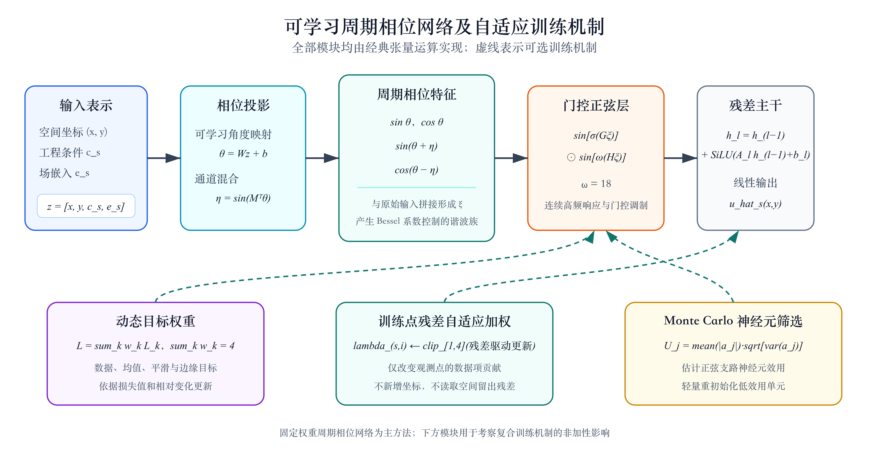
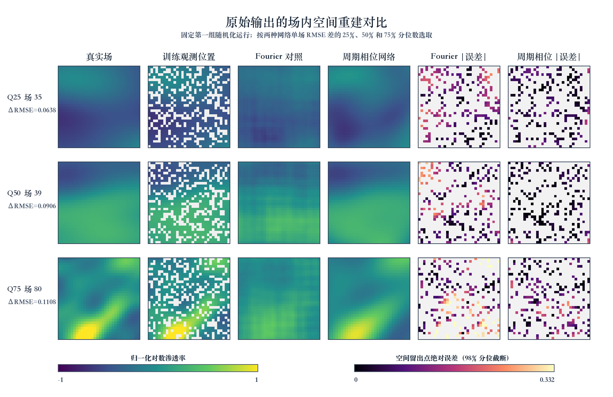

# 面向非均质渗透率场内空间补全的可学习周期相位网络

作者：【待补】
单位：【待补】
通讯作者及邮箱：【待补】

## 摘要

非均质渗透率场的空间补全是地下流动模拟与储层表征的重要基础。针对坐标网络易受频谱偏置影响、复合先验目标可能引发优化冲突的问题，本文提出一种完全运行于经典计算环境的可学习周期相位网络。该方法将空间坐标、工程条件与场级嵌入投影为相位变量，通过正弦—余弦响应、可学习相位耦合、门控正弦层和残差主干构造连续场表示，并进一步考察动态目标权重、训练点残差自适应加权与 Monte Carlo 神经元效用筛选。理论分析给出了相位耦合特征的精确 Bessel–Fourier 展开、特征有界性及 Lipschitz 上界，证明正动态权重不能保证数据误差单调下降，并以反例说明场均值先验不能推出局部 Darcy 守恒。在 128 个 \(32\times32\) 归一化对数渗透率场的场内空间留出实验中，周期相位网络未经后处理的 RMSE 为 \(0.0845\pm0.0014\)，Fourier 对照网络为 \(0.1741\pm0.0021\)；共享同一组场的五次独立随机化运行具有一致的配对差方向，平均差为 0.0896，运行级 Bootstrap 95% 区间为 \([0.0870,0.0918]\)。动态目标权重与其他模块的累积加入未产生单调增益，且训练终态表现出目标权重极化；残差加权仅在动态权重路径上形成有限恢复。现有结果支持两个完整架构方案在训练阶段已见场的空间补全任务中存在探索性差异，但由于对照网络与周期相位网络并非等骨干、等参数的单因素比较，且场均值先验标定使用了完整场统计量，本文不将该差异解释为相位编码的独立因果效应，也不外推为未知场泛化、量子加速或局部物理守恒。

**关键词：** 非均质渗透率；空间补全；隐式神经场；周期相位特征；多目标优化；残差自适应

## A Learnable Phase-Periodic Network for Within-Field Completion of Heterogeneous Permeability Fields

### Abstract

Spatial completion of heterogeneous permeability fields is fundamental to subsurface-flow simulation and reservoir characterization. To address spectral bias in coordinate networks and optimization conflicts induced by composite prior-guided objectives, this study develops a learnable phase-periodic network executed entirely on classical hardware. Spatial coordinates, engineering conditions, and field-specific embeddings are projected into phase variables; sinusoidal responses, trainable phase coupling, a gated sine layer, and a residual backbone then form a continuous field representation. Dynamic objective weighting, residual-adaptive point weighting, and Monte Carlo neuron-utility screening are further examined. Theoretical analysis establishes an exact Bessel–Fourier expansion of the coupled phase features, boundedness and a Lipschitz upper bound of the representation, a gradient-alignment condition showing that positive dynamic weights do not guarantee monotonic reduction of the data loss, and a counterexample proving that a field-mean prior does not imply local Darcy conservation. On a within-field spatial holdout task involving 128 normalized log-permeability fields on \(32\times32\) grids, the phase-periodic network achieves a raw RMSE of \(0.0845\pm0.0014\), whereas a Fourier coordinate network yields \(0.1741\pm0.0021\). Paired differences have the same direction across five independently randomized runs sharing the same fixed set of fields, with a mean difference of 0.0896 and a run-level Bootstrap 95% interval of \([0.0870,0.0918]\). Cumulative addition of the adaptive mechanisms does not produce monotonic gains and is accompanied by terminal objective-weight polarization; residual-adaptive weighting provides only limited recovery along the dynamic-weighting path. The current evidence supports exploratory differences between two complete architecture packages for within-field completion of training-seen fields. Because the comparison is not a parameter-matched single-factor ablation and the field-mean prior is calibrated with full-field statistics, the results are not interpreted as an isolated causal effect of phase encoding, unseen-field generalization, quantum acceleration, or local physical conservation.

**Keywords:** heterogeneous permeability; spatial completion; neural field; phase-periodic feature; multi-objective optimization; residual adaptation

## 1 引言

### 1.1 研究背景与意义

渗透率表征多孔介质传输流体的能力，其空间分布直接影响优势通道、压力传播、驱替前缘与储层连通性。受沉积环境、成岩演化及裂缝发育等过程共同作用，地下介质中的渗透率通常具有强非均质、多尺度和方向相关特征。地下流动模拟需要相对完整的参数场作为输入，而工程观测通常只存在于有限井位或采样位置，因而依据稀疏信息恢复未观测区域是储层表征与参数反演中的基础问题。

渗透率场补全本质上是欠定问题。不同空间分布可能在已观测位置具有近似相同的数值，却在未观测区域呈现显著不同的连通结构。逆距离加权和 Kriging 分别通过距离权重与协方差或变差函数传播观测信息，其结果取决于邻域及空间统计模型的设定[1–2]。数据驱动方法可以学习更复杂的非线性模式，但普通坐标网络往往优先拟合低频分量，对局部突变和细尺度结构产生平滑偏差[3–4]。Fourier 特征与周期激活能够扩展低维坐标网络的频率表示范围[3,5]，为非均质参数场的连续重建提供了新的函数表示基础。

物理信息神经网络将观测数据、控制方程和边界条件纳入统一目标，为稀疏观测条件下的科学机器学习提供了重要路径[6–7]。然而，严格的物理反演需要状态变量、控制方程、源汇项、物理尺度及边界条件完整可用；当训练目标仅包含场均值、平滑性或边缘统计时，其作用应界定为弱先验引导，而非局部偏微分方程约束。与此同时，不同损失分量可能出现梯度尺度与收敛速率失衡[8]。因此，渗透率场补全不仅需要比较预测误差，还应分析表示能力、目标权衡和物理解释之间的边界。

本文采用的周期相位表示受到量子数据编码所呈现 Fourier 型响应的形式启发[9]。这一联系只用于构造可学习相位投影、周期响应和通道耦合；模型不包含量子比特、变分量子线路、测量采样或量子硬件。研究的理论意义在于刻画相位耦合特征所形成的频率族及其稳定性，方法意义在于揭示周期表示与自适应优化机制的组合效应，应用意义在于为训练阶段已见非均质渗透率场的连续空间补全提供可复核的候选方案。

### 1.2 国内外研究现状

#### 1.2.1 物理信息学习与自适应优化

Raissi 等[6]以自动微分计算偏微分方程残差，建立了数据、方程与初边值条件联合优化的 PINN 框架；Karniadakis 等[7]进一步从数据与数学模型融合的角度系统总结了物理信息机器学习。针对 PINN 难以训练的问题，Wang 等[8]从梯度流病态出发说明不同损失分量可能具有不平衡的收敛速度，随后又利用神经切线核分析边界、初值与方程残差的收敛差异[10]。在此基础上，逐点可学习权重[11]、残差驱动采样[12]、残差注意机制[13]和梯度增强 PINN[14]分别从目标权重、样本位置和高阶残差信息等角度改善训练。

上述方法改变优化过程的方式并不相同。残差自适应采样调整配置点的空间分布，逐点注意或加权改变既有训练点的贡献，动态目标权重则重新分配数据项与各类约束项的相对强度。将这些机制统称为“自适应采样”会掩盖其数学对象与作用路径。更重要的是，多种机制的设计动机均为合理并不意味着其组合效果具有可加性；当目标梯度方向冲突、权重尺度发生极化或参数重初始化与优化器状态不一致时，模块叠加仍可能降低预测精度。

#### 1.2.2 周期坐标表示与隐式神经场

神经网络优先学习低频成分的现象通常被称为频谱偏置[4]。Tancik 等[3]将低维坐标映射到固定正弦—余弦基，使网络能够更有效地拟合高频函数；Sitzmann 等[5]使用周期激活构建隐式神经表示，增强了连续信号的细节表达。Xie 等[15]从条件变量、坐标映射、网络架构和前向过程等方面系统归纳了 neural field，为坐标条件连续表示提供了统一语境。

固定 Fourier 特征具有频率范围明确、实现稳定的优点，但频率集合需要预先选定。周期激活将振荡性引入隐藏层，其性能又与初始化、频率尺度和主干结构密切相关。对于同时包含局部突变、方向性和多尺度相关结构的渗透率场，单一预设频率集合未必适合所有样本。可学习相位投影允许网络依据坐标、工程条件和场级表示共同调整周期基，相位通道之间的非线性耦合还可形成整数谐波频率族。该设计属于经典隐式神经场的一种参数化方式，不能因其形式受到量子编码启发而等同于量子计算。

#### 1.2.3 地下流动与参数场重建

代表性地下介质研究已覆盖参数与本构关系估计、多物理数据同化及高维参数识别。Tartakovsky 等[16]利用 Darcy 方程和 Richards 方程，从稀疏观测中联合估计水头、导水率及非饱和本构关系；He 等[17]以独立网络表示导水率、水头和浓度，通过流动—输运方程开展多物理数据同化；Guo 等[18]则将 PINN 用于高维水力层析成像中的导水率反演。这些工作以控制方程、状态观测和边界信息共同定义地下流动反问题，其物理约束强度高于仅使用全局统计先验的空间补全。

中国学者主导或参与的代表性工作主要沿地下 PDE 求解与算子学习两条路径展开。GW-PINN 与非均质、裂缝多孔介质两相流 PINN 将控制方程残差用于地下流动状态求解[19–20]；地下油水两相流 FNO 与 Porous-DeepONet 分别学习参数化流动方程和反应输运方程的解算子[21–22]。前一类方法依赖明确的控制方程与边界条件，后一类方法面向跨实例函数映射，二者与本文的静态场内坐标补全具有不同的输入信息与泛化目标。

Rao 等[23]进一步构建含角度编码与参数化量子核心的量子—经典混合网络，并联合测量、PDE 与边界损失，已在单相储层数值算例中用于渗透率反演。与之相比，本文全部计算均为经典张量运算，量子启发只体现在周期相位表示形式；研究任务是训练阶段已见场的空间补全，现有训练也未启用局部 Darcy 残差。

#### 1.2.4 神经算子及任务边界

DeepONet 通过分支网络与主干网络学习输入函数到输出函数的非线性映射，并以算子通用逼近理论为基础[24]；FNO 在 Fourier 空间中参数化积分核，用于学习参数化偏微分方程的解算子[25]。Lu 等[26]在统一数据与多个基准上比较了 DeepONet 和 FNO，Wen 等[27]则将 U-FNO 用于非均质多孔介质中的多相流代理建模。地下两相流 FNO[21]与 Porous-DeepONet[22]进一步说明，神经算子已经能够服务于地下流动与多孔介质反应输运过程的快速模拟。

神经算子的目标是从多个问题实例学习函数空间之间的映射，并对未见输入函数进行推断。本文模型通过可学习场嵌入区分训练阶段已见样本，空间留出位置虽然不参与点值数据项，其所属场却已在训练过程中出现。因此，本文评价的是场内坐标补全而非未知场算子泛化。只有按完整场划分数据、移除直接场标识并建立稀疏观测编码器后，才适合与 DeepONet、FNO 或 U-FNO 进行同层级比较。

综合来看，现有研究分别从 PDE 约束、自适应优化、周期坐标表示、地质统计插值和函数空间学习等角度推进了空间场建模，但仍有四个问题需要在明确任务边界后检验：可学习相位耦合究竟形成何种频谱结构；周期相位完整架构与 Fourier 坐标网络的经验差异能否在独立随机化运行中保持一致；动态目标权重、残差加权与神经元筛选能否产生累积增益；全局弱先验的一致性是否必然伴随更低的空间补全误差。

### 1.3 研究内容与论文结构

本文围绕非均质渗透率场内空间补全开展理论、方法与实验研究。首先，将空间坐标、样本级工程条件和可学习场嵌入统一表示为坐标网络输入，严格区分训练阶段已见场内补全、未知场泛化和神经算子学习。其次，设计由角度投影、正弦—余弦响应、相位耦合、门控正弦层和残差主干组成的可学习周期相位网络，并以固定 Fourier 坐标网络作为直接对照。再次，从 Bessel–Fourier 展开、特征有界性、Lipschitz 连续性、多目标梯度对齐和 Darcy 平移不变性等角度分析方法的表示性质与解释边界。最后，在统一场内空间留出协议下比较六种模型配置，同时报告点值误差、全图结构相似性、弱先验偏差、参数规模与空间重建，并利用训练结束权重和逐场误差分布为自适应模块的非单调组合效果提供诊断性解释。

全文共四章。第一章说明研究背景与意义，梳理国内外物理信息学习、周期坐标表示、地下参数反演及神经算子研究，并界定本文任务。第二章介绍相关理论基础，给出本文模型、复合目标和自适应机制的设计及数学推导。第三章说明实验设置、评价方法和结果，分析预测性能、模块交互、后处理效应、参数规模与空间重建表现。第四章总结研究工作，讨论信息使用、因果识别、未知场泛化和物理有效性等局限，并提出后续研究方向。

## 2 理论基础与方法设计

### 2.1 相关理论基础

#### 2.1.1 渗透率场与场内空间补全

对单相不可压缩流动，Darcy 定律与质量守恒可写为[16]

\[
\mathbf q=-\frac{K}{\mu}\left(\nabla p-\rho\mathbf g\right),\qquad
\nabla\cdot\mathbf q=f_{\mathrm{src}},
\tag{1}
\]

其中 \(K\) 为渗透率，\(\mu\) 为黏度，\(p\) 为压力，\(f_{\mathrm{src}}\) 为源汇项。若忽略重力、令 \(f_{\mathrm{src}}=0\)，并假设黏度为空间常数，则有

\[
\nabla\cdot\left(K\nabla p\right)=0.
\tag{2}
\]

式（2）表明，局部 Darcy 守恒需要渗透率、压力、源汇及边界条件共同定义。本文数据只包含归一化对数渗透率场和样本级工程条件，不含逐点压力状态、源汇项与完整物理边界，故研究对象不是式（2）定义的严格 PDE 反演，而是场内空间补全。

设第 \(s\) 个归一化对数渗透率场为

\[
u_s:\Omega\rightarrow[-1,1],\qquad \Omega=[-1,1]^2,
\tag{3}
\]

工程条件为

\[
\mathbf c_s=[P_s,G_s,\mu_s,\varphi_s,Q_s]^\top,
\tag{4}
\]

其中 \(P_s\)、\(G_s\)、\(\mu_s\)、\(\varphi_s\) 和 \(Q_s\) 分别表示压力、压力梯度、黏度、孔隙度和流量。对同一训练阶段已见场，观测位置集合、验证位置集合与空间留出位置集合两两互斥。网络只在观测位置上构造点值数据项，以验证位置选择模型状态，并在空间留出位置评价 \(u_s\) 的恢复误差。

网络输入写为

\[
\mathbf z_{s,i}
=
[x_i,y_i,\widetilde{\mathbf c}_s^\top,\mathbf e_s^\top]^\top
\in\mathbb R^d,
\tag{5}
\]

其中 \(\widetilde{\mathbf c}_s\) 为标准化工程条件，\(\mathbf e_s\in\mathbb R^{24}\) 为可学习场嵌入。场嵌入使共享网络能够区分同一训练集合中的不同场，但也意味着评价范围仅限于这些训练阶段已见场中的未观测坐标。

#### 2.1.2 坐标型隐式表示与周期基

坐标型隐式表示以连续函数 \(f_{\boldsymbol\vartheta}(\mathbf z)\) 逼近 \(u_s(x,y)\)。若直接使用普通多层感知机，优化往往优先恢复低频成分。固定 Fourier 对照网络对二维坐标采用频率集合 \(\mathcal F=\{1,2,4,8\}\)[3]，构造

\[
\gamma(x,y)
=
\big[
\sin(\pi f x),\cos(\pi f x),
\sin(\pi f y),\cos(\pi f y)
\big]_{f\in\mathcal F},
\tag{6}
\]

并将 \(\gamma(x,y)\) 与原输入拼接后送入残差网络。该表示预先给定有限频率集合，频谱结构清晰，但不能随样本条件主动调整。

本文方法不直接预设空间频率，而是先由完整输入生成相位，再通过相位耦合形成谐波族。其理论问题包括：耦合通道实际包含哪些频率，特征是否有界，以及这种表示能否在输入扰动下保持连续。上述问题将在 2.2 节给出精确推导。

#### 2.1.3 弱先验引导的多目标学习

设数据拟合、场均值、空间平滑和边缘统计四项损失分别为
\(\mathcal L_d\)、\(\mathcal L_m\)、\(\mathcal L_s\) 和 \(\mathcal L_b\)，复合目标为

\[
\mathcal L(\boldsymbol\vartheta)
=
\sum_{k\in\{d,m,s,b\}}
w_k\mathcal L_k(\boldsymbol\vartheta),
\qquad w_k\ge0.
\tag{7}
\]

非负权重保证总目标仍是各损失的加权和，却不保证任一单项均沿参数更新方向下降。其原因在于不同目标的梯度可能具有不同尺度和方向。对本文任务而言，场均值、平滑性和边缘统计只提供低阶结构偏好，不能替代式（2）的局部守恒条件。因此，多目标学习需要同时分析优化方向与先验含义，而不能仅依据总损失下降推断点值误差或物理残差下降。

### 2.2 本文方法或模型设计

#### 2.2.1 可学习周期相位网络

令输入 \(\mathbf z\in\mathbb R^d\) 为列向量，首先生成 \(q=6\) 个相位角：

\[
\boldsymbol\theta=W\mathbf z+\mathbf b,\qquad
W\in\mathbb R^{q\times d},\quad
\mathbf b\in\mathbb R^q.
\tag{8}
\]

以可学习矩阵 \(M\in\mathbb R^{q\times q}\) 进行相位通道混合，其列向量形式为

\[
\boldsymbol\psi=M^\top\boldsymbol\theta,\qquad
\boldsymbol\eta=\sin\boldsymbol\psi.
\tag{9}
\]

周期相位特征定义为

\[
\boldsymbol\phi(\mathbf z)
=
\begin{bmatrix}
\sin\boldsymbol\theta\\
\cos\boldsymbol\theta\\
\sin(\boldsymbol\theta+\boldsymbol\eta)\\
\cos(\boldsymbol\theta-\boldsymbol\eta)
\end{bmatrix}
\in\mathbb R^{4q}.
\tag{10}
\]

令 \(\boldsymbol\xi=[\mathbf z^\top,\boldsymbol\phi(\mathbf z)^\top]^\top\)。门控正弦首层为

\[
\mathbf h_0
=
\sin\!\left[\sigma(G\boldsymbol\xi+\mathbf b_g)\right]
\odot
\sin\!\left[\omega(H\boldsymbol\xi+\mathbf b_h)\right],
\qquad \omega=18,
\tag{11}
\]

其中 \(\sigma\) 为 Sigmoid，\(\odot\) 表示逐元素乘积。后续残差更新及输出为

\[
\mathbf h_\ell
=
\mathbf h_{\ell-1}
+\operatorname{SiLU}(A_\ell\mathbf h_{\ell-1}+\mathbf b_\ell),
\qquad
\widehat u=\mathbf w_o^\top\mathbf h_L+b_o.
\tag{12}
\]

其中 \(\mathbf w_o\) 与 \(b_o\) 分别为线性输出层的权重和偏置。式（8）—（12）均由标准经典张量运算实现。“相位”和“耦合”描述的是特征构造形式，不表示量子态演化或量子纠缠。模型整体结构及可选训练机制见图 1。

**图 1　可学习周期相位网络及自适应训练机制。** 固定权重周期相位网络构成主预测路径；动态目标权重、RBA 与 MC 筛选作为可选训练机制分别作用于目标尺度、观测点贡献与正弦支路神经元状态。图中全部运算均为经典张量运算。

#### 2.2.2 相位耦合特征的精确频谱展开

记 \(W\) 的第 \(k\) 行为 \(\mathbf w_k^\top\)，\(M\) 的第 \(k\) 列为 \(\mathbf m_k\)，并令

\[
\boldsymbol\nu_k=W^\top\mathbf m_k,\qquad
\beta_k=\mathbf m_k^\top\mathbf b.
\tag{13}
\]

于是

\[
\theta_k=\mathbf w_k^\top\mathbf z+b_k,\qquad
\psi_k=\boldsymbol\nu_k^\top\mathbf z+\beta_k.
\tag{14}
\]

**命题 1　相位耦合通道的 Bessel–Fourier 展开。** 对任意 \(k\)，有

\[
\sin(\theta_k+\sin\psi_k)
=
\sum_{n=-\infty}^{\infty}
J_n(1)
\sin\!\left[
(\mathbf w_k+n\boldsymbol\nu_k)^\top\mathbf z
+b_k+n\beta_k
\right],
\tag{15}
\]

\[
\cos(\theta_k-\sin\psi_k)
=
\sum_{n=-\infty}^{\infty}
J_n(1)
\cos\!\left[
(\mathbf w_k-n\boldsymbol\nu_k)^\top\mathbf z
+b_k-n\beta_k
\right],
\tag{16}
\]

其中 \(J_n\) 为第一类整数阶 Bessel 函数。

**证明。** Jacobi–Anger 恒等式[28]给出

\[
\exp(i\sin\psi)
=
\sum_{n=-\infty}^{\infty}J_n(1)\exp(in\psi).
\tag{17}
\]

将式（17）乘以 \(\exp(i\theta_k)\) 并取虚部，即得式（15）。对
\(\exp[-i\sin\psi]\) 作同样处理并取实部，即得式（16）。对 \(n\ge0\)，由 Bessel 函数的幂级数可得

\[
|J_n(1)|
\le
e^{1/4}\frac{2^{-n}}{n!}.
\tag{18}
\]

因此级数绝对且一致收敛；截断到 \(|n|\le N\) 时，任一标量通道的余项满足

\[
|R_N|
\le
2e^{1/4}
\sum_{n=N+1}^{\infty}\frac{2^{-n}}{n!}.
\tag{19}
\]

证毕。

命题 1 说明，可学习混合矩阵并非简单增加一个正弦非线性，而是围绕基础频率 \(\mathbf w_k\) 生成沿 \(\boldsymbol\nu_k\) 方向的整数谐波族，高阶分量的幅度由 \(J_n(1)\) 快速衰减。该结论刻画的是表示结构，不意味着无限有效带宽、优化必然收敛、预测必然改善或存在量子加速。

#### 2.2.3 特征有界性与输入稳定性

**命题 2　周期相位特征的有界性。** 对任意输入 \(\mathbf z\)，

\[
\|\boldsymbol\phi(\mathbf z)\|_\infty\le1,\qquad
\|\boldsymbol\phi(\mathbf z)\|_2\le\sqrt{3q}.
\tag{20}
\]

当 \(q=6\) 时，
\(\|\boldsymbol\phi(\mathbf z)\|_2\le\sqrt{18}\)。

**证明。** 式（10）的每个分量均为正弦或余弦，故无穷范数不超过 1。前两个特征块满足

\[
\sum_{k=1}^{q}
\left(\sin^2\theta_k+\cos^2\theta_k\right)=q,
\tag{21}
\]

其余两个特征块的平方和分别不超过 \(q\)，因而总平方范数不超过 \(3q\)。证毕。

**命题 3　周期相位映射的 Lipschitz 上界。** 记 \(J_{\phi}\) 为
\(\boldsymbol\phi\) 对 \(\mathbf z\) 的 Jacobian，则

\[
\|J_{\phi}(\mathbf z)\|_2
\le
\|W\|_2
\sqrt{1+2(1+\|M\|_2)^2}
=:L_{\phi}.
\tag{22}
\]

因此，对任意 \(\mathbf z_1,\mathbf z_2\)，

\[
\|\boldsymbol\phi(\mathbf z_1)-\boldsymbol\phi(\mathbf z_2)\|_2
\le
L_{\phi}\|\mathbf z_1-\mathbf z_2\|_2.
\tag{23}
\]

**证明。** 由式（9）有

\[
J_{\eta}
=
D_{\cos(M^\top\boldsymbol\theta)}M^\top W,
\qquad
\|J_\eta\|_2\le\|M\|_2\|W\|_2,
\tag{24}
\]

其中 \(D_{\mathbf v}\) 表示以 \(\mathbf v\) 为对角元的对角矩阵。式（10）四个特征块的 Jacobian 分别为

\[
D_{\cos\theta}W,\quad
-D_{\sin\theta}W,\quad
D_{\cos(\theta+\eta)}(W+J_\eta),\quad
-D_{\sin(\theta-\eta)}(W-J_\eta).
\tag{25}
\]

对任意向量 \(\mathbf v\)，前两个块满足

\[
\|D_{\cos\theta}W\mathbf v\|_2^2
+\|D_{\sin\theta}W\mathbf v\|_2^2
=\|W\mathbf v\|_2^2,
\tag{26}
\]

其余两块分别不超过
\((1+\|M\|_2)^2\|W\|_2^2\|\mathbf v\|_2^2\)。
将三项平方上界相加即得式（22），再由均值定理得到式（23）。证毕。

进一步，拼接特征 \(\boldsymbol\xi=[\mathbf z;\boldsymbol\phi(\mathbf z)]\) 满足

\[
L_{\xi}\le\sqrt{1+L_{\phi}^2}.
\tag{27}
\]

若记 \(C_{\mathrm{SiLU}}=1+e^{-1}\) 为 SiLU 导数的一个全局上界，则固定网络参数后的输出函数可取 Lipschitz 上界

\[
L_{\widehat u}
\le
\|\mathbf w_o\|_2
\prod_{\ell=1}^{L}
\left(1+C_{\mathrm{SiLU}}\|A_\ell\|_2\right)
\left(
\frac14\|G\|_2+\omega\sin(1)\|H\|_2
\right)
\sqrt{1+L_{\phi}^2}.
\tag{28}
\]

式（28）表明，周期特征本身有界且对输入连续，但完整网络的稳定常数仍受训练后权重谱范数控制。本文未对 \(\|W\|_2\)、\(\|M\|_2\) 或残差层谱范数施加硬约束，故不能将式（28）解释为与参数无关的统一鲁棒性保证。

#### 2.2.4 弱先验目标与自适应机制

训练点数据项写为

\[
\mathcal L_d
=
\frac{
\sum_{s,i\in\mathcal O_s}
\lambda_{s,i}
(\widehat u_{s,i}-u_{s,i})^2
}{
\sum_{s,i\in\mathcal O_s}\lambda_{s,i}+\varepsilon
},
\tag{29}
\]

其中 \(\mathcal O_s\) 为观测位置集合。工程条件先验指数定义为

\[
\zeta_s
=
\log\frac{Q_s}{Q_0}
+\log\frac{\mu_s}{\mu_0}
-\log\frac{G_s}{G_0}
+2.8\frac{\varphi_s-\varphi_0}{\varphi_0}
-\chi(P_s-P_0),
\tag{30}
\]

其中下标 0 表示参考工况，\(\chi=0.015\ {\rm MPa}^{-1}\)。再经线性标定得到期望场均值 \(m_s=a\zeta_s+b\)。本组实验使用完整真实场均值拟合 \(a\) 与 \(b\)，因此空间留出区域的场级统计信息间接进入训练目标；其有效性限制见 4.2 节。相应弱先验项为

\[
\mathcal L_m
=
\frac1B\sum_{s=1}^{B}
\left(\overline{\widehat u}_s-m_s\right)^2.
\tag{31}
\]

空间平滑项与边缘统计项分别为

\[
\mathcal L_s
=
\operatorname{mean}\!\left[(\Delta_x\widehat u)^2\right]
+\operatorname{mean}\!\left[(\Delta_y\widehat u)^2\right],
\tag{32}
\]

\[
\mathcal L_b
=
\frac1B\sum_{s=1}^{B}
\left[
(\overline{\widehat u}_{s,\mathrm{left}}-\overline{\widehat u}_{s,\mathrm{right}})^2
+(\overline{\widehat u}_{s,\mathrm{top}}-\overline{\widehat u}_{s,\mathrm{bottom}})^2
\right].
\tag{33}
\]

式（32）的均值遍历批内场及相应水平或垂直相邻网格差分；式（33）中的边缘上划线表示单个场在指定边缘上的空间均值。下文所有数值稳定项统一取 \(\varepsilon=10^{-8}\)。

固定权重配置采用

\[
(w_d,w_m,w_s,w_b)=(1,0.1,0.002,0.001).
\tag{34}
\]

动态目标权重配置为四个目标维护概率幅值。令 \(p_{k,t}=a_{k,t}^2\)，并将第 \(t\) 次权重更新所读取的末批损失记作 \(\mathcal L_{k,t}\)，则损失分数与概率分配为

\[
s_{k,t}
=
\frac{1}{\mathcal L_{k,t}+\varepsilon}
+
\operatorname{clip}\!\left(
\frac{\mathcal L_{k,t-1}-\mathcal L_{k,t}}
{|\mathcal L_{k,t-1}|+\varepsilon},
-0.5,0.5
\right),
\qquad
\rho_{k,t}
=
\frac{e^{s_{k,t}}}{\sum_j e^{s_{j,t}}},
\tag{35}
\]

首次更新只使用损失倒数项。概率幅值更新等价于

\[
p_{k,t+1}=0.70p_{k,t}+0.30\rho_{k,t},\qquad
w_{k,t}=4p_{k,t}.
\tag{36}
\]

因此

\[
w_{k,t}>0,\qquad
\sum_{k=1}^{4}w_{k,t}=4.
\tag{37}
\]

若初始 \(w_{k,0}=1\)，则

\[
0.70^t\le w_{k,t}\le4-3(0.70)^t.
\tag{38}
\]

动态权重直接替代式（34），而不是在固定尺度附近作小幅校正。

训练点残差自适应加权根据
\(r_{s,i}=|\widehat u_{s,i}-u_{s,i}|\) 更新。记
\(\bar r_s=|\mathcal O_s|^{-1}\sum_{i\in\mathcal O_s}r_{s,i}\) 为第 \(s\) 个场在观测掩码内的平均绝对残差，则

\[
\widetilde\lambda_{s,i}
=
1+\alpha
\frac{r_{s,i}}
{\bar r_s+\varepsilon}
+\delta_{s,i},
\tag{39}
\]

\[
\lambda_{s,i}^{(t+1)}
=
\Pi_{[1,W_{\max}]}
\left[
\beta\lambda_{s,i}^{(t)}
+(1-\beta)\widetilde\lambda_{s,i}
\right],
\tag{40}
\]

其中 \(\alpha=0.20\)、\(\beta=0.70\)、\(W_{\max}=4\)，
\(\delta_{s,i}\ge0\) 表示稠密高残差区域的附加强度。该机制不新增或替换坐标，其准确含义是“训练点残差自适应空间加权”。

**命题 4　RBA 权重及加权误差的有界性。** 若
\(\lambda_{s,i}^{(0)}=1\)，则任意更新后均有

\[
1\le\lambda_{s,i}^{(t)}\le4.
\tag{41}
\]

若同一掩码内共有 \(N\) 个训练点，未加权均方误差为
\(\operatorname{MSE}=N^{-1}\sum_i e_i^2\)，则

\[
\frac{N}{4N+\varepsilon}\operatorname{MSE}
\le
\mathcal L_{\mathrm{RBA}}
\le
\frac{4N}{N+\varepsilon}\operatorname{MSE}.
\tag{42}
\]

**证明。** 因 \(\alpha,\delta_{s,i}\ge0\)，有
\(\widetilde\lambda_{s,i}\ge1\)。若
\(\lambda_{s,i}^{(t)}\ge1\)，则式（40）投影前的凸组合不小于 1，投影后又不超过 4，由数学归纳法得到式（41）。式（42）的下界由分子不小于 \(\sum_i e_i^2\)、分母不大于 \(4N+\varepsilon\) 得到；上界由分子不大于 \(4\sum_i e_i^2\)、分母不小于 \(N+\varepsilon\) 得到。证毕。

Monte Carlo 神经元筛选针对门控乘积之前的正弦支路进行诊断。设 \(a_{n,j}^{(t)}\) 为第 \(t\) 个估计批次中样本点 \(n\) 在正弦首层第 \(j\) 个神经元上的激活，则

\[
U_j
=
\frac1T\sum_{t=1}^{T}
\left[
\operatorname{mean}_{n}\!\left|a_{n,j}^{(t)}\right|
\sqrt{\operatorname{Var}_{n}\!\left(a_{n,j}^{(t)}\right)+\varepsilon}
\right]
\tag{43}
\]

衡量神经元效用。本文取 \(T=4\)，方差按批内总体方差计算，并对效用低于第 5 百分位的单元进行轻量重初始化。该操作不改变模型宽度与参数量，但会改变参数轨迹；若优化器动量未同步重置，参数状态与动量状态还可能出现不一致。

#### 2.2.5 多目标优化条件与物理解释边界

令 \(\mathbf g_k=\nabla_{\boldsymbol\vartheta}\mathcal L_k\)。动态权重在单个参数更新步内视为冻结量，不对权重更新规则反向传播，则总更新梯度为

\[
\mathbf g=\sum_k w_k\mathbf g_k.
\tag{44}
\]

**命题 5　数据损失下降的梯度对齐条件。** 假设
\(\mathcal L_d\) 的梯度为 \(L_d\)-Lipschitz，对梯度步

\[
\boldsymbol\vartheta^+
=
\boldsymbol\vartheta-\gamma\mathbf g
\tag{45}
\]

定义

\[
A
=
\langle\mathbf g_d,\mathbf g\rangle
=
w_d\|\mathbf g_d\|_2^2
+\sum_{k\ne d}w_k
\langle\mathbf g_d,\mathbf g_k\rangle.
\tag{46}
\]

若 \(A>0\) 且

\[
0<\gamma<
\frac{2A}{L_d\|\mathbf g\|_2^2},
\tag{47}
\]

则数据损失严格下降；若 \(A<0\) 且

\[
0<\gamma<
\frac{-2A}{L_d\|\mathbf g\|_2^2},
\tag{48}
\]

则数据损失严格上升。

**证明。** 由 \(L_d\)-光滑函数的二阶余项界，

\[
\left|
\mathcal L_d(\boldsymbol\vartheta-\gamma\mathbf g)
-\mathcal L_d(\boldsymbol\vartheta)
+\gamma\langle\mathbf g_d,\mathbf g\rangle
\right|
\le
\frac{L_d\gamma^2}{2}\|\mathbf g\|_2^2.
\tag{49}
\]

分别使用式（49）的上界与下界即可得到式（47）和式（48）。证毕。

式（46）也可写为

\[
A
=
w_d\|\mathbf g_d\|_2^2
+\|\mathbf g_d\|_2
\sum_{k\ne d}
w_k\|\mathbf g_k\|_2\cos\alpha_{dk}.
\tag{50}
\]

因此，所有目标权重为正并不能保证 \(A>0\)。上述动态权重只利用损失值及相对变化率，不测量梯度夹角，故不能保证数据项单调下降。实际训练使用 AdamW、动量、梯度裁剪与预条件时，应将 \(\mathbf g\) 替换为实际更新方向；一阶判据仍取决于数据梯度与更新方向的内积。

最后考察场均值先验与 Darcy 守恒的关系。本文采用的 Darcy 诊断将归一化对数渗透率场 \(U\) 映射为无量纲相对渗透率

\[
\kappa(U)
=
\exp\!\left[
\operatorname{clip}(U-\overline U,-6,6)
\right].
\tag{51}
\]

对任意常数 \(c\)，有

\[
\kappa(U+c\mathbf 1)=\kappa(U),
\tag{52}
\]

而

\[
\overline{U+c\mathbf 1}=\overline U+c.
\tag{53}
\]

故总可以取 \(c=m-\overline U\) 使场均值损失为零，同时保持由 \(\kappa(U)\) 计算的 Darcy 残差不变。这已说明 \(\mathcal L_m=0\) 不能推出局部守恒。更具体地，在
\(\Omega_0=[0,1]^2\) 上取

\[
u(x,y)=m+a\left(x-\frac12\right),\qquad
p(x,y)=1-x,
\tag{54}
\]

其中 \(|m|<1\) 且 \(0<|a|\le2(1-|m|)\)，从而 \(u\in[-1,1]\) 且裁剪不生效。此时 \(\bar u=m\)，并有

\[
\kappa=e^{a(x-1/2)},\qquad
\nabla\cdot(\kappa\nabla p)
=
-a e^{a(x-1/2)}
\ne0.
\tag{55}
\]

函数 \(p\) 同时满足左右定值及上下无流边界形式。

式（54）—（55）构成显式反例：场均值先验可被严格满足，局部 Darcy 方程仍不成立。因此，本文实验中的场均值先验偏差只能解释为全局统计一致性，不能命名为局部物理残差。

### 2.3 本章小结

本章首先从 Darcy 定律出发界定了严格地下流动反演与场内空间补全的差异，随后给出本文周期相位网络、弱先验目标和三类自适应机制。理论推导表明，相位耦合通道能够形成 Bessel 系数控制的整数谐波频率族；周期特征有界并具有由 \(W\) 与 \(M\) 谱范数控制的 Lipschitz 上界；RBA 逐点权重被限制在有限区间，但动态目标权重与逐点权重均不提供预测误差下降保证；场均值约束不蕴含局部 Darcy 守恒，且在式（51）的相对渗透率映射下二者对常数平移解耦。这些结论为第三章解释完整架构差异、自适应模块负结果和弱先验权衡提供了理论依据，同时避免把表示能力误写为性能定理。

## 3 实验与结果分析

### 3.1 实验设置

#### 3.1.1 数据与评价协议

实验数据包含 128 个 \(32\times32\) 归一化对数渗透率合成场，数据来源类别均标记为 GAN。每个场附带压力、压力梯度、黏度、孔隙度和流量五维工程条件。场值范围为 \([-1,1]\)，工程条件经标准化后输入网络。各场的观测、验证与空间留出位置两两互斥并完整覆盖网格：观测位置进入点值数据项，验证位置用于模型状态选择，空间留出位置用于最终点值评价。需要指出的是，式（30）的线性标定使用了完整真实场均值，因而空间留出标签虽未直接进入点值损失，仍以场级统计量形式间接参与训练。由于同一批场及其可学习嵌入参与训练，本文将该协议称为“场内空间留出”，不称为独立场测试或未知场泛化。

五维工程条件的描述统计见表 1。

**表 1　工程条件统计（128 个场）**

| 工程条件 | 单位 | 均值 | 标准差 | 最小值 | 最大值 |
|---|---|---:|---:|---:|---:|
| 压力 | MPa | 30.1751 | 4.9193 | 19.7594 | 41.8335 |
| 压力梯度 | MPa·m\(^{-1}\) | 0.0120 | 0.0017 | 0.0065 | 0.0166 |
| 黏度 | cP | 1.0130 | 0.1450 | 0.6792 | 1.3856 |
| 孔隙度 | — | 0.2210 | 0.0178 | 0.1727 | 0.2689 |
| 流量 | m\(^3\)·d\(^{-1}\) | 119.1079 | 18.5368 | 69.0806 | 167.9973 |

#### 3.1.2 对比模型与训练参数

实验比较六种配置。Fourier 对照网络采用固定 Fourier 坐标特征、LayerNorm 和 SiLU 残差块；周期相位网络对应式（8）—（12）；其余配置在同一周期相位主干上累积加入动态目标权重、RBA 和 MC 筛选。六种配置均在经典计算环境中运行，训练目标不含局部 PDE 残差，网络结构不含量子线路。组件关系见表 2。

**表 2　模型组件与参数规模**

| 模型 | 固定 Fourier | 周期相位架构 | 动态目标权重 | RBA | MC 筛选 | 参数量 |
|---|:---:|:---:|:---:|:---:|:---:|---:|
| Fourier 对照网络 | ✓ | — | — | — | — | 142977 |
| 周期相位网络 | — | ✓ | — | — | — | 67301 |
| 周期相位 + 动态权重 | — | ✓ | ✓ | — | — | 67301 |
| 周期相位 + 动态权重 + MC | — | ✓ | ✓ | — | ✓ | 67301 |
| 周期相位 + 动态权重 + RBA | — | ✓ | ✓ | ✓ | — | 67301 |
| 周期相位 + 动态权重 + RBA + MC | — | ✓ | ✓ | ✓ | ✓ | 67301 |

Fourier 对照与周期相位网络既不等参数，也不共享相同主干：前者的深度参数对应 4 个双线性层残差块，后者对应正弦首层后的 3 个 Linear–SiLU 残差更新。因此，两者构成完整架构方案比较，而不是相位特征的单因素消融。训练采用 AdamW、余弦退火和梯度裁剪；所有配置均以式（34）的固定权重验证损失选择模型状态，即使训练阶段采用动态权重也不改变验证准则。本实验的训练目标不包含 Darcy 方程残差。影响模型容量和优化过程的主要设置列于表 3。

**表 3　主要训练参数**

| 参数 | 设置 | 参数 | 设置 |
|---|---:|---|---:|
| 独立随机化运行 | 5 | 训练周期 | 40 |
| 批量大小 | 8 | 隐藏维度 | 128 |
| 深度参数 | 4 | 场嵌入维度 | 24 |
| 学习率 | 0.001 | AdamW 权重衰减 | \(10^{-5}\) |
| 相位通道数 | 6 | 正弦频率系数 | 18 |
| MC 估计批次数 | 4 | 梯度范数上限 | 1.0 |
| RBA 逐点权重更新 | 每个训练周期 | 稠密区域增强间隔 | 5 个训练周期 |
| RBA 权重上限 | 4.0 | 模型选择准则 | 固定权重验证损失，见式（34） |
| Darcy 方程残差 | 不纳入训练目标 | MC 筛选范围 | 训练前半程 |

#### 3.1.3 评价指标与统计方法

主评价对象是网络未经空间后处理的原始输出。设空间留出位置总数为 \(N_{\mathrm h}\)，真实值和预测值分别为 \(u_i\) 与 \(\widehat u_i\)，则

\[
\operatorname{RMSE}
=
\sqrt{\frac1{N_{\mathrm h}}\sum_i(\widehat u_i-u_i)^2},
\qquad
\operatorname{MAE}
=
\frac1{N_{\mathrm h}}\sum_i|\widehat u_i-u_i|,
\tag{56}
\]

\[
R^2
=
1-
\frac{\sum_i(\widehat u_i-u_i)^2}
{\sum_i(u_i-\bar u_{\mathrm h})^2+10^{-8}},
\tag{57}
\]

其中 \(\bar u_{\mathrm h}=N_{\mathrm h}^{-1}\sum_i u_i\) 为全部空间留出点的池化均值。参照结构相似性的亮度、对比度与结构统计形式[29]，本文对第 \(s\) 个完整预测场定义单窗口全图结构相似性

\[
S_{g,s}
=
\frac{
\left(2\mu_{u,s}\mu_{\widehat u,s}+C_1\right)
\!\left(2\sigma_{u\widehat u,s}+C_2\right)
}{
\left(\mu_{u,s}^2+\mu_{\widehat u,s}^2+C_1\right)
\!\left(\sigma_{u,s}^2+\sigma_{\widehat u,s}^2+C_2\right)
},
\qquad
S_g=\frac1S\sum_{s=1}^{S}S_{g,s},
\tag{58}
\]

其中 \(\mu\)、\(\sigma^2\) 和 \(\sigma_{u\widehat u}\) 分别为整幅图上的总体均值、总体方差和总体协方差。本文固定取 \(C_1=0.01^2\)、\(C_2=0.03^2\)，不随单个场的动态范围重新缩放。该量不是标准滑窗 SSIM，故记为 \(S_g\)。场均值先验偏差定义为

\[
E_m
=
\frac1S\sum_{s=1}^{S}
|\overline{\widehat u}_s-m_s|.
\tag{59}
\]

\(E_m\) 越低表示输出均值越接近式（30）—（31）的经验先验，但不表示局部 Darcy 残差越低。

五次独立随机化运行共享同一组 128 个场，但采用不同的空间掩码、参数初始化与训练随机路径。聚合结果以五次运行的均值与样本标准差表示，表 4 的 RMSE 区间为运行均值的 Student-\(t\) 95% 置信区间。Fourier 对照与平均 RMSE 最低的候选架构之间另报告运行级配对差及 Bootstrap 区间。上述区间仅刻画固定数据集上的运行随机性，不包含从地质场总体重新抽样所产生的数据不确定性。由于候选架构由同一批结果事后选择，Wilcoxon 单侧 \(p=0.03125\) 仅作为未校正探索性统计量，不据此使用“统计显著优于”的表述。逐场结果用于描述误差分布和配对胜率，128 个场及 640 个场—运行组合均不被当作相互独立的主推断单位。

### 3.2 实验结果与分析

#### 3.2.1 原始输出的总体性能

表 4 汇总六种配置的原始输出结果。RMSE、MAE 与 \(R^2\) 仅基于空间留出点计算，\(S_g\) 与 \(E_m\) 则基于完整预测场计算。

**表 4　原始场内空间留出结果（均值±标准差，5 次独立随机化运行）**

| 模型 | RMSE | RMSE 的 Student-\(t\) 95% CI | MAE | \(R^2\) | \(S_g\) | \(E_m\) |
|---|---:|---:|---:|---:|---:|---:|
| Fourier 对照网络 | 0.1741±0.0021 | [0.1715, 0.1767] | 0.1317±0.0014 | 0.7237±0.0058 | 0.6866±0.0122 | 0.1228±0.0003 |
| 周期相位网络 | **0.0845±0.0014** | **[0.0827, 0.0862]** | **0.0591±0.0009** | **0.9349±0.0025** | **0.9384±0.0028** | 0.1209±0.0001 |
| 周期相位 + 动态权重 | 0.2309±0.0040 | [0.2259, 0.2358] | 0.1809±0.0034 | 0.5141±0.0168 | 0.3296±0.0109 | 0.0600±0.0016 |
| 周期相位 + 动态权重 + MC | 0.2553±0.0048 | [0.2494, 0.2613] | 0.2020±0.0035 | 0.4055±0.0253 | 0.1546±0.0133 | **0.0339±0.0030** |
| 周期相位 + 动态权重 + RBA | 0.2284±0.0015 | [0.2266, 0.2303] | 0.1794±0.0010 | 0.5245±0.0033 | 0.3483±0.0217 | 0.0627±0.0036 |
| 周期相位 + 动态权重 + RBA + MC | 0.2477±0.0041 | [0.2426, 0.2528] | 0.1966±0.0034 | 0.4406±0.0212 | 0.1852±0.0291 | 0.0395±0.0035 |

周期相位网络在 RMSE、MAE、\(R^2\) 与 \(S_g\) 四项预测指标上取得最低或最高均值。相较 Fourier 对照，其平均 RMSE 数值低 0.0896，相对差为 51.47%；MAE 由 0.1317 降至 0.0591，\(R^2\) 由 0.7237 提高至 0.9349，\(S_g\) 由 0.6866 提高至 0.9384。两者的场均值先验偏差接近，说明主要差异出现在点值恢复与全图结构统计，而非全局均值先验。

五次独立随机化运行中，Fourier 对照 RMSE 减去周期相位网络 RMSE 的差值范围为 0.0851—0.0925，方向全部一致；平均配对差为 0.0896，运行级 Bootstrap 95% 区间为 \([0.0870,0.0918]\)。该结果表明上述架构排序不是由单次运行驱动，但区间未校正事后选模，且两种架构同时改变编码、激活、归一化、残差块形式和参数量，故不能把 51.47% 的差异单独归因于相位耦合。

#### 3.2.2 逐场误差分布

仅比较全局 RMSE 可能掩盖模型在不同场上的误差异质性。表 5 因而汇总 640 个场—运行组合的单场 RMSE 分布，并计算各配置相对同一运行、同一场 Fourier 对照的配对胜率。这些组合共享场与模型参数，只用于描述，不用于扩大统计样本量。

**表 5　单场 RMSE 分布与配对胜率**

| 模型 | 中位数 | 四分位区间 | 90% 分位数 | 相对 Fourier 对照胜率 |
|---|---:|---:|---:|---:|
| Fourier 对照网络 | 0.1519 | [0.1225, 0.2001] | 0.2458 | — |
| 周期相位网络 | **0.0611** | **[0.0468, 0.0869]** | **0.1407** | **100.00%** |
| 周期相位 + 动态权重 | 0.2229 | [0.1717, 0.2643] | 0.3049 | 11.72% |
| 周期相位 + 动态权重 + MC | 0.2413 | [0.1906, 0.3004] | 0.3378 | 8.13% |
| 周期相位 + 动态权重 + RBA | 0.2201 | [0.1669, 0.2645] | 0.3023 | 15.16% |
| 周期相位 + 动态权重 + RBA + MC | 0.2332 | [0.1841, 0.2884] | 0.3299 | 11.09% |

周期相位网络在全部 640 个配对场—运行组合上均取得更低单场 RMSE。进一步先对每个场跨随机化运行求平均，该模型在 128 个场上的平均 RMSE 也全部低于 Fourier 对照；场级平均差的中位数为 0.0849，四分位区间为 [0.0661, 0.1075]。这一结果加强了“完整架构方案差异具有广泛场覆盖”的描述，但仍不改变场内评价与架构混杂的限制。

#### 3.2.3 自适应模块的累积效应与权重极化

以不含自适应模块的周期相位网络为参照，累积加入动态权重、动态权重 + MC、动态权重 + RBA 以及三者完整组合后，平均原始 RMSE 分别高 173.26%、202.21%、170.36% 和 193.17%。在已启用动态目标权重的路径内，RBA 使全局 RMSE 数值降低 1.06%，MC 与完整组合则分别提高 10.60% 和 7.29%。逐场层面，RBA 相对仅使用动态权重的配置在 385/640 个场—运行组合上误差更低，说明其产生了局部恢复，但恢复幅度不足以抵消动态目标权重相对固定权重模型造成的整体差距。

训练历史进一步揭示了动态目标的权重极化。表 6 给出训练结束后更新状态的主导目标与数据项权重；“主导次数”表示五次独立随机化运行中权重接近 4 的目标。该权重状态未再参与后续参数更新，也不一定对应验证准则选中的模型状态，因此表中不与预测指标并列，仅作为优化轨迹诊断。

**表 6　动态目标权重的训练结束状态**

| 模型 | 主导目标 | 主导次数 | 数据项权重 |
|---|---|---:|---:|
| 周期相位 + 动态权重 | 平滑项 | 5/5 | \(6.37\times10^{-7}\) |
| 周期相位 + 动态权重 + MC | 平滑项；均值项 | 4/5；1/5 | \(6.37\times10^{-7}\) |
| 周期相位 + 动态权重 + RBA | 平滑项 | 5/5 | \(6.37\times10^{-7}\) |
| 周期相位 + 动态权重 + RBA + MC | 平滑项 | 5/5 | \(6.37\times10^{-7}\) |

四个动态配置的数据项权重均衰减到式（38）在 \(t=40\) 时的下界量级，20 个运行的训练结束状态中有 19 个由平滑项主导，另 1 个由均值项主导。该现象与式（35）—（36）一致：损失倒数进入 softmax 后，数值较小的目标可能获得接近全部权重，使数据项即使保持正值也几乎失去影响。命题 5 又表明，正权重本身不能保证数据梯度与实际更新方向对齐。二者共同给出一个与观测结果相容的解释：动态机制优化了全局先验或平滑目标，却牺牲了点值拟合。由于实验没有记录梯度夹角，这一解释仍是机制证据而非因果证明。

RBA 在训练结束状态下的逐点权重并未接近上限。动态权重 + RBA 配置的权重均值、95% 分位数和最大值分别为 \(1.2143\pm0.0001\)、\(1.5232\pm0.0008\) 和 \(2.1340\pm0.0424\)；完整组合对应为 \(1.2146\pm0.0004\)、\(1.5174\pm0.0014\) 和 \(2.1764\pm0.0451\)。这说明 RBA 确实重新分配了训练点强度，但没有饱和到上限 4。上述负结果更直接地伴随目标级权重极化，而不能简单归结为逐点权重过大。

MC 配置在每次独立随机化运行中累计执行 140 次神经元级轻量重初始化，但其 RMSE 未低于对应的动态权重路径。现有配置缺少 MC-only、RBA-only、优化器状态同步重置和完整正交消融，因而只能否定“模块累积必然产生单调增益”，不能推出 MC 或 RBA 在其他目标尺度、训练预算或任务中普遍无效。

#### 3.2.4 IDW 残差校正的诊断性次分析

实验还考察了利用观测位置残差进行 IDW 校正[1]的结果，见表 7。校正使用 8 个近邻、距离幂指数 2 和强度系数 0.95。六种模型的校正 RMSE 均低于原始输出，且六模型平均 RMSE 的极差由 0.17085 压缩至 0.01142。周期相位网络仍具有最低均值，动态权重 + RBA 与仅动态权重配置的中间排序则发生交换。

**表 7　IDW 校正结果（均值±标准差，5 次独立随机化运行）**

| 模型 | RMSE | MAE | \(R^2\) |
|---|---:|---:|---:|
| Fourier 对照网络 | 0.03057±0.00091 | 0.02221±0.00066 | 0.99148±0.00048 |
| 周期相位网络 | **0.01915±0.00018** | **0.01131±0.00011** | **0.99666±0.00007** |
| 周期相位 + 动态权重 | 0.02603±0.00047 | 0.01800±0.00033 | 0.99382±0.00021 |
| 周期相位 + 动态权重 + MC | 0.02676±0.00021 | 0.01887±0.00017 | 0.99347±0.00011 |
| 周期相位 + 动态权重 + RBA | 0.02590±0.00034 | 0.01792±0.00017 | 0.99389±0.00014 |
| 周期相位 + 动态权重 + RBA + MC | 0.02641±0.00039 | 0.01857±0.00025 | 0.99364±0.00019 |

该次分析不能作为网络本体性能的主证据。IDW 将观测位置的真实残差传播到邻近位置，并以完整真实场的全局极值裁剪输出；完整重建场还直接保留观测位置真值。因此，校正结果评价的是“网络 + 局部插值 + 真值范围裁剪”系统，且含有不适用于严格无泄漏比较的信息。本文不报告其全图结构相似性，也不以该表支持任何架构的确认性优势。

#### 3.2.5 空间重建的代表性比较

为避免依据视觉效果主观挑选样本，图 2 预先固定第一组随机化运行，计算每个场的“Fourier 对照 RMSE − 周期相位网络 RMSE”，再选取最接近该差值分布第 25%、50% 和 75% 分位数的三个场。所选场的一基编号分别为 35、39 和 80。图中仅展示网络原始输出；误差图只在空间留出位置着色，且两种模型共用同一误差色标。

**图 2　原始输出的场内空间重建对比。** 三个样本分别对应第一组随机化运行中配对单场 RMSE 差的第 25%、50% 和 75% 分位附近；训练观测位置列的灰白网格为非训练观测位置，误差列的灰白网格为非空间留出位置。周期相位网络在三种改善幅度下均降低了空间留出误差，但该图只说明完整架构方案的代表性空间表现，不构成相位特征的单因素证据。

在第 25% 分位附近的低改善场中，两种模型均能恢复主体低频结构，周期相位网络主要减小局部偏差；在中位和第 75% 分位附近，Fourier 对照对方向性带状结构与局部高值区的平滑更明显。该观察与表 5 的分布结果一致，但因图中场属于训练阶段已见样本，不能解释为未知地质场的结构泛化。

### 3.3 本章小结

本章在统一场内空间留出协议下比较了六种配置，并从总体指标、逐场分布、自适应权重和空间重建四个层面补充证据。周期相位网络在五次独立随机化运行和全部配对场—运行组合中均表现出较低原始 RMSE，但该结果比较的是两个结构与参数量均不同的完整架构方案。动态目标权重的累积路径没有形成精度增益，并在训练结束状态下出现数据项权重趋近于零、平滑项占据主导的极化；RBA 权重保持在有限范围并产生小幅局部恢复，但不足以改变总体排序。IDW 校正显著压缩模型差距，却因插值与真值范围裁剪只能作为诊断性次分析。上述结果与第二章的频谱表示、梯度对齐条件和先验解释边界相一致，但不构成相位编码独立有效或自适应模块普遍无效的因果结论。

## 4 总结与展望

### 4.1 研究工作总结

本文面向训练阶段已见非均质渗透率场中的未观测位置恢复，提出了一种完全经典执行的可学习周期相位网络。模型利用工程条件与场嵌入生成相位，以正弦—余弦响应和可学习相位耦合构造周期特征，再通过门控正弦层及残差主干输出连续场值。在此基础上，本文统一描述了动态目标权重、训练点残差自适应加权和 Monte Carlo 神经元效用筛选，并以 Fourier 坐标网络为直接参照。

理论方面，本文证明相位耦合通道可精确展开为 Bessel 系数控制的整数谐波频率族，给出特征范数与 Jacobian 的上界，并将完整网络的输入稳定性表示为各层谱范数的乘积界。针对复合目标，本文推导了数据损失下降所需的梯度对齐条件，证明全部目标权重为正仍不足以保证数据误差下降；同时给出 RBA 权重与加权误差的严格界。针对物理解释，平移不变性与显式反例共同证明，场均值先验无法推出局部 Darcy 守恒。

实验方面，周期相位完整架构的平均原始 RMSE 为 \(0.0845\pm0.0014\)，Fourier 对照为 \(0.1741\pm0.0021\)，五次独立随机化运行的配对方向一致；逐场分析显示，该排序覆盖全部 640 个配对场—运行组合。动态目标权重、RBA 与 MC 的累积加入没有产生单调精度增益。训练结束状态中数据项权重降至 \(10^{-7}\) 量级，多数运行由平滑目标主导；RBA 只形成有限局部恢复。由此可见，表示方式、目标尺度和自适应机制的组合效果呈现非加性关系，系统性能不能从单个模块的设计动机直接推导。

### 4.2 局限性与未来展望

现有研究的首要局限是信息使用边界。场均值先验的线性标定使用了完整真实场均值，因而验证与空间留出位置的统计信息间接进入训练目标；IDW 次分析又使用完整真实场极值裁剪输出。正式确认性实验应只利用观测位置或外部训练数据拟合先验标定，在任何模型与后处理阶段禁止读取空间留出标签，并增加空间留出标签不变性检验，验证改变留出标签不会影响训练状态、模型选择或校正输出。完成该修复并重新训练前，本文数值只能视为探索性结果。

第二项局限是因果识别不足。Fourier 对照与周期相位模型同时改变了 Fourier 编码、相位投影、激活函数、门控、归一化、残差块形式和参数量；现有模块比较又采用累积路径，缺少 MC-only、RBA-only 及目标尺度匹配的正交组合。后续应在共享主干、匹配参数量和计算预算的条件下，分别控制固定 Fourier、可学习角度、相位混合、正弦激活与门控，并采用全因子或预先指定的分数因子设计。动态目标权重可加入权重上下界、温度校准或梯度夹角约束，避免损失倒数 softmax 导致单目标极化；同时记录每项梯度范数与夹角，以直接检验命题 5 所描述的冲突机制。

第三项局限来自任务与数据范围。现有数据为单一 GAN 来源类别的合成场，数据说明尚未提供生成器版本、训练数据许可证、空间协方差、相关长度与各向异性设置；所有空间留出位置又均属于训练过程中出现的场，且模型依赖可学习场 ID 嵌入。因此结果不能外推到新地质场、真实储层或跨分辨率预测。后续应完整发布数据生成说明与许可证，增加不同相关长度、各向异性、非平稳结构和真实测井或岩心数据，按完整场划分训练、验证与测试集合，并以稀疏观测编码器替代直接场 ID。场内任务应加入 IDW-only、Kriging、径向基插值、Fourier 与 SIREN 等外部基线；未知场任务则应与 DeepONet、FNO、U-FNO 和 Porous-DeepONet 等函数算子在相同信息条件下比较。

第四项局限是物理有效性。本实验的训练目标未包含 Darcy 方程残差，工程条件均值、平滑与边缘统计均不是局部守恒方程。若后续能够获得绝对渗透率尺度、压力场、源汇项、区域尺寸和物理边界条件，可联合预测渗透率与压力，并将 Darcy 通量连续性、井边界及压力观测纳入损失；只有此时才适合报告局部质量守恒与物理反演结果。若研究目标扩展到真正的量子—经典模型，还需与已有 QCPINN[23]在量子线路、测量噪声、可训练参数、硬件调用成本和经典对照上进行公平比较，而不能由经典周期特征推断量子优势。

最后，五次独立随机化运行只能提供固定数据集上的有限不确定性描述，且主比较由同批候选模型事后选出。后续研究应预先规定主假设、主指标、比较模型、停止规则和统计方法，依据预期效应与功效分析确定运行次数，并对多模型选择进行校正。通过无泄漏协议、等骨干消融、未知场评价和完整物理数据四方面的共同改进，才能把当前架构观察转化为可推广、可证伪且适合正式投稿的确认性结论。

## 数据与代码可用性

支撑本文结论的处理后数据、模型代码、实验配置与统计程序将在论文接收后存放于长期可访问的存储库；数据生成说明、许可证、校验和及访问链接将同步提供。【公开链接待补】

## 基金与致谢

【待作者补充】

## 作者贡献

【待作者按 CRediT taxonomy 补充】

## 利益冲突

作者声明不存在可能影响本文工作的已知利益冲突。【需全体作者确认】

## 参考文献

[1] LU G Y, WONG D W. An adaptive inverse-distance weighting spatial interpolation technique[J]. *Computers & Geosciences*, 2008, 34(9): 1044–1055. DOI: 10.1016/j.cageo.2007.07.010.

[2] MÜLLER S, SCHÜLER L, ZECH A, et al. GSTools v1.3: A toolbox for geostatistical modelling in Python[J]. *Geoscientific Model Development*, 2022, 15: 3161–3182. DOI: 10.5194/gmd-15-3161-2022.

[3] TANCIK M, SRINIVASAN P P, MILDENHALL B, et al. Fourier features let networks learn high frequency functions in low dimensional domains[C]//*Advances in Neural Information Processing Systems*. 2020, 33: 7537–7547.

[4] RAHAMAN N, BARATIN A, ARPIT D, et al. On the spectral bias of neural networks[C]//*Proceedings of the 36th International Conference on Machine Learning*. 2019, 97: 5301–5310.

[5] SITZMANN V, MARTEL J N P, BERGMAN A W, et al. Implicit neural representations with periodic activation functions[C]//*Advances in Neural Information Processing Systems*. 2020, 33: 7462–7473.

[6] RAISSI M, PERDIKARIS P, KARNIADAKIS G E. Physics-informed neural networks: A deep learning framework for solving forward and inverse problems involving nonlinear partial differential equations[J]. *Journal of Computational Physics*, 2019, 378: 686–707. DOI: 10.1016/j.jcp.2018.10.045.

[7] KARNIADAKIS G E, KEVREKIDIS I G, LU L, et al. Physics-informed machine learning[J]. *Nature Reviews Physics*, 2021, 3: 422–440. DOI: 10.1038/s42254-021-00314-5.

[8] WANG S, TENG Y, PERDIKARIS P. Understanding and mitigating gradient flow pathologies in physics-informed neural networks[J]. *SIAM Journal on Scientific Computing*, 2021, 43(5): A3055–A3081. DOI: 10.1137/20M1318043.

[9] SCHULD M, SWEKE R, MEYER J J. Effect of data encoding on the expressive power of variational quantum-machine-learning models[J]. *Physical Review A*, 2021, 103(3): 032430. DOI: 10.1103/PhysRevA.103.032430.

[10] WANG S, YU X, PERDIKARIS P. When and why PINNs fail to train: A neural tangent kernel perspective[J]. *Journal of Computational Physics*, 2022, 449: 110768. DOI: 10.1016/j.jcp.2021.110768.

[11] MCCLENNY L D, BRAGA-NETO U M. Self-adaptive physics-informed neural networks[J]. *Journal of Computational Physics*, 2023, 474: 111722. DOI: 10.1016/j.jcp.2022.111722.

[12] WU C, ZHU M, TAN Q, et al. A comprehensive study of non-adaptive and residual-based adaptive sampling for physics-informed neural networks[J]. *Computer Methods in Applied Mechanics and Engineering*, 2023, 403: 115671. DOI: 10.1016/j.cma.2022.115671.

[13] ANAGNOSTOPOULOS S J, TOSCANO J D, STERGIOPULOS N, et al. Residual-based attention in physics-informed neural networks[J]. *Computer Methods in Applied Mechanics and Engineering*, 2024, 421: 116805. DOI: 10.1016/j.cma.2024.116805.

[14] YU J, LU L, MENG X, et al. Gradient-enhanced physics-informed neural networks for forward and inverse PDE problems[J]. *Computer Methods in Applied Mechanics and Engineering*, 2022, 393: 114823. DOI: 10.1016/j.cma.2022.114823.

[15] XIE Y, TAKIKAWA T, SAITO S, et al. Neural fields in visual computing and beyond[J]. *Computer Graphics Forum*, 2022, 41(2): 641–676. DOI: 10.1111/cgf.14505.

[16] TARTAKOVSKY A M, ORTIZ MARRERO C, PERDIKARIS P, et al. Physics-informed deep neural networks for learning parameters and constitutive relationships in subsurface flow problems[J]. *Water Resources Research*, 2020, 56(5): e2019WR026731. DOI: 10.1029/2019WR026731.

[17] HE Q, BARAJAS-SOLANO D, TARTAKOVSKY G, et al. Physics-informed neural networks for multiphysics data assimilation with application to subsurface transport[J]. *Advances in Water Resources*, 2020, 141: 103610. DOI: 10.1016/j.advwatres.2020.103610.

[18] GUO Q, ZHAO Y, LU C, et al. High-dimensional inverse modeling of hydraulic tomography by physics informed neural network (HT-PINN)[J]. *Journal of Hydrology*, 2023, 616: 128828. DOI: 10.1016/j.jhydrol.2022.128828.

[19] ZHANG X, ZHU Y, WANG J, et al. GW-PINN: A deep learning algorithm for solving groundwater flow equations[J]. *Advances in Water Resources*, 2022, 165: 104243. DOI: 10.1016/j.advwatres.2022.104243.

[20] YAN X, LIN J, WANG S, et al. Physics-informed neural network simulation of two-phase flow in heterogeneous and fractured porous media[J]. *Advances in Water Resources*, 2024, 189: 104731. DOI: 10.1016/j.advwatres.2024.104731.

[21] ZHANG K, ZUO Y, ZHAO H, et al. Fourier neural operator for solving subsurface oil/water two-phase flow partial differential equation[J]. *SPE Journal*, 2022, 27(3): 1815–1830. DOI: 10.2118/209223-PA.

[22] HUANG P, LENG Y, LIAN C, et al. Porous-DeepONet: Learning the solution operators of parametric reactive transport equations in porous media[J]. *Engineering*, 2024, 39: 94–103. DOI: 10.1016/j.eng.2024.07.002.

[23] RAO X, OUYANG X, LIU Y. Quantum-classical physics-informed neural networks for permeability inversion in single-phase reservoir flow[J]. *Advanced Quantum Technologies*, 2026, 9(8): e70409. DOI: 10.1002/qute.70409.

[24] LU L, JIN P, PANG G, et al. Learning nonlinear operators via DeepONet based on the universal approximation theorem of operators[J]. *Nature Machine Intelligence*, 2021, 3: 218–229. DOI: 10.1038/s42256-021-00302-5.

[25] LI Z, KOVACHKI N, AZIZZADENESHELI K, et al. Fourier neural operator for parametric partial differential equations[C]//*International Conference on Learning Representations*. 2021.

[26] LU L, MENG X, CAI S, et al. A comprehensive and fair comparison of two neural operators (with practical extensions) based on FAIR data[J]. *Computer Methods in Applied Mechanics and Engineering*, 2022, 393: 114778. DOI: 10.1016/j.cma.2022.114778.

[27] WEN G, LI Z, AZIZZADENESHELI K, et al. U-FNO—An enhanced Fourier neural operator-based deep-learning model for multiphase flow[J]. *Advances in Water Resources*, 2022, 163: 104180. DOI: 10.1016/j.advwatres.2022.104180.

[28] OLVER F W J, LOZIER D W, BOISVERT R F, et al., eds. *NIST Handbook of Mathematical Functions*[M]. Cambridge: Cambridge University Press, 2010.

[29] WANG Z, BOVIK A C, SHEIKH H R, et al. Image quality assessment: From error visibility to structural similarity[J]. *IEEE Transactions on Image Processing*, 2004, 13(4): 600–612. DOI: 10.1109/TIP.2003.819861.
