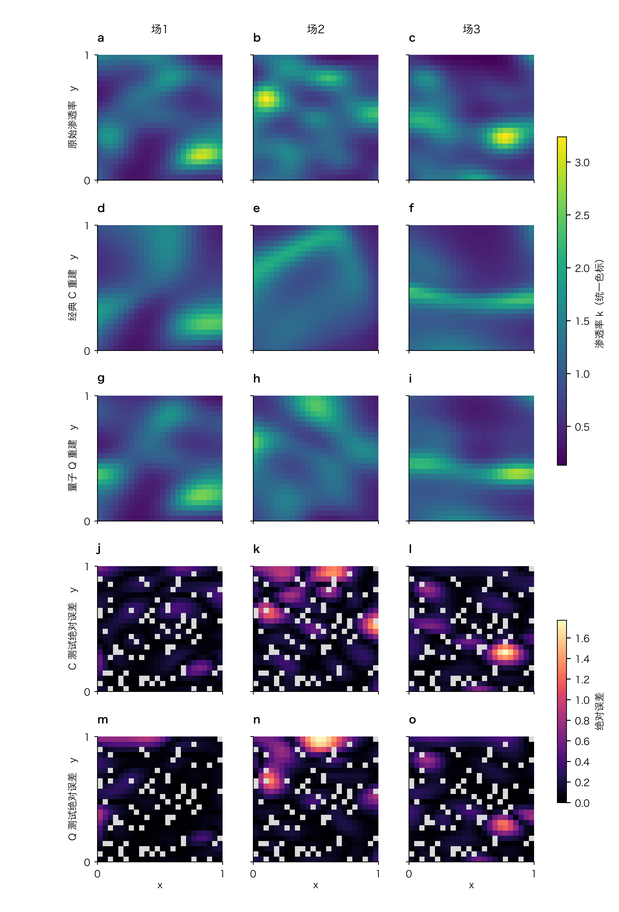

# V3 重建预算对比

这是同一数据上的探索性预算诊断，不是独立外部验证。
只改变预算300→5000轮；全部三个场、首次重复101、经典和量子基础组均保留。
每次训练仅按验证损失选择检查点，测试值不进入训练或选模。
参考场、全部观测及配置点逐数组一致，六次训练的前301条日志与旧归档逐记录一致。

| 场 | 方法 | 原测试相对L2 | 新测试相对L2 | 误差相对下降 | 新选中轮次 | 原PDE RMSE | 新PDE RMSE |
| --- | --- | ---: | ---: | ---: | ---: | ---: | ---: |
| 11 | classical_plain | 0.329851 | 0.159014 | 51.79% | 539 | 0.330352 | 0.234557 |
| 11 | quantum_plain | 0.263601 | 0.166381 | 36.88% | 4981 | 0.226701 | 0.146532 |
| 22 | classical_plain | 0.325392 | 0.315341 | 3.09% | 1120 | 0.196812 | 0.192403 |
| 22 | quantum_plain | 0.303891 | 0.311359 | -2.46% | 1769 | 0.204760 | 0.267884 |
| 33 | classical_plain | 0.427202 | 0.273007 | 36.09% | 1077 | 0.090921 | 0.404150 |
| 33 | quantum_plain | 0.328600 | 0.221030 | 32.74% | 1625 | 0.208876 | 0.179457 |

## 同次重复的跨场均值

- classical_plain：0.360815→0.249121，误差相对下降30.96%。
- quantum_plain：0.298697→0.232923，误差相对下降22.02%。

以上均值各含三个场的一次拟合，不是原论文每组九次拟合的均值。
不能把延长训练的收益全部归因于量子模块，也不能据此宣布收敛或量子优势。
本轮没有运行长预算RBA、MC或组合消融。

## 新预算原始预测图

每列为一个场；五行依次为原场、C、Q、C测试误差、Q测试误差。
前三行共用渗透率色标，后两行共用误差色标，灰色为训练或验证位置。
不裁剪、不插值、不独立归一化预测图、不混合参考场。

## 核验范围

图源共1728行，记录全部位置、划分和两个模型输出。独立指标复算及档案核验另由qpinn verify完成。
面板对齐、最终PDF文字和碰撞检查已执行，详见同目录JSON报告。
源代码预检中的未导出TIFF及正值断言识别警告沿用主绘图脚本的说明。
本图复用既有Python/Matplotlib空间图布局；PNG为600 dpi，另有PDF/SVG。
不能将自动检查视为期刊合规认证；最终语义和空间形态仍须目视检查。
