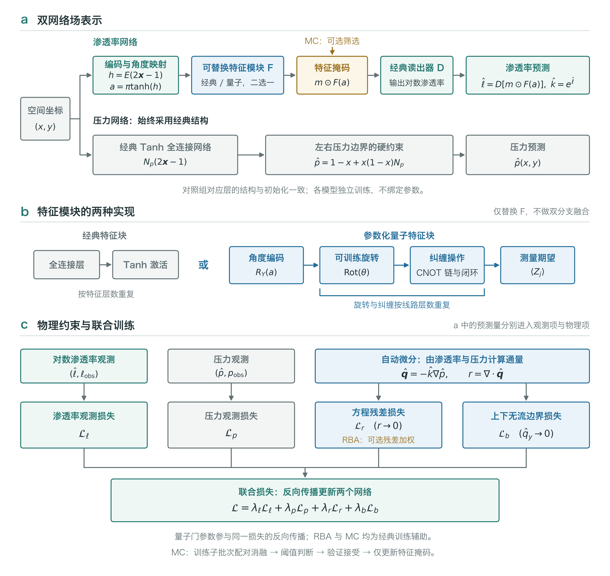
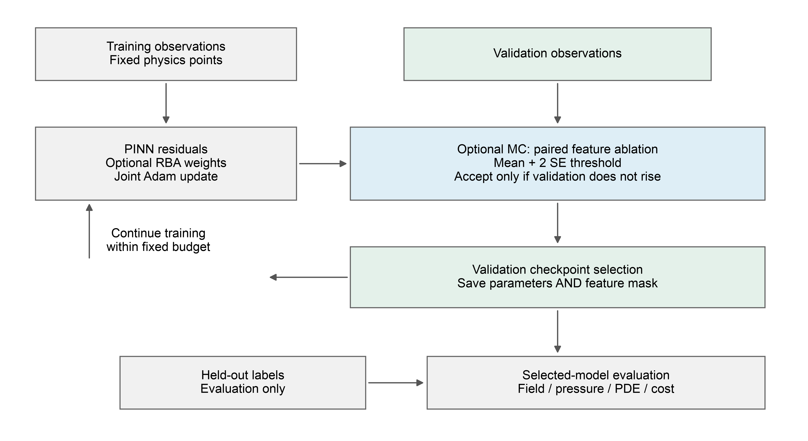
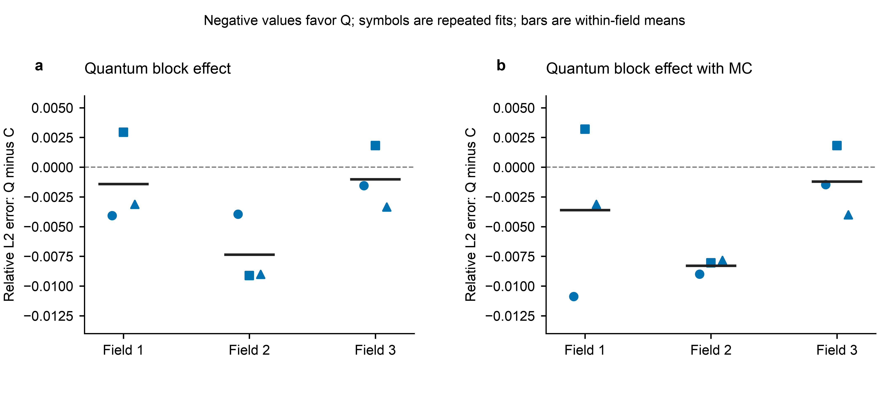
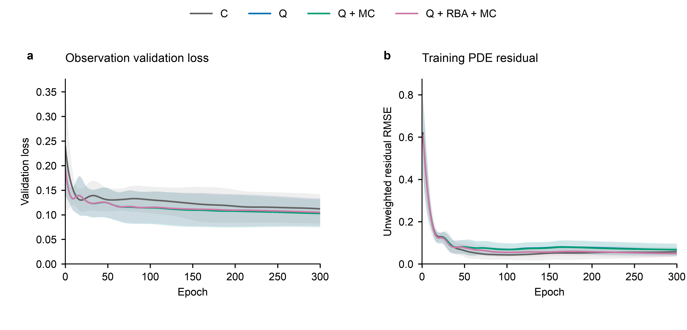
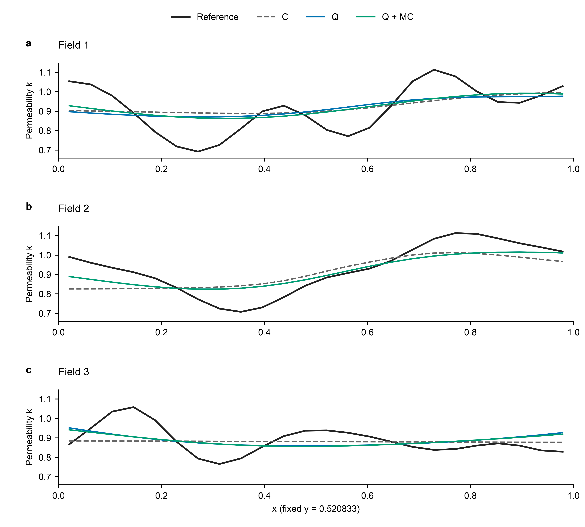

# 量子特征增强物理信息神经网络的渗透率场反演与自适应训练

> 版本边界：本稿及图表保留的是首轮“三角级数渗透率场＋压力观测监督”的历史实验。当前代码已改为默认“GSTools新生成场＋仅渗透率观测”，本稿的方法、图1及结果尚未按新协议整体重写，不能把下列数值解释为GSTools实验结论。当前协议见[研究说明](../../../docs/QUANTUM_PINN_V3.md)。

## 摘要

稀疏观测条件下的渗透率场反演需要同时利用局部测量与渗流方程约束，网络表示及物理残差的训练方式共同影响恢复精度。针对二维稳态单相 Darcy 流动，构建压力与对数渗透率双网络，将参数化量子线路作为渗透率网络中的可替换特征模块，并在相同观测、共同网络层初始化及训练轮数下，与全连接经典物理信息神经网络进行比较。采用具有单位权重下限的归一化残差注意力，以及基于随机子批次配对消融、保守阈值和验证接受的蒙特卡罗特征筛选，分别考察表示替换与训练增强的作用。在三个独立合成场、每场三次观测划分与初始化重复组成的数值实验中，基础量子模型的测试渗透率相对 \(L_2\) 误差为0.102443，较经典基线降低3.09%；量子模型结合蒙特卡罗筛选后为0.101942，较采用相同筛选的经典模型降低4.11%。残差注意力与筛选组合使量子模型的平均独立配置点方程残差降低6.65%，但未进一步降低渗透率误差。上述结果说明，小规模量子特征在当前逐场反演条件下提供了有限的场值精度增益，不同训练增强分别影响表示选择和物理一致性；压力误差及模拟耗时仍高于经典对照，因而该增益不等同于综合性能或量子计算加速优势。

**关键词：** 渗透率反演；物理信息神经网络；参数化量子线路；Darcy 方程；残差注意力；蒙特卡罗筛选

## 1 引言

渗透率描述多孔介质传导流体的能力，其空间分布同时影响压力传播与通量响应。在稀疏观测下，仅拟合已知位置的渗透率不足以约束未观测区域；引入压力信息和控制方程，可以把场值恢复与流动响应联系起来。物理信息神经网络（physics-informed neural network，PINN）通过自动微分计算网络输出的微分算子，将观测误差、方程残差和边界条件纳入共同优化目标，为正反问题提供了统一的函数表示框架[1]。深度 Galerkin 方法与 Deep Ritz 方法分别从微分残差和变分能量出发构造神经数值求解器[2-3]，相关综述及软件研究进一步总结了物理信息学习的主要组成和实现路径[4-5]。

PINN 的物理约束并不自动保证训练充分或反演准确。复合损失中的梯度失衡、不同目标的收敛速率差异，以及特定方程参数范围内的优化困难，均可能影响结果[6-8]。训练方案和基线的选择因此应与网络表示共同考察[9]。在表示层面，Fourier 特征、周期激活及多尺度特征映射能够改变坐标网络的频谱响应[10-12]，自适应激活及局部斜率学习则调整网络的优化行为[13-14]。这些方法本质上仍可完全由经典计算实现；是否属于 PINN，取决于训练目标中是否实际包含物理方程，而不是网络名称或激活函数形式。

在训练层面，自适应点权重可增加难拟合区域的影响[15]，残差注意力（residual-based attention，RBA）利用累计残差构造无需额外梯度优化的权重更新[16]。配置点重采样[17]、残差梯度增强[18]和边界条件的精确嵌入[19]分别从采样、目标与表示约束改善求解过程。不同机制改变的对象并不相同，不能将其合并后的收益全部归于某一个模块。对于需要检验量子模块是否有效的研究，尤其需要保留结构与训练策略的交叉对照。

量子线路学习通过输入编码、可训练酉变换和可观测量测量构造参数化函数[20]。可微量子线路已被用于微分方程求解[21]，连续变量量子 PINN 和量子—经典混合 PINN 也已有数值研究[22-23]。量子模型的表达受编码方式约束，其测量期望值与 Fourier 表示之间存在明确联系[24]；因此，引入量子线路不能直接推出表达优势。量子参数训练还可能受到梯度集中现象影响[25]。PennyLane 提供混合计算图及自动微分接口[26]，而硬件参数移位与高阶导数估计研究说明，模拟器中的导数计算成本不能直接替代硬件资源评价[27-28]。

本文关注的是给定场在获得稀疏观测后的逐场反演，与 DeepONet 和 Fourier 神经算子学习跨函数映射的任务不同[29-30]。此外，已有工作已将量子—经典 PINN 用于单相储层渗透率反演[31]，故本文不把“量子网络与渗透率反演的结合”作为首次提出的概念。本文的具体工作是：在共同压力网络、共同渗透率编码与读出结构下，以真实参数化量子线路替换经典特征块；仅引入 RBA 与蒙特卡罗阈值筛选两项训练增强，构成完整交叉比较；通过独立生成的压力参考、隔离的测试位置及配对结果，判断场值改善、物理一致性和计算成本之间的关系。研究目标是辨明当前设置中量子模块的实际作用，而非预设其在全部指标上优于经典方法。

## 2 渗透率反演问题

### 2.1 控制方程与边界条件

考虑单位正方形 \(\Omega=(0,1)^2\) 上无源、稳态、单相 Darcy 流动，黏度及参考尺度经无量纲化后取1：

$$
\boldsymbol q=-k\nabla p,\qquad
\nabla\cdot\boldsymbol q=0,\qquad k=\exp(\ell)>0,
\tag{1}
$$

其中 \(p\) 为压力，\(\boldsymbol q\) 为 Darcy 通量，\(\ell=\log k\) 为对数渗透率。左右边界施加固定压差，上下边界无流：

$$
p(0,y)=1,\quad p(1,y)=0,\quad
q_y(x,0)=q_y(x,1)=0.
\tag{2}
$$

在有限位置给定 \(\ell\) 与 \(p\) 的观测值，分别记为
\(\mathcal D_\ell=\{(\boldsymbol x_i,\ell_i)\}\) 与
\(\mathcal D_p=\{(\boldsymbol x_j,p_j)\}\)。两类观测位置不要求一致。目标是在保持渗透率正值及满足流动约束的同时，恢复未观测位置的渗透率。本文因此不是仅由压力反演任意渗透率场，也不是利用完整渗透率标签进行监督训练。

式(1)中，当渗透率整体乘以常数而压力边界保持不变时，压力解可以不变，通量尺度则相应变化。这表明，仅凭该单一工况的压力并不能消除全部尺度不确定性。渗透率点值观测在本任务中提供额外尺度信息；空间上的不可辨识性仍取决于观测分布和模型先验，不由量子模块自动解决。

### 2.2 场生成与独立压力参考

对数渗透率采用可追溯的有限三角级数：

$$
\ell(x,y)=b+\sum_{m=1}^{M}
c_m\sin(2\pi f_{m,x}x+\phi_{m,x})
\sin(2\pi f_{m,y}y+\phi_{m,y}).
\tag{3}
$$

系数绝对值之和由预先规定的幅度约束，频率、相位及均值参数随场独立生成并保存。该过程不利用测试场值的均值、方差或极值进行归一化。由 \(k=\exp(\ell)\) 得到正渗透率，再由独立有限体积方法计算压力参考。内部单元面采用调和平均传导率，压力边界按半单元距离处理；较细网格用于压力观测参考，粗网格用于同分辨率下的下游通量比较。

训练、验证和测试位置在每种变量内分别互斥。训练使用观测点、域内配置点和无流边界点；验证只使用留出的观测值，测试标签在模型选择完成后才进入评价。这样的信息分工既允许依靠验证结果接受筛选，也避免利用真实完整场挑选阈值或检查点。本文只考察平滑、无噪声的合成场，未将其等同于现场储层数据。

## 3 量子特征增强 PINN

### 3.1 经典基线与模块替换

采用两个坐标网络分别表示压力和对数渗透率。压力网络保持为经典 Tanh 多层感知机，并写成

$$
\widehat p(\boldsymbol x)=1-x+x(1-x)N_p(2\boldsymbol x-\boldsymbol 1).
\tag{4}
$$

该结构对任意网络参数均精确满足左右压力边界，是在简单矩形几何上嵌入 Dirichlet 条件的具体形式[19]。上下无流条件通过损失约束，不宣称同时获得精确 Neumann 边界。

渗透率网络依次包含共同编码器 \(E\)、角度映射、可替换特征块 \(F\)、二值特征掩码 \(\boldsymbol m\) 与共同读出器 \(D\)：

$$
\boldsymbol a=\pi\tanh[E(2\boldsymbol x-\boldsymbol 1)],\qquad
\widehat\ell(\boldsymbol x)=D[\boldsymbol m\odot F(\boldsymbol a)],
\quad \widehat k=\exp(\widehat\ell).
\tag{5}
$$

经典基线中，\(F\) 由连续的全连接 Tanh 层构成。其训练直接最小化观测、Darcy 方程及边界残差，属于经典 PINN。量子模型只将 \(F\) 替换为参数化量子线路，其余路径保持相同。这里的“共同”表示结构及对应初始化一致，不表示两组模型在训练过程中绑定参数。每组模型独立拟合，但共同层的随机初始化不受特征块参数数量影响。

**图1 量子特征增强 Darcy PINN 的结构与训练约束。** a：空间坐标分别进入渗透率网络和经典压力网络；渗透率经对数输出的指数变换保持正值，压力通过输出变换精确满足左右边界。b：特征模块 F 选择经典全连接 Tanh 块或参数化量子线路，不进行双分支融合；量子线路仅初始编码一次，逐层重复旋转与纠缠后测量 Pauli-Z 期望值。c：对数渗透率与压力分别形成观测损失，渗透率和压力共同参与自动微分，形成方程残差与上下无流边界损失，四项加权组成联合训练目标。RBA 仅调整方程残差权重；MC 经训练消融、阈值判断及验证接受后更新特征掩码，不裁剪量子门。对照组对应经典层的结构与初始化一致，但各模型独立训练，不绑定参数。

### 3.2 参数化量子线路及物理导数

量子特征首先将编码器输出作为 \(R_Y\) 门角度输入初始态，再施加可训练旋转和固定纠缠操作：

$$
|\psi(\boldsymbol a,\boldsymbol\theta)\rangle
=V_L(\boldsymbol\theta_L)\cdots V_1(\boldsymbol\theta_1)
\left[\bigotimes_{j=1}^{n_q}R_Y(a_j)\right]|0\rangle^{\otimes n_q},
\tag{6}
$$

$$
z_j=\langle\psi|Z_j|\psi\rangle,\qquad
F_Q(\boldsymbol a)=
[z_1,\ldots,z_{n_q}]^\mathsf T.
\tag{7}
$$

每层 \(V_l\) 先对各量子比特应用可训练 Rot 门，再按固定顺序施加 CNOT 链，并连接末端与首端比特。数据只在初始编码阶段输入，本文未采用逐层重复编码。Pauli-\(Z\) 测量期望值经过经典读出器得到 \(\widehat\ell\)，并不直接等于渗透率。

该模块是量子线路函数的经典模拟，不是将普通正弦激活重新命名为量子算法。另一方面，编码后的量子函数与经典周期表示存在联系[24]，因此两者不是毫无关联的函数类别。本文的实验检验特定量子参数化相对于所设 Tanh 模块的效果，未据此声称量子函数不能被经典网络模拟。

根据式(1)，网络方程残差为

$$
r(\boldsymbol x)
=-\nabla\cdot[\exp(\widehat\ell)\nabla\widehat p]
=-\exp(\widehat\ell)
\left(\nabla\widehat\ell\cdot\nabla\widehat p+
\Delta\widehat p\right).
\tag{8}
$$

其求值需要渗透率网络的一阶坐标导数和压力网络的二阶坐标导数；优化量子门参数时，还需沿这些坐标导数继续反向传播。可微量子线路为这一组合提供函数及导数表示基础[21]。本文使用 PennyLane 状态向量模拟器、精确期望值和 Torch 反向传播[26]，不采用有限测量次数，也未运行真实量子硬件。参数移位和硬件高阶导数估计是相关但不同的计算路线[27-28]。

### 3.3 共同损失与残差注意力

定义观测与边界损失

$$
\mathcal L_\ell=\frac1{N_\ell}\sum_i
(\widehat\ell_i-\ell_i)^2,\quad
\mathcal L_p=\frac1{N_p}\sum_j
(\widehat p_j-p_j)^2,\quad
\mathcal L_b=\frac1{N_b}\sum_h\widehat q_y(\boldsymbol x_h)^2,
\tag{9}
$$

并以域内配置点残差构造方程损失：

$$
\mathcal L_r=\frac{\sum_i w_i r_i^2}{\sum_iw_i},\qquad
\mathcal L=
\lambda_\ell\mathcal L_\ell+\lambda_p\mathcal L_p+
\lambda_r\mathcal L_r+\lambda_b\mathcal L_b.
\tag{10}
$$

所有方法采用相同的固定全局权重。基础模型中 \(w_i=1\)；RBA 组根据训练配置点的残差更新局部注意力：

$$
a_i^{(t)}=\gamma a_i^{(t-1)}
+(1-\gamma)\frac{|r_i^{(t)}|}
{\max(\max_j|r_j^{(t)}|,\varepsilon)},
\qquad
w_i^{(t)}=1+\alpha a_i^{(t)}.
\tag{11}
$$

式(11)中的 \(\varepsilon\) 为分母数值下限。初始注意力为零，更新时分离残差计算图，使权重本身不成为待学习参数。在 \(0\leq\gamma<1\) 且 \(\alpha\geq0\) 时，注意力受限于 \([0,1]\)，权重受限于 \([1,1+\alpha]\)。单位下限保留低残差位置的约束，式(10)中的归一化避免权重整体增大直接放大方程项尺度。

这一设计借鉴残差累计注意力[16]，但增加单位下限并采用归一化加权均方，因此称为 RBA 启发变体，而非原论文算法的逐式复现。它也不同于通过最大化点权重进行对抗式训练的自适应方法[15]。本文固定配置点，不引入残差重采样[17]或额外的残差梯度损失[18]，以减少量子模块比较中的干预因素。

### 3.4 蒙特卡罗配对消融与阈值筛选

为判断哪些测量特征对当前任务贡献较小，在训练中对现存特征实施随机子批次消融。对于第 \(b\) 个训练子批次，先在当前掩码下计算共同损失 \(\mathcal L^{(b)}\)，再仅屏蔽第 \(j\) 个特征，得到 \(\mathcal L_{-j}^{(b)}\)，定义相对损失增量

$$
u_j^{(b)}
=\frac{\mathcal L_{-j}^{(b)}-\mathcal L^{(b)}}
{\max(|\mathcal L^{(b)}|,\varepsilon)}.
\tag{12}
$$

同一次试验内，全部候选特征使用相同观测、配置点及边界子批次，RBA 权重保持冻结，使损失差反映屏蔽特征这一项变化。跨子批次计算 \(\overline u_j\) 与样本标准差 \(s_j\)，并构造

$$
U_j=\overline u_j+2s_j/\sqrt B.
\tag{13}
$$

优先从平均增量较小的特征中选取候选，仅当 \(U_j\leq\tau\)、保留特征数不低于预设下限，且候选掩码不增加完整验证观测损失时，才接受屏蔽。式(13)是控制筛选风险的工程启发评分，子批次可能重叠且试验次数有限，不能解释成严格置信上界。阈值固定于实验配置，不由测试误差调节。

筛选改变的是送入读出器的测量特征，而不是线路中的量子比特数或门拓扑。量子线路仍完整执行，故特征减少不等于量子计算量下降。接受筛选后继续优化既有参数，不重置旋转门、经典神经元或优化器状态。经典模型采用相同筛选程序，RBA 和蒙特卡罗筛选均属于经典训练辅助，而量子成分仅位于式(6)-(7)的特征计算中。

### 3.5 训练与模型选择

训练使用共同的 Adam 设置、梯度裁剪与轮数预算。验证评分由对数渗透率和压力观测损失的加权和组成，选取包括初始状态在内的最小评分检查点，同时恢复该检查点的网络参数和特征掩码。最终训练轮次发生过筛选，不意味着选中的较早检查点也使用了筛选后的掩码。

**图2 信息隔离的训练与评价流程。** 训练观测和物理配置点用于参数优化及蒙特卡罗消融，验证观测用于筛选接受与检查点选择，测试标签仅在选模完成后参与评价。无增强组绕过两项可选步骤；启用相应增强时，经典和量子组遵循同一规则。示意图不表示测试数据对训练存在反馈。

## 4 数值实验与结果

### 4.1 比较协议和评价指标

实验采用三个独立生成场，每场进行三次观测划分与初始化重复。每种方法共有九次拟合，但独立场仅有三个；同一场的重复用于观察拟合变化，不作为新的独立数据集。经典特征与量子特征分别搭配无增强、RBA、蒙特卡罗筛选（MC）及二者组合，形成八组实验，全部纳入汇总。

各组共享观测划分、压力参考、训练配置点、边界点、损失权重、共同层初始化及训练轮数。经典与量子特征块输入输出尺寸相同，但参数量并非严格相等；预算控制的是迭代轮数，而非墙钟时间。网络尺寸、参数量、观测数量、全部种子与软件版本见补充材料S1-S2。本文不将该比较解释为等参数、等时间条件下的最优模型竞争。

在留出的渗透率位置 \(\mathcal T_\ell\) 上计算

$$
E_k=
\frac{\left[\sum_{i\in\mathcal T_\ell}
(\widehat k_i-k_i)^2\right]^{1/2}}
{\left[\sum_{i\in\mathcal T_\ell}k_i^2\right]^{1/2}}.
\tag{14}
$$

压力误差 \(E_p\) 为压力测试位置的 RMSE；方程误差 \(E_r\) 为独立域内评价配置点上的未加权残差 RMSE。另将预测渗透率交给独立有限体积求解器，以入口总通量相对误差 \(E_Q\) 评价下游响应。网络压力误差与有限体积重求解误差属于不同指标，不相互替代。主表给出九次运行均值和样本标准差，标准差仅描述这组运行的离散程度，不是跨场总体的置信区间。

### 4.2 量子特征的渗透率恢复效果

量子特征在四种训练配置下均获得了较低的平均渗透率误差。表1中，基础量子模型 Q 的 \(E_k\) 为0.102443，经典基线 C 为0.105710，平均误差相对降低3.09%。MC 条件下，Q+MC 为0.101942，较 C+MC 降低4.11%。RBA 与组合条件下的对应降低幅度分别为2.78%和2.92%。这种跨配置的一致平均趋势，支持量子特征在当前网络接口和训练预算下具有一定的场值表示收益。

**表1 八组模型的独立测试结果，均值±样本标准差**

| 方法 | 渗透率相对 \(L_2\) 误差 \(E_k\) | 压力 RMSE \(E_p\) | 方程残差 RMSE \(E_r\) | 训练时间/s |
| --- | ---: | ---: | ---: | ---: |
| C | 0.105710±0.010794 | 0.008259±0.001458 | 0.093851±0.031759 | 0.833±0.029 |
| C+RBA | 0.106315±0.009951 | 0.008584±0.001475 | 0.085065±0.034361 | 0.876±0.069 |
| C+MC | 0.106312±0.009891 | 0.007888±0.001603 | 0.095809±0.031118 | 1.045±0.114 |
| C+RBA+MC | 0.106469±0.009595 | 0.008500±0.001433 | 0.084851±0.034945 | 1.043±0.122 |
| Q | 0.102443±0.013657 | 0.010563±0.009552 | 0.123228±0.089309 | 6.649±0.240 |
| Q+RBA | 0.103364±0.013183 | 0.010944±0.009405 | 0.115810±0.093177 | 6.630±0.278 |
| Q+MC | **0.101942±0.012996** | 0.010410±0.009619 | 0.124264±0.090595 | 9.021±0.595 |
| Q+RBA+MC | 0.103363±0.013097 | 0.010900±0.009432 | 0.115033±0.093787 | 8.934±0.500 |

注：C、Q 分别为经典与量子特征 PINN；粗体只标出最低平均场值误差，不表示统计显著。训练时间包括循环内筛选和验证，不包括模型创建、初始验证及最终测试。全部量子结果来自精确状态向量模拟。

场级结果进一步显示，上述平均改善并非完全来自不同场的混合权重。先在每个场内平均三次拟合，Q 相对于 C 在三个场上均具有较低的 \(E_k\)，其中第二个场的改善更明显；Q+MC 相对于 C+MC 也保持同方向，见表2。但在逐次配对中，Q 与 Q+MC 各有七次优于其相同策略经典对照、两次较差。因而，更准确的结论是当前少量场上的平均改善，而不是逐次训练均获得优势。

**表2 场内三次拟合平均的渗透率相对误差**

| 场 | C | Q | C+MC | Q+MC |
| --- | ---: | ---: | ---: | ---: |
| 场1 | 0.113983 | 0.112564 | 0.113859 | 0.110255 |
| 场2 | 0.092520 | 0.085163 | 0.094233 | 0.085943 |
| 场3 | 0.110627 | 0.109602 | 0.110843 | 0.109630 |

**图3 量子特征替换的配对效果。** a比较 Q 与 C，b比较 Q+MC 与 C+MC。纵轴为量子组减经典组的 \(E_k\)，负值表示量子组误差较小。圆、方、三角表示三次对应重复，黑色短线为场内平均差值；显示全部三个场和九次配对，不做显著性标注。不同场为离散实例，点之间不连线。

### 4.3 训练增强的作用分工

Q+MC 在本轮矩阵中取得最低平均场值误差，相对于 Q 降低0.49%，相对于 C 降低3.56%。筛选由训练子批次的相对损失变化产生候选，并经完整验证观测接受，可以在不访问测试标签的情况下调整读出特征。不过，九次量子拟合中，Q+MC 相对于 Q 有一次改善、五次保持相同、三次小幅变差；均值下降主要来自其中一次较大的改善。这个结果支持其作为任务相关筛选机制的可行性，尚不足以支持稳定的普遍增益。

筛选日志也说明“发生筛选”和“最终模型使用筛选”需要区分。Q+MC 在完整训练过程中共接受七次筛选，但选中的九个检查点中只有四个使用了减少后的特征掩码；Q+RBA+MC 的对应数量为五次接受、两个检查点使用。没有通过阈值与验证条件时，算法保留原结构；若最佳验证评分出现在筛选前，最终模型仍恢复较早的掩码。表3报告全部筛选组，而不只展示接受案例。

**表3 筛选过程与最终检查点**

| 方法 | 接受筛选事件数 | 最终采用减少特征的拟合数/9 | 平均筛选耗时/s |
| --- | ---: | ---: | ---: |
| C+MC | 11 | 5 | 0.179 |
| C+RBA+MC | 11 | 5 | 0.181 |
| Q+MC | 7 | 4 | 2.349 |
| Q+RBA+MC | 5 | 2 | 2.407 |

注：各组有126条筛选时点记录，其中包含达到最低特征数后跳过消融的记录，因此不将126解释为全部完成的独立筛选试验。

RBA 的主要收益出现在方程残差上。相对于 Q，Q+RBA 的独立配置点 \(E_r\) 从0.123228降至0.115810，降低6.02%；Q+RBA+MC 进一步为0.115033，较 Q 降低6.65%。其场值误差则约为0.103363，略高于 Q。这表明，在目前的损失权重及验证选模规则下，局部残差加权增加了对物理约束的关注，但这一改变没有同步转化为更小的渗透率误差。RBA 通过共同损失影响压力与渗透率网络，不能将该变化解释为只修正量子特征的独立效应。

**图4 共同预算内的训练轨迹。** a为完整验证观测损失；b为每次参数更新前固定训练配置点的未加权残差 RMSE，而不是 RBA 加权损失，也不是独立测试残差。曲线与阴影分别为全部九次运行的均值与一个样本标准差，连接全部记录且不平滑。C、Q、Q+MC 和 Q+RBA+MC 用于展示基础替换、筛选及组合路径；完整八组数值见表1，全部历史见随稿源数据。

图4保留了训练过程的波动和运行间离散性，不能仅凭均值曲线判断全部模型充分收敛。部分检查点位于训练预算末端，另一些较早获得最佳验证评分。表1比较的是同预算和同选模规则下的结果，而非各方法达到充分收敛后的极限误差。

### 4.4 空间恢复的连续表示

图5在全部三个合成场上展示同一横向剖面，使用固定的首次重复，不按改善幅度选取案例。两类 PINN 均能输出连续坐标函数，量子模型保持了这一性质；MC 屏蔽作用于全域读出特征，不是对个别测试位置进行局部回填。剖面同时显示参考场的起伏和预测幅值偏差，使平均相对误差对应的空间表现可直接检查。

连续输出并不意味着所有局部转折均准确恢复。图中曲线在部分区段相近、在另一些区段分离，说明特征替换对空间位置的作用并不均匀。该图展示完整固定剖面，包含训练、验证和测试位置，仅用于描述空间形态；独立预测能力仍以表1的留出位置指标为依据。不将训练位置的拟合表现当作测试结果，也不依据单条剖面推断通道、裂缝等未包含于数据生成机制的地质结构恢复能力。

**图5 固定剖面的渗透率恢复。** a-c分别对应场1-3，均采用首次重复及 \(y=0.520833\) 处的完整横向网格行。黑线为参考，灰虚线、蓝线、绿线分别为 C、Q、Q+MC；坐标范围与纵轴尺度一致。曲线连接原始网格值，不插值平滑，不回填观测值。单次实例不绘制重复误差带，各显示点所属划分记录在图表源数据中。

### 4.5 下游响应与计算成本

将预测渗透率代入独立有限体积求解器，可进一步观察场值误差是否影响整体传导响应。Q 的平均入口总通量相对误差为0.014668，Q+RBA+MC 为0.011090，降低24.39%；Q+RBA 为0.011220，表现接近。这一结果与 RBA 降低方程残差的方向相符，但下游通量来自重新求解的压力，不能据此宣称网络自身已严格守恒。完整下游结果见补充材料S3。

场值、压力与方程指标并不具有相同排序。表1中，Q 的压力 RMSE 和独立配置点残差均高于 C；Q+MC 也没有在这两项指标上超过相同策略的经典对照。另一方面，量子基础模型平均训练约6.65 s，为经典基线的7.98倍，筛选进一步增加了模拟开销。因此，本研究观察到的是有限的场值恢复收益及部分物理响应改善，而不是量子模型在精度、守恒与耗时上的整体占优。较少的特征块参数也不意味着模拟计算更便宜。

## 5 讨论

### 5.1 量子模块的可归因范围

本文将结构替换限定在渗透率特征块，保持压力网络、前后处理、观测信息和训练程序可比。由此，Q 与 C 的差异能够归于这一特定模块替换及其引起的联合优化变化，而不包含额外观测或后处理插值的贡献。相较于整体更换网络，此设计更适合检验量子特征是否值得继续研究。

现有证据尚不能进一步区分角度编码后的周期函数性质、纠缠结构和具体参数化各自的作用，也未排除更合适经典表示取得相同或更好结果的可能。相关文献已经指出经典 Fourier 表示、周期激活及量子编码均会改变可表示函数与优化行为[10-12,24]。因此，本文以“小规模受控数值比较”定位其贡献，不将有限误差降低表述为不可经典模拟的优势，也不与不同观测条件的既有渗透率反演结果直接比较数值大小[31]。

### 5.2 两类增强不应被视为同一目标

MC 以当前任务的损失响应筛选特征，其验证接受条件只保证接受当时的验证评分不增加，并不保证后续优化或测试误差单调改善。RBA 则重新分配方程约束内部的关注程度，不能替代观测信息，也不直接最小化渗透率测试误差。二者分别改变表示选择和残差权重，因此组合不必优于各自单用。实验中最低场值误差来自 Q+MC，较低量子方程残差来自含 RBA 的配置，正体现了这种作用分工。

对渗透率反演而言，应先明确所需输出是场值、网络压力，还是由预测场导出的流动响应，再依据相应验证原则选择模型。本实验固定以观测损失选模，保留物理指标作为独立评价，未在看到测试结果后改换目标。这样的区分使局部改善具有可解释范围，也避免将残差更小直接等同于参数反演更准确。

### 5.3 适用条件

本研究限于少量平滑无噪声合成场、单一边界工况及固定短预算。重复划分与初始化同时变化，尚未分离各自不确定性；独立场数量不足以支持广泛统计推广。有限体积实现已通过解析解检查，但当前三个随机场的参考采用固定细化级别，未完成全面网格敏感性分析。量子线路采用精确模拟，有限测量次数、噪声设备及更大线路的可训练性不在本次验证范围内[25,27-28]。因此，本文结果用于判断当前方法的可行性与增益来源，不作为现场应用、未知场零样本泛化或硬件效率的证明。

## 6 结论

本文建立了以经典双网络 PINN 为基线、在渗透率表示的固定位置嵌入参数化量子线路的 Darcy 反演方法，形成了观测、物理方程及边界条件共同参与的可微训练过程。量子成分具有明确的门操作与测量定义，RBA 和蒙特卡罗筛选作为可分离的经典辅助机制参与训练。

在当前三个合成场及其重复拟合中，基础量子模型的平均渗透率相对误差较经典基线降低3.09%；量子模型结合 MC 取得最低平均误差0.101942，较同策略经典模型降低4.11%。MC 对量子基础模型的额外平均改善较小且不均匀，RBA 与 MC 组合主要改善方程残差和部分下游响应，未继续降低场值误差。

量子特征在本设置中体现了有限但可测量的反演精度增益。该增益伴随更高的压力误差和模拟成本，不能扩展为全面性能优势。区分表示收益、物理约束收益和计算成本，是评价量子模块用于经典 PINN 渗透率反演时应保留的比较原则。

## 数据与代码说明

本文全部结果来自项目 V3 独立实验档案，不使用旧版本的周期网络插值结果。复现配置、数据划分、参数数量、完整辅助指标及核验方法见[补充材料](SUPPLEMENTARY_MATERIAL_V3.md)；图表均由已保存实验输出生成，没有为本文追加训练或根据测试结果重新选择场。逐篇文献阅读范围见[文献记录](LITERATURE_READING_V3.md)，文稿检查范围见[核验记录](MANUSCRIPT_V3_QA.md)。

## 参考文献

[1] RAISSI M, PERDIKARIS P, KARNIADAKIS G E. Physics-informed neural networks: A deep learning framework for solving forward and inverse problems involving nonlinear partial differential equations[J]. Journal of Computational Physics, 2019, 378: 686-707. DOI: 10.1016/j.jcp.2018.10.045.

[2] SIRIGNANO J, SPILIOPOULOS K. DGM: A deep learning algorithm for solving partial differential equations[J]. Journal of Computational Physics, 2018, 375: 1339-1364. DOI: 10.1016/j.jcp.2018.08.029.

[3] E W, YU B. The Deep Ritz method: A deep learning-based numerical algorithm for solving variational problems[J]. Communications in Mathematics and Statistics, 2018, 6(1): 1-12. DOI: 10.1007/s40304-018-0127-z.

[4] CUOMO S, DI COLA V S, GIAMPAOLO F, et al. Scientific machine learning through physics-informed neural networks: Where we are and what's next[J]. Journal of Scientific Computing, 2022, 92: 88. DOI: 10.1007/s10915-022-01939-z.

[5] LU L, MENG X, MAO Z, et al. DeepXDE: A deep learning library for solving differential equations[J]. SIAM Review, 2021, 63(1): 208-228. DOI: 10.1137/19M1274067.

[6] WANG S, TENG Y, PERDIKARIS P. Understanding and mitigating gradient flow pathologies in physics-informed neural networks[J]. SIAM Journal on Scientific Computing, 2021, 43(5): A3055-A3081. DOI: 10.1137/20M1318043.

[7] WANG S, YU X, PERDIKARIS P. When and why PINNs fail to train: A neural tangent kernel perspective[J]. Journal of Computational Physics, 2022, 449: 110768. DOI: 10.1016/j.jcp.2021.110768.

[8] KRISHNAPRIYAN A S, GHOLAMI A, ZHE S, et al. Characterizing possible failure modes in physics-informed neural networks[C]//Advances in Neural Information Processing Systems. 2021, 34: 26548-26560.

[9] WANG S, SANKARAN S, WANG H, et al. An expert's guide to training physics-informed neural networks[EB/OL]. arXiv:2308.08468, 2023. DOI: 10.48550/arXiv.2308.08468.

[10] TANCIK M, SRINIVASAN P P, MILDENHALL B, et al. Fourier features let networks learn high frequency functions in low dimensional domains[C]//Advances in Neural Information Processing Systems. 2020, 33: 7537-7547.

[11] SITZMANN V, MARTEL J N P, BERGMAN A W, et al. Implicit neural representations with periodic activation functions[C]//Advances in Neural Information Processing Systems. 2020, 33: 7462-7473.

[12] WANG S, WANG H, PERDIKARIS P. On the eigenvector bias of Fourier feature networks: From regression to solving multi-scale PDEs with physics-informed neural networks[J]. Computer Methods in Applied Mechanics and Engineering, 2021, 384: 113938. DOI: 10.1016/j.cma.2021.113938.

[13] JAGTAP A D, KAWAGUCHI K, KARNIADAKIS G E. Adaptive activation functions accelerate convergence in deep and physics-informed neural networks[J]. Journal of Computational Physics, 2020, 404: 109136. DOI: 10.1016/j.jcp.2019.109136.

[14] JAGTAP A D, KAWAGUCHI K, KARNIADAKIS G E. Locally adaptive activation functions with slope recovery for deep and physics-informed neural networks[J]. Proceedings of the Royal Society A, 2020, 476(2239): 20200334. DOI: 10.1098/rspa.2020.0334.

[15] MCCLENNY L D, BRAGA-NETO U M. Self-adaptive physics-informed neural networks[J]. Journal of Computational Physics, 2023, 474: 111722. DOI: 10.1016/j.jcp.2022.111722.

[16] ANAGNOSTOPOULOS S J, TOSCANO J D, STERGIOPULOS N, et al. Residual-based attention in physics-informed neural networks[J]. Computer Methods in Applied Mechanics and Engineering, 2024, 421: 116805. DOI: 10.1016/j.cma.2024.116805.

[17] WU C, ZHU M, TAN Q, et al. A comprehensive study of non-adaptive and residual-based adaptive sampling for physics-informed neural networks[J]. Computer Methods in Applied Mechanics and Engineering, 2023, 403: 115671. DOI: 10.1016/j.cma.2022.115671.

[18] YU J, LU L, MENG X, et al. Gradient-enhanced physics-informed neural networks for forward and inverse PDE problems[J]. Computer Methods in Applied Mechanics and Engineering, 2022, 393: 114823. DOI: 10.1016/j.cma.2022.114823.

[19] SUKUMAR N, SRIVASTAVA A. Exact imposition of boundary conditions with distance functions in physics-informed deep neural networks[J]. Computer Methods in Applied Mechanics and Engineering, 2022, 389: 114333. DOI: 10.1016/j.cma.2021.114333.

[20] MITARAI K, NEGORO M, KITAGAWA M, et al. Quantum circuit learning[J]. Physical Review A, 2018, 98: 032309. DOI: 10.1103/PhysRevA.98.032309.

[21] KYRIIENKO O, PAINE A E, ELFVING V E. Solving nonlinear differential equations with differentiable quantum circuits[J]. Physical Review A, 2021, 103: 052416. DOI: 10.1103/PhysRevA.103.052416.

[22] MARKIDIS S. On physics-informed neural networks for quantum computers[J]. Frontiers in Applied Mathematics and Statistics, 2022, 8: 1036711. DOI: 10.3389/fams.2022.1036711.

[23] TRAHAN C, LOVELAND M, DENT S. Quantum physics-informed neural networks[J]. Entropy, 2024, 26(8): 649. DOI: 10.3390/e26080649.

[24] SCHULD M, SWEKE R, MEYER J J. Effect of data encoding on the expressive power of variational quantum-machine-learning models[J]. Physical Review A, 2021, 103: 032430. DOI: 10.1103/PhysRevA.103.032430.

[25] MCCLEAN J R, BOIXO S, SMELYANSKIY V N, et al. Barren plateaus in quantum neural network training landscapes[J]. Nature Communications, 2018, 9: 4812. DOI: 10.1038/s41467-018-07090-4.

[26] BERGHOLM V, IZAAC J, SCHULD M, et al. PennyLane: Automatic differentiation of hybrid quantum-classical computations[EB/OL]. arXiv:1811.04968, 2018. DOI: 10.48550/arXiv.1811.04968.

[27] SCHULD M, BERGHOLM V, GOGOLIN C, et al. Evaluating analytic gradients on quantum hardware[J]. Physical Review A, 2019, 99: 032331. DOI: 10.1103/PhysRevA.99.032331.

[28] MARI A, BROMLEY T R, KILLORAN N. Estimating the gradient and higher-order derivatives on quantum hardware[J]. Physical Review A, 2021, 103: 012405. DOI: 10.1103/PhysRevA.103.012405.

[29] LU L, JIN P, PANG G, et al. Learning nonlinear operators via DeepONet based on the universal approximation theorem of operators[J]. Nature Machine Intelligence, 2021, 3: 218-229. DOI: 10.1038/s42256-021-00302-5.

[30] LI Z, KOVACHKI N, AZIZZADENESHELI K, et al. Fourier neural operator for parametric partial differential equations[C]//International Conference on Learning Representations. 2021. arXiv:2010.08895.

[31] RAO X, OUYANG X, LIU Y. Quantum-classical physics-informed neural networks for permeability inversion in single-phase reservoir flow[J]. Advanced Quantum Technologies, 2026, 9(8): e70409. DOI: 10.1002/qute.70409.
